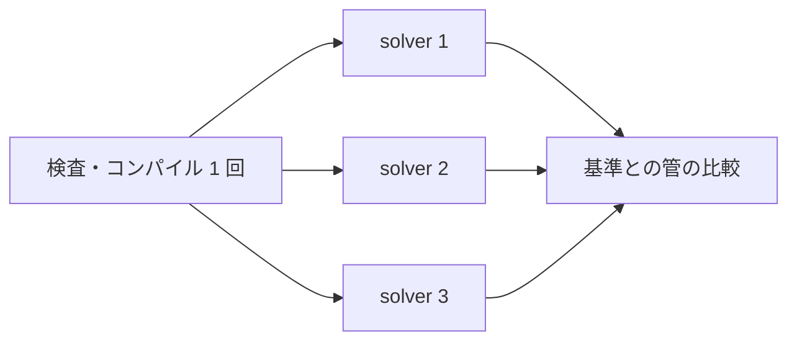

# S322 複数のソルバで回して結果を比べる

| | |
| --- | --- |
| セッション | S322 |
| 日付 | 2026-11-15 |
| ブランチ | `feature/s322-multi-solver-compare` |
| Phase | P4 / P8 |
| スライド | [slides.html](slides.html) |
| 作業記録 | `log/work/2026-11-15-s322-multi-solver-compare.md` |

## 1. 目的

ユーザーの要望（2026-11-15）は、シミュレーションを複数のソルバで回して結果を比べる手段である。3 つ以上を選べる（既定は 1 つ）、1 つずつ回すか並列か選べる（既定は 1 つずつ）、全部が終わったあとに自動で比べる（既定は比べない。最大積分次数・許容値・比較の閾値 10^-n を指定）。この WP は計算の側（facade・CLI・LSP・wasm・Python・`Backend`）で、UI は次の S323 が作る。判断は [ADR-0040](../../adr/0040-multi-solver-compare.md)、機能表は [features.md](../../features.md)、順序は [roadmap.md](../../roadmap.md)。

## 2. 決定と理由

| 項目 | 決定 | 理由 |
| --- | --- | --- |
| 最大の積分次数 | `SimSettings.max_order`。cvode・ida だけが使い（1〜5）、持たないソルバでは無視して情報 `GM-I10005` | diffsol の BDF は上限が定数 5 で口が無い。そのほかは次数が手法で固定。黙って無視しない |
| 許容値 | 既存の `tolerance`（相対と絶対に同じ値）をそのまま全部の実行に渡す | 新しい設定は要らない。固定刻みは使わず GM-I10004 の注記 |
| 並列 | 同じコンパイル結果を共有するスレッドで最大 `min(CPU, 4, ソルバ数)`。wasm は逐次 | RSS が GiB の単位（ADR-0023）、facade は wasm・Python からも呼ばれる。**要望の「別プロセス」とは違う**。硬い実行を kill できないのが欠点 |
| 比較 | MSL の参照結果と同じ矩形の管（`globe-mode-sim::compare`）。幅は 10^-n × 範囲 | 同じ数え方を 2 か所に書かない。格子とイベントに強い。**要望の「補間して相対差」とは違う**。最大の相対差は出さない |
| 数の上限 | 1〜16 個、重複は誤り | 列を全部返すので JSON が大きくなる |

## 3. 図



## 4. 再現手順

```bash
globe simulate src/Modelica/GlobeModeValidation -m GlobeModeValidation.Simulation.Decay \
  --solvers bdf,euler,rk4 --parallel --compare 6 --tolerance 1e-9 --max-order 3
cargo test -p globe-mode --test simulate_many
cargo test -p globe-mode-cli --test simulate solvers_run
cargo test -p globe-mode-lsp --lib custom_requests
uv run pytest src/Python/tests/test_columns.py
node src/Svelte/tests/test_tauri.mjs
```

検証の結果は [作業記録](../../../log/work/2026-11-15-s322-multi-solver-compare.md) に書いた。

## 5. 次回（S323 の UI が使う口の形）

呼ぶのは `Backend.simulateMany(req, onProgress)`（`src/Svelte/src/lib/backend.ts`。`TauriBackend` は sidecar の LSP `globe/simulateMany`、`WorkerBackend` は wasm の `simulate_many_columns`）。型は `src/Svelte/src/lib/protocol.ts` の `SimulateManyRequest`・`SimulateManyResponse`。

### 要求（`req`）

```json
{
  "model": "GlobeModeValidation.Simulation.Decay",
  "settings": { "stop_time": 1, "tolerance": 1e-9, "max_order": 5 },
  "solvers": ["bdf", "esdirk34", "radau5"],
  "parallel": false,
  "compare": { "threshold_exp": 6, "reference": "bdf" }
}
```

- `solvers`: 1〜16 個、重複なし。UI のチェックボックスの順がそのまま `runs` の順になる。`settings.solver` は渡さない（誤り）。
- `settings`: 全部の実行に同じものが渡る。`max_order` は cvode・ida だけが使い、ほかのソルバでは使わず `runs[i].notes` に出る。固定刻みのソルバに `tolerance` は効かない（同じく注記）。
- `parallel`: 省略は false（1 つずつ）。ブラウザ（wasm）は true でも逐次に落ち、応答の `mode_note` に理由が出る。
- `compare`: 省略は比べない。`threshold_exp` は 1〜15（既定 6。閾値 10^-n）、`reference` は `solvers` の中の名前（省略は最初に成功した実行）。
- `files`・`force` は `SimulateRequest` と同じ（省略可）。

### 応答（`response`。`Backend.simulateMany` は `{ response, columns }` を返す）

```json
{
  "model": "GlobeModeValidation.Simulation.Decay",
  "ok": true,
  "refused": null,
  "diagnostics": [],
  "mode": "parallel",
  "workers": 3,
  "runs": [
    {
      "solver": "bdf",
      "status": "ok",
      "response": { "ok": true, "settings": { "solver": "bdf", "tolerance": 1e-9 }, "termination": { "kind": "stop_time" }, "stats": { "points": 501 }, "final": { "x": 0.36787944 }, "diagnostics": [ { "code": "GM-I10005", "severity": "info", "message": "指定した最大次数（3）はソルバ bdf では使わない（次数の上限を設定できるのは cvode・ida だけ）" } ] },
      "elapsed_ms": 56.4,
      "notes": ["指定した最大次数（3）はソルバ bdf では使わない（次数の上限を設定できるのは cvode・ida だけ）"]
    }
  ],
  "comparison": {
    "threshold_exp": 6,
    "threshold": 1e-6,
    "reference": "bdf",
    "passed": false,
    "pairs": [
      { "solver": "euler", "passed": false, "signals": 1, "failed_signals": 1,
        "failures": [ { "name": "x", "passed": false, "errors": 500, "max_excess": 0.00036755744887678743, "first_error_time": 0.002 } ] },
      { "solver": "rk4", "passed": true, "signals": 1, "failed_signals": 0, "failures": [] }
    ],
    "skipped": []
  },
  "elapsed_ms": 303.2
}
```

- 上の例は `--solvers bdf,euler,rk4` の実測を短くしたもの（`runs` は 1 つだけ載せた）。
- `ok`: すべての実行が成功。比較の合否は **`comparison.passed`**（`comparison` は `compare` を頼んだときだけ）。
- `status`: `ok` / `failed`（診断は `runs[i].response.diagnostics`。`response.refused`・`summary` に理由）/ `cancelled`。`response` は `SimulateResponse` と同じ形で `csv` は無い。共通の検査・コンパイルの診断は応答の最上位の `diagnostics`。
- `refused`: 回さなかった理由（検査で断った、DAE にできない、依頼の誤り）。そのとき `runs` は空。
- `comparison.pairs[i].failures`: 管の外に出た信号（`max_excess` の大きい順。`errors` は外れた点の数、`max_excess` は値の単位）。合格した信号は数（`signals`・`failed_signals`）だけ。`skipped`: 比べなかった実行（失敗したもの）と理由。

### 列（`columns[i]`）

`Backend.simulateMany` が返す `columns[i]` は `response.runs[i]` の時系列で、既存の `Columns`（`names` は `time` を除く、`points`、`defaults`、`data`）と同じ。回せなかった実行は `points: 0`。

### 進捗（`onProgress`）

`Progress` に、どの実行の進捗かを示す `index`（`solvers` の添字）と `solver`（名前）が付く（LSP の `$/progress` の report には `count` も）。並列のときはソルバごとの進捗が交互に来る。積分の `time` が付くのは session の道のソルバだけで、`percentage` は実行ごと。

### 中断

`Backend.cancel()` は全部の実行に効く（`cancelled` の実行は途中までの列を持つことがある）。Desktop は sidecar の kill の予算を「ソルバの数 × 180 s」にしてある。

### 持ち越し

- 別プロセスでの並列（硬い実行を確実に止めたいとき）。
- 最大の相対差・絶対差の数字（今は管の外の点の数と最大のはみ出し量）。
- `bdf` の最大次数（diffsol に口が無い。上流への依頼）。
- S323: UI（チェックボックス、並列の選択、比較の欄、結果の重ね描き）。
