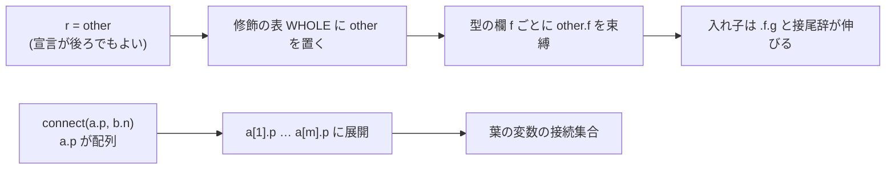

# S324 レコードの束縛・外部オブジェクト・配列のコネクタ

| | |
| --- | --- |
| セッション | S324 |
| 日付 | 2026-11-15 |
| ブランチ | `feature/s324-flat-composite` |
| Phase | Track B（B3 の続き） |
| スライド | [slides.html](slides.html) |
| 作業記録 | `log/work/2026-11-15-s324-flat-composite.md` |

## 1. 目的

S297 の時点で、MSL の例題で平坦化できなかった理由の上位は `composite-binding` 155 本と `connect-array` 72 本だった。この 2 つを `globe-mode-flat` の中だけで減らす。

## 2. 決定と理由

| 項目 | 決定 | 理由 |
| --- | --- | --- |
| 宣言が後ろの兄弟のレコード | 束縛の相手の欄を調べず、束縛される側の型の欄 `f` に `other.f` を当てる（修飾の表の特別な名前 `WHOLE = "*"`） | 相手がまだ宣言されていなくても欄は型から分かる。巻き戻しは要らない。配列の欄も通る |
| 優先順 | 外側の明示した修飾、`r = other`、宣言の既定値 | MLS の修飾の優先順。既定値のあるレコードの欄も上書きされる |
| 関数の戻り値のレコード | 評価せず `R.T = f().T` の形で欄ごとに束縛 | brief のとおり。評価できない関数が多い |
| 外部オブジェクト | 不透明な 1 つの変数（型の名前は完全修飾、束縛は呼び出しの式） | Rumoca の flat も同じ名前の変数を残す（名前の集合 350/350） |
| 配列のレコード | 1 次元。リテラルは要素ごとの式、別の配列は `x[k]` に欄を足す | `portsData`・`states` の形。多次元は断る |
| 配列のコネクタの一括接続 | `gen_connects` が要素ごとの接続に展開してから集合を作る。配列の変数 1 つと要素ごとの端は `i[k]` に分ける | 集合を葉の変数の単位で作る S312 の仕組みにそのまま乗る |
| `a.pin.v` の方程式 | 数は要素の数、印字は `{a.pin[1].v, …}` | これまで 1 本と数えていた。Rumoca の flat と同じ形にすると、DAE の incidence が要素ごとの変数を拾える |

## 3. 図



## 4. 再現手順

```bash
cargo test -p globe-mode-flat
# 食い違いを小さいモデルで見る
cargo xtask diff-frontend --class Modelica.Electrical.Machines.Examples.DCMachines.DCPM_Temperature --dump
# 回帰の確認（前回の target/frontend-diff.json と比べ、doc/frontend-diff.md を書く）
mise run msl:diff-frontend
```

| 項目（MSL の例題 566 本） | S297 | S324 |
| --- | --- | --- |
| 自前で平坦化できた本数 | 279 | 358 |
| `composite-binding` で断った | 155 | 31 |
| `connect-array` で断った | 72 | 1 |
| 名前の集合が一致（母数は Rumoca も通った本数） | 273 / 273 | 350 / 350 |
| 方程式の数が一致 | 273 / 273（S312） | 340 / 350 |
| 釣り合いの判定が一致 | 201 / 201（S312） | 253 / 253 |
| 構造が正則かの判定が一致 | 201 / 201（S325） | 249 / 253 |

`GlobeModeValidation` の 75 本は変わらない。回帰 0 本、改善 96 本（S325 の 17 本を含む。S324 だけでは 79 本）。

## 5. 次回

- 方程式の数が合わない 10 本は Rotational の摩擦・歯車。`tau0 = mu0*cgeo*fn` を Rumoca が 2 本と数える（`mu0` は `tableID` の表引きを束縛に持つ parameter）。原因は未確認。
- 新しい断る理由の上位: 条件つきの宣言 58、配列の修飾 38（`cylinders[n](length = {…})`）、`Complex` の演算子の式 31、`stream` 20、`for` の範囲が定数でない 16。
- DAE が `f(…).T`（呼び出しのあとの欄）を読めない（`MixtureGases` 1 本）。S325 の担当。
- 詳細は [ADR-0039 の付記（S324）](../../adr/0039-native-cst-parser.md)。
