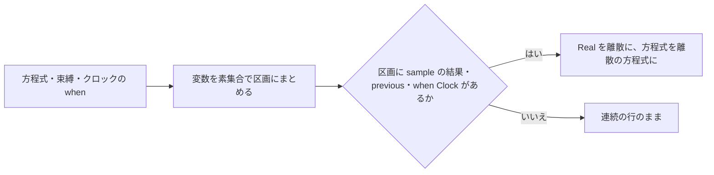

# S325 構造の正則の食い違い 17 本を直す

| | |
| --- | --- |
| セッション | S325 |
| 日付 | 2026-11-15 |
| ブランチ | `feature/s325-dae-regularity` |
| Phase | Track B（B4 の続き） |
| スライド | [slides.html](slides.html) |
| 作業記録 | `log/work/2026-11-15-s325-dae-regularity.md` |

## 1. 目的

[S312](../S312-dae-mismatches/解説書.md) で残った、構造の正則の判定の食い違い 17 本（MSL の `Modelica.Clocked` の例題 16 本と `Modelica.Media.Examples.WaterIF97`。自前が非正則、Rumoca が正則）の原因を確かめ、`globe-mode-dae` の数え方で直す。直せないものは既知の差として [ADR-0039](../../adr/0039-native-cst-parser.md) の付記（S325）に書く。`globe-mode-flat` は変えない。

## 2. 決定と理由

| 項目 | 決定 | 理由 |
| --- | --- | --- |
| 調べ方 | `diff-frontend --dump` に、自前と Rumoca の `DaeStructure`（行ごとの incidence、どの行にも参照されない未知数）を足した | 方程式の数は合っていて、どの行・未知数の扱いが違うかが分からなかった |
| クロックの区画 | 方程式・束縛・クロックの `when` の変数を素集合で区画にまとめ、クロックの印のある区画の Real（代数）を離散に、方程式を離散の方程式に数える。`sample`・`hold`・`subSample`・`superSample`・`shiftSample`・`backSample`・`noClock` の第 1 引数は区画に入れない | Rumoca は MLS 16.5.1 のクロックの区画を求め、その変数・方程式を連続の行・未知数から外す（`rumoca-phase-dae` の `analysis/clocks.rs`）。S312 の見立ては当たり |
| `if` の枝の混在 | 最初の枝が単純な代入だけで、代入先の大きさの和が方程式の数と一致するとき、代入先ごとに離散か連続かを分ける | 最初の代入が離散だというだけで全部を離散に数え、連続の代入の行が消えていた |
| レコードの離散の欄 | 離散の変数の欄は離散の方程式に数える | `phase`（Integer）の欄を連続の行に数え、行が未知数より多かった |
| shortcut | 区画の持ち主のクロック・変換の整合・区画の `der` は見ない | MSL の例題の計測で Rumoca と一致する範囲に絞る。ADR に書いた |

## 3. 図



## 4. 再現手順

```bash
cargo test -p globe-mode-dae
# 食い違いを 1 本ずつ見る（自前と Rumoca の行を並べる）
cargo xtask diff-frontend --class Modelica.Clocked.Examples.Elementary.RealSignals.UpSample1 --dump
# 回帰の確認（前回の target/frontend-diff.json と比べ、doc/frontend-diff.md を書く）
mise run msl:diff-frontend
```

`cargo xtask` は release でビルドされ、共有の `target-shared` の `xtask` は別の worktree に上書きされることがある。worktree 専用の `CARGO_TARGET_DIR` で回すと確実。

| 項目（MSL の例題、Rumoca も通った 201 本） | S312 | S325 |
| --- | --- | --- |
| 構造が正則かの判定が一致 | 184 / 201 | 201 / 201 |

方程式の数 273/273・釣り合い 201/201・状態の数 201/201 は変わらない。`GlobeModeValidation` の 75 本も変わらない（正則 72/72）。回帰 0 本、改善 17 本。

## 5. 次回

- 区画の持ち主のクロック、変換の整合（`sample(u, c)` の `c`）、区画の `der`（Rumoca は断る）は見ていない。入れ子の `if`・`for` の離散と連続の混在も、今まで通り最初の代入で決める。MSL の例題では出ていない。
- 平らにできない 287 本（flat の側。S324）。
