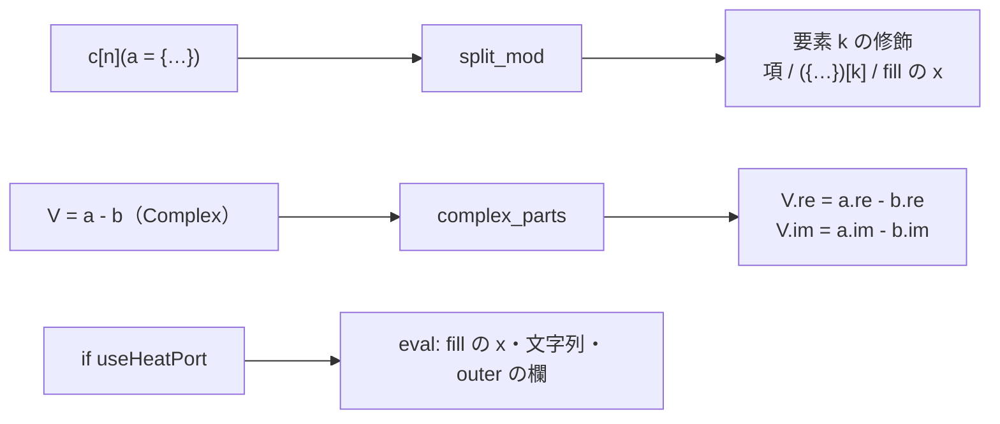

# S329 部品の配列への修飾・Complex の演算子・条件の評価

| | |
| --- | --- |
| セッション | S329 |
| 日付 | 2026-11-15 |
| ブランチ | `feature/s329-flat-arrays-complex` |
| Phase | Track B（B3 の続き） |
| スライド | [slides.html](slides.html) |
| 作業記録 | `log/work/2026-11-15-s329-flat-arrays-complex.md` |

## 1. 目的

S324 の後に上位になった断る理由（array-modification 38、conditional-component 58、composite-binding 31、non-constant-for 16）を、`globe-mode-flat` の中だけで減らす。

## 2. 決定と理由

| 項目 | 決定 | 理由 |
| --- | --- | --- |
| 部品の配列への修飾 | `c[n](a = {…})`・`fill(x, n…)` を要素ごとの修飾に分ける。`each` は分けない。1 次元の `{…}` は項そのもの、内包・多次元は `({…})[k]` | MultiBody の `cylinders[n](length = {… for i in 1:n})` 27 本と `fill(useHeatPort, N)` が当たる。式への添字には括弧が要る |
| `Complex` の演算子 | `+ - * /`・単項 `-`・`if`・`Complex(…)`・`ComplexMath` の関数を、評価せず `re`・`im` の式にする。MSL の定義を決め打つ | 演算子の関数の `algorithm` を読むには引数の型による解決が要る。4 つの演算子で全部足りるので小さい方 |
| 型の分からない参照 | Complex と見なす（Real の部品・定数・`time` は Real） | 宣言が後ろの部品は型を引けない。足りなくなったら型を引く（コードに `shortcut:` を書いた） |
| 文字列の比較 | `Val::S(hash)`。`==`・`<>` だけ | `Val` を `Copy` のままにする。比較にしか使わない |
| `outer` の欄 | `world.enableAnimation` の先頭を inner の名前に付け替える。まだ平らにしていない inner は、宣言の修飾→型の既定値から引く（`pending_field`） | inner が兄弟の後ろに宣言されると、環境にまだ値が無い |
| 定数の `if` のレコード | 選ばれた枝を `record_value` に渡す | `R_rel = if rotationType == … then … else …` |
| `numberOfSymmetricBaseSystems` | MSL のこの 1 つの関数だけ決め打つ（16 本の `for k in 1:mSystems`、25 本の `if mBase <> 2`） | 関数の評価器は別の仕事 |

## 3. 図



## 4. 再現手順

```bash
cargo test -p globe-mode-flat
# 1 本ずつ断る理由と差を見る
cargo xtask diff-frontend --class Modelica.Mechanics.MultiBody.Examples.Constraints.PrismaticConstraint --dump
# 回帰の確認（前回の target/frontend-diff.json と比べ、doc/frontend-diff.md を書く）
mise run msl:diff-frontend
```

| 項目（MSL の例題 566 本） | S324 | S329 |
| --- | --- | --- |
| 自前で平らにできた本数 | 358 | 471 |
| array-modification | 38 | 0 |
| conditional-component | 58 | 0 |
| composite-binding | 31 | 25 |
| non-constant-for | 16 | 1 |
| 名前の集合が一致（母数は Rumoca も通った本数） | 350 / 350 | 425 / 463 |
| 方程式の数が一致 | 340 / 350 | 435 / 463 |
| 釣り合いの判定が一致 | 253 / 253 | 295 / 297 |
| 構造が正則かの判定が一致 | 249 / 253 | 289 / 297 |

回帰 0 本、改善 113 本。`GlobeModeValidation` の 75 本は変わらない。646 s、最大 RSS 4.8 GiB。

名前が合わない 51 本のうち 37 本は、Rumoca が `cylinders[n]`・`Complex aw[2]` を要素に展開せず `cylinders.R.T` の 1 つの配列の変数にするもの（自前は `cylinders[1].R.T` …）。`Pin pin[m]` は Rumoca も展開するので、展開しない条件は【未確認】。

## 5. 次回

- Rumoca が部品・レコードの配列を展開しない条件を確かめ、合わせるか決める。
- DAE が読めない 41 本（`f(…).T` 37、`if` 式・括弧 4）は S330。
- 上位: unsized-array 28、stream 22、composite-binding 25。`ActuatorWithNoise`（方程式 728 対 736）・`EngineV6`（7392 対 7464）は原因未確認。
- 詳細は [ADR-0039 の付記（S329）](../../adr/0039-native-cst-parser.md)。
