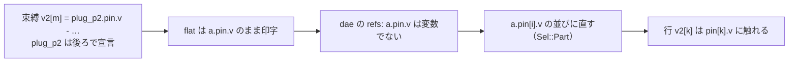

# S330 S324 の後に残った食い違いの原因

| | |
| --- | --- |
| セッション | S330 |
| 日付 | 2026-11-15 |
| ブランチ | `feature/s330-dae-mismatches-2` |
| Phase | Track B（B3・B4 の続き） |
| スライド | [slides.html](slides.html) |
| 作業記録 | `log/work/2026-11-15-s330-dae-mismatches-2.md` |

## 1. 目的

[S324](../S324-flat-composite/解説書.md) の後に残った 3 つの食い違い（方程式の数 10 本、構造の正則 4 本、`dae-parse` 1 本）の原因を `diff-frontend --class … --dump` で 1 本ずつ確かめ、`globe-mode-dae`（と必要なら `globe-mode-syntax` の式の読み）で直せるものを直す。`globe-mode-flat` は別の担当（S329）が触るので変えない。

## 2. 決定と理由

| 項目 | 決定 | 理由 |
| --- | --- | --- |
| 方程式の数 10 本（Rotational の摩擦・歯車） | **自前は直さない**。Rumoca の数え方の誤りとして [ADR-0039](../../adr/0039-native-cst-parser.md) の付記（S330）に最小の再現と内訳を書いた | `tau0 = mu0*cgeo*fn` の 3 つの変数はどれもスカラーで 1 本。Rumoca は `mu0` の束縛 `getTable1DValueNoDer2(tableID, 1, 0)` をたどって、表の行列 `mu_pos` の大きさ（`[0, 0.5]` なら 2、3×2 なら 6）の方程式に数える。MLS に、`Real` を返す関数の結果が引数の大きさを引き継ぐ規則は無い |
| 構造の正則 4 本（`Transformers`） | `globe-mode-dae` の `refs` が、変数に引けない `a.pin.v` を `a.pin[i].v` の並びに直し、行 k はその k 番目だけに触れる（`Sel::Part`） | `PartialCore` の束縛 `v2[m] = plug_p2.pin.v - …` は `plug_p2` の宣言より前にあるので、flat は展開せずそのまま印字する。行 `v2[k]` が `plug_p2.pin[k].v` に触れず、`core.v2`・`v3`・`im` の 9 行がマッチングから外れた |
| `dae-parse` 1 本（`MixtureGases`） | `globe-mode-syntax` の式の読みで、呼び出しの後ろの `.欄` を `CallExpr` の節に取り込む | flat が印字する `R.T = f(…).T` を dae が読み直せない。木の形は変えず、`callee()` も今まで通り |
| 調べ方 | `--dump` に `state_refs`（`x` 側の参照）も並べる | S6 は `incidence ∪ state_refs` で完全マッチングを見る。`incidence` だけだと、自前も Rumoca も非正則に見えた |

## 3. 図



## 4. 再現手順

```bash
cargo test -p globe-mode-dae -p globe-mode-syntax
# 方程式の数 10 本の最小の再現（ADR の W4。--validation に置いたディレクトリを使う）
cargo xtask diff-frontend --validation <dir> --class W4 --dump
# 正則 4 本
cargo xtask diff-frontend --class Modelica.Electrical.Machines.Examples.Transformers.AsymmetricalLoad --dump
# 全体（前回の target/frontend-diff.json と比べ、doc/frontend-diff.md を書く）
mise run msl:diff-frontend
```

| 項目（MSL の例題 566 本） | S324 | S330 |
| --- | --- | --- |
| 自前で DAE にできた | 357 / 358 | 358 / 358 |
| 構造が正則かの判定が一致（Rumoca の構造が取れた本数） | 249 / 253 | 253 / 253 |
| 方程式の数が Rumoca の flat と一致 | 340 / 350 | 340 / 350（10 本は Rumoca の誤り） |

回帰 0 本、改善 5 本（正則 4・dae 1）。`GlobeModeValidation` の 75 本は変わらない。

## 5. 次回

- `HeatLosses` の差 +21 の部品ごとの内訳は確かめていない。
- 方程式の数 10 本の Rumoca の誤りは、[doc/upstream.md](../../upstream.md) の 4 点セットとしては未作成。
- 部品の配列を通した欄の参照は、配列が 1 か所のときだけ直した（`a[i].b[j].v` は直さない。MSL では出ていない）。
