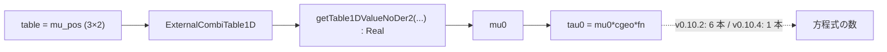

# S331 上流の下書き 36: 表の大きさが方程式の数になる誤り

| | |
| --- | --- |
| セッション | S331 |
| 日付 | 2026-11-15 |
| ブランチ | `feature/s331-upstream-table-count` |
| Phase | 文書（上流への報告の下書き） |
| スライド | [slides.html](slides.html) |
| 作業記録 | `log/work/2026-11-15-s331-upstream-table-count.md` |

## 1. 目的

S330 が Track B の食い違い 10 本の原因として見つけた、Rumoca の方程式の数え方の誤り（外部オブジェクトを作る表 `table = mu_pos` の大きさが、表から読むスカラーの parameter `mu0` を通って、`tau0 = mu0*cgeo*fn` の方程式の数になる）を、[doc/upstream.md](../../upstream.md) の流儀の下書きにする。提出はしない（ユーザーが出す）。

## 2. 決定と理由

| 項目 | 決定 | 理由 |
| --- | --- | --- |
| 状態 | **v0.10.4 で修正**（出さない） | 最新のリリース v0.10.4（2026-11-15 でも最新）の配布バイナリで、MSL の `W4` と Rotational・Translational の 10 本がすべて通り、flat の方程式の数も自前と一致した。v0.10.2 は ED001（9 本）と数の差（10 本） |
| 置くもの | 英語の `.md` と `.mo` だけ | 直った件は「出さない。記録として残す」慣例（25g・26 など）で、日本語版とスライドは作っていない。[research/upstream/README.md](../../research/upstream/README.md) に同じ書き方 |
| 再現 | 自己完結の `.mo` は flat の数だけ。釣り合いの誤りは MSL の `W4` | 自前の外部オブジェクトの toy は、`compile` の段で別の限界（`ED019 function value type`）に当たるため。MSL の `ExternalCombiTable1D` は当たらない |
| Rumoca main | 未確認 | ビルドしていない。直った変更の特定もしていない |

## 3. 図



## 4. 再現手順

```bash
# 取得物は data/rumoca（v0.10.2）。v0.10.4 は release の配布バイナリを別の場所に置く
rumoca compile W4.mo -m W4 --source-root data/msl                       # v0.10.2: ED001（7 本・未知数 2）
rumoca compile 36-flat-equation-count-from-external-object-table-size.mo -m Rep36.B --emit flat-json
```

検証の結果（数字）:

- 自己完結の `Rep36.A`（2×2）・`B`（3×2）・`C`・`D` の方程式の `scalar_count`: v0.10.2 は `[1, 4]`・`[1, 6]`・`[1, 1]`・`[1, 1]`、v0.10.4 はすべて `[1, 1]`。
- MSL の 10 本（Rotational の `OneWayClutch`・`OneWayClutchDisengaged`・`LossyGearDemo1〜3`・`SimpleGearShift`・`Friction`・`CoupledClutches`・`HeatLosses`、Translational の `Brake`）: v0.10.2 は ED001（`OneWayClutch` 44 対 43 ほか）、v0.10.4 は compile が通る。`flat-json` の `scalar_count` の和は v0.10.4 で自前の数に一致（`LossyGearDemo1` 69、`HeatLosses` 239 など。v0.10.2 は 77・260）。

## 5. 次回

- GlobeMode の Rumoca の rev を v0.10.4 に上げる版の最初に、`mise run msl:diff-frontend` の方程式の数 340/350 が 350/350 になるか、`msl:funnel` の OK が増えるかを確かめる（今回は回していない）。
- S330 の ADR-0039 の付記（「上流への報告の候補（4 点セットは未作成）」）は、S330 の側で下書き 36 へのリンクと「v0.10.4 で修正」に直す。
