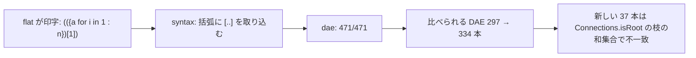

# S332 S329 と S330 を合わせた計測

| | |
| --- | --- |
| セッション | S332 |
| 日付 | 2026-11-15 |
| ブランチ | `feature/s332-trackb-after-329` |
| Phase | Track B（B1・B3・B4 の続き） |
| スライド | [slides.html](slides.html) |
| 作業記録 | `log/work/2026-11-15-s332-trackb-after-329.md` |

## 1. 目的

S329（平坦化できた本数 358 → 471）と S330（`f(…).T` を読む）はまだ一緒に計測されていなかった。両方を origin/main に取り込んで `mise run msl:diff-frontend` を回し、S329 の報告で残った (1) DAE が読めない 41 本、(2) 名前の食い違い 37 本、(3) `ActuatorWithNoise`・`EngineV6` の方程式の数の差の原因を確かめる。

## 2. 決定と理由

| 項目 | 決定 | 理由 |
| --- | --- | --- |
| DAE が読めない 41 本 | `globe-mode-syntax` が括弧の式への添字 `(x)[1]` を読む | 37 本は `f(…).T` でなく `(({a for i in 1 : n})[1])`。MLS の文法の primary に `"(" … ")" [ array-subscripts ]` がある |
| 名前の食い違い 37 本 | 自前は直さない。`diff-frontend` が比べるときだけ要素の添字（`.` の直前の `[…]`）を落とす | Rumoca は次元の式（`size(a, 1)` に参照で修飾した値など）を評価できないと配列の部品を展開しない。自前の展開が普通の flat。真似ると Rumoca の評価器の癖に縛られる |
| `ActuatorWithNoise` | 既知の差（S330 と同じ Rumoca の数え方の誤り） | `LossyGear` 1 つの最小の試験で、表 1×5 は +8、2×5 は +18 |
| `EngineV6` ほか MultiBody | 原因を特定、直すのは次の WP | `Parts.Body` の `if not Connections.isRoot(frame_a.R)`。Rumoca は根を決めて 1 つの枝、自前は枝の和集合 |

詳しくは [ADR-0039](../../adr/0039-native-cst-parser.md) の付記（S332）。

## 3. 図



## 4. 再現手順

```bash
cargo test -p globe-mode-syntax -p xtask
mise run msl:diff-frontend    # release、約 9 分、最大 RSS 5.7 GiB
cargo xtask diff-frontend --validation <dir> --class V1 --dump   # Rumoca の変数名も出る
```

## 5. 数字

MSL の例題 566 本（S329 の報告 → S332）: DAE にできた 430 → 471 / 471、flat の名前の一致 425/463 → 463/463、方程式の数 435/463（変わらず）、Rumoca の釣り合いまで通った 297 → 334 本（新しい 37 本は判定・数・状態・正則が不一致）。回帰 0、改善 85 項目。`GlobeModeValidation` 75 本は変わらず。

## 6. 次回

- 過剰決定の接続のグラフ（`Connections.root`・`potentialRoot`・`branch`・`isRoot`）を `globe-mode-flat` に作る。
- `a = {1, 2}`（リテラルの修飾）で Rumoca が展開するかの確認。
- 表の方程式の数を上流への報告の 4 点セットにする。
