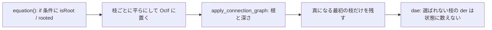

# S333 Connections.isRoot の根の決定

| | |
| --- | --- |
| セッション | S333 |
| 日付 | 2026-11-15 |
| ブランチ | `feature/s333-connections-isroot` |
| Phase | Track B（B3・B4 の続き） |
| スライド | [slides.html](slides.html) |
| 作業記録 | `log/work/2026-11-15-s333-connections-isroot.md` |

## 1. 目的

S332 が特定した、MultiBody の DAE（Rumoca の釣り合いまで通った 37 本）が Rumoca と合わない原因を直す。`Parts.Body` の `if not Connections.isRoot(frame_a.R) … elseif … else …` を、Rumoca は過剰決定の接続のグラフ（[MLS 9.4](https://specification.modelica.org/master/connectors-and-connections.html)、2026-11-15 確認）で根を決めて枝を 1 つ選ぶ。自前は枝の和集合を 1 行にしていたので、選ばれない枝の `der(Q)`・`der(phi)` も状態に数えた。

## 2. 決定と理由

| 項目 | 決定 | 理由 |
| --- | --- | --- |
| `if` の扱い | 条件が `[not] isRoot(N)`・`[not] rooted(N)` の `if` は、枝ごとに平らにして `OcIf` に置き、根の決定のあとで真になる最初の枝だけを残す | 接続を集め終えるまで根が決まらない。畳むのを後ろにずらすのが一番小さい |
| 根と深さ | 確定した根 → 潜在的な根（優先度の小さい順、同じなら名前）→ 名前。深さは選んだ木の上の幅優先 | MLS 9.4 と Rumoca の `build_vcg` |
| 木の選び方 | 必須の辺（`branch`）のあと、根からの距離が近い任意の辺から採る | `rooted` が木の形に依存する。Rumoca と同じ順にした |
| ベクトルの積 | `a * b`（ベクトルどうし）は 1 本、行列 × ベクトルは行の数 | 計測の最初の回帰（`UniversalConstraint`）で見つけた、前から有った数え間違い |

詳しくは [ADR-0039](../../adr/0039-native-cst-parser.md) の付記（S333）。

## 3. 図



## 4. 再現手順

```bash
cargo test -p globe-mode-flat
mise run msl:diff-frontend    # release、約 9 分、最大 RSS 6.0 GiB
```

## 5. 数字

MSL の例題 566 本（S332 → S333）: flat の方程式の数 435/463 → 449/463、MultiBody の 37 本を含む DAE の判定・数 297/334 → 332/334、状態 294/334 → 332/334、構造の正則 296/334 → 301/334。回帰 0、改善 39 本。`EngineV6`・`EngineV6_analytic` の方程式の数は一致。`GlobeModeValidation` 75 本は変わらない。

## 6. 次回

- 構造の正則の不一致 33 本（MultiBody。原因未確認）。
- `PrismaticConstraint`（2 本差）・`Fourbar1`（3 本差）の方程式の数。
- `rooted` の MLS の制約（`branch` がちょうど 1 つ）を確かめる。
