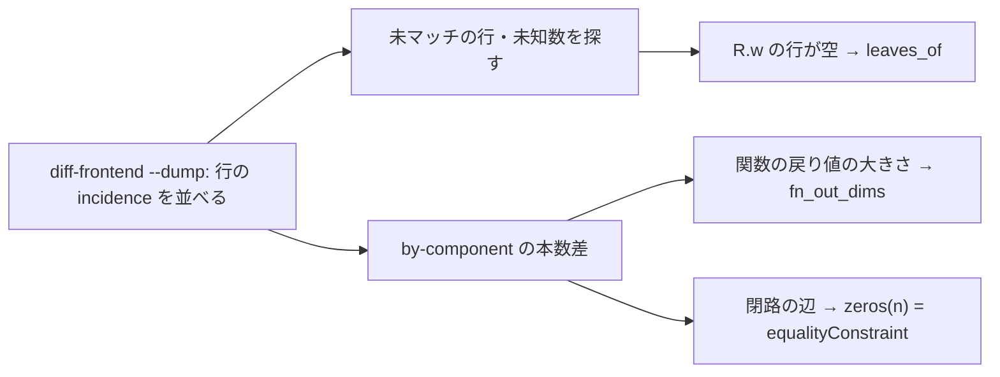

# S334 MultiBody の構造の正則

| | |
| --- | --- |
| セッション | S334 |
| 日付 | 2026-11-15 |
| ブランチ | `feature/s334-multibody-regularity` |
| Phase | Track B（B3・B4 の続き） |
| スライド | [slides.html](slides.html) |
| 作業記録 | `log/work/2026-11-15-s334-multibody-regularity.md` |

## 1. 目的

S333 の後に残った、MultiBody の構造の正則の不一致 33 本と、`PrismaticConstraint`（2 本差）・`Fourbar1`（3 本差）の flat の方程式の数の差の原因を確かめて直す。自前と Rumoca のどちらが誤りかを先に確かめた。**すべて自前の誤りで、Rumoca は正しかった**。

## 2. 決定と理由

| 項目 | 決定 | 理由 |
| --- | --- | --- |
| レコードを関数に渡す参照 | 変数でも部品の配列を通した欄でもない `a.R` は、欄すべての変数に触れる行にする（`globe-mode-dae` の `leaves_of`） | `w_a = Frames.angularVelocity2(frame_a.R)` の incidence が空で、`R.w[1..3]` が `from_Q` の行だけで取り合いになり、マッチングが完全にならなかった |
| 関数の戻り値の大きさ | 出力が 1 つで宣言の添字が定数なら、その大きさ（`globe-mode-flat` の `fn_out_dims`） | 左辺が `angularVelocity2(R_b)` の方程式は 3 本だが、1 本と数えていた（`PrismaticConstraint`） |
| 閉路の辺 | 木に選ばれなかった任意の辺ごとに `zeros(n) = equalityConstraint(a, b)` を `n` 本足す（`n` は `residue[n]`。0 なら作らない） | Rumoca が作る。`Reference`（QuasiStatic）は `residue[0]` で、今までどおり作らない（`Fourbar1`） |

詳しくは [ADR-0039](../../adr/0039-native-cst-parser.md) の付記（S334）。

## 3. 図



## 4. 再現手順

```bash
cargo test -p globe-mode-flat -p globe-mode-dae
cargo xtask diff-frontend --class Modelica.Mechanics.MultiBody.Examples.Elementary.FreeBody --dump
mise run msl:diff-frontend    # release、約 9 分、最大 RSS 5.8 GiB
```

## 5. 数字

MSL の例題 566 本（S333 → S334）: 構造の正則 301/334 → 334/334、DAE の判定・数 332/334 → 334/334、flat の方程式の数 449/463 → 451/463、状態の数は 332/334 のまま（`IMC_DCBraking`・`IMC_Initialize`）。回帰 0。`GlobeModeValidation` 75 本は変わらない。

## 6. 次回

- 状態の数 2 本（`IMC_DCBraking`・`IMC_Initialize`）。
- `ShowTransferFunction` の方程式の数（14 対 16。原因未確認）。
- レコードを渡す incidence を、関数の本体を見て欄ごとに絞るか。
