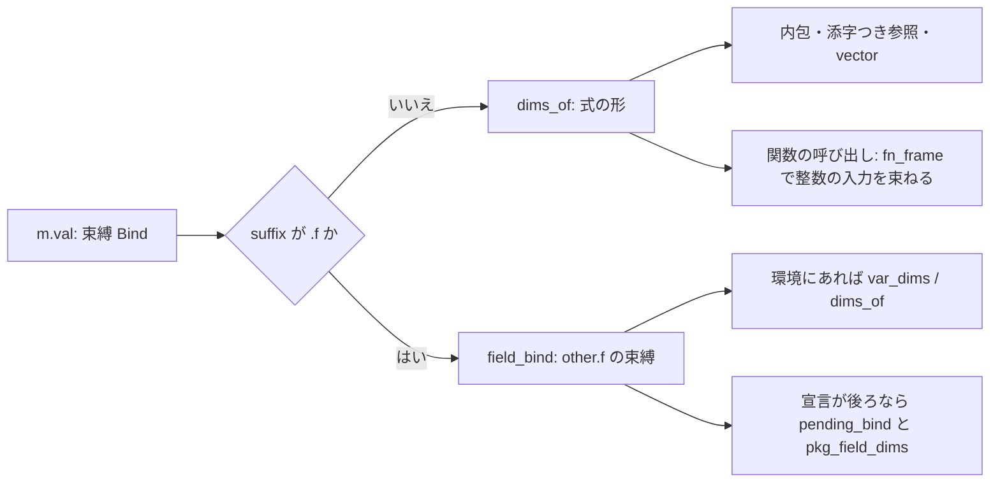

# S335 flat の `[:]` の大きさ

| | |
| --- | --- |
| セッション | S335 |
| 日付 | 2026-11-15 |
| ブランチ | `feature/s335-flat-unsized-array` |
| Phase | Track B（B3 の続き） |
| スライド | [slides.html](slides.html) |
| 作業記録 | `log/work/2026-11-15-s335-flat-unsized-array.md` |

## 1. 目的

自前の flat（`globe-mode-flat`）が MSL の例題 28 本を `unsized-array` で断っていた。大きさ `[:]` の配列の大きさを、束縛の式・関数の引数・レコードの束縛から決めて平らにできるようにする（MLS 10.1）。Rumoca の flat と変数の名前・方程式の数を突き合わせ、回帰 0 を条件にする。

## 2. 決定と理由

28 本を原因ごとに分けた。

| 原因 | 本数 | 例 | 直し |
| --- | ---: | --- | --- |
| `BooleanTable` の `table = if n > 0 then … [table[1], 1.0; table, {mod(i + 1, 2.0) for i in 1:n}]` | 12 | `BooleanNetwork1`・`Clocked` の `BooleanSignals` | 添字つきの参照・内包・`mod` の形を `dims_of` に足した |
| `bb = vector([zeros(max(0,na-nb),1); b])` | 6 | `Dimmer_R`・`ThyristorBridge2Pulse_DC_Drive` | `vector` を足した |
| `cellData = cellData1` で欄に分けた `OCV_SOC` | 7 | Batteries の `CCCV_*` | 欄の束縛 `cellData1.OCV_SOC` の大きさを引く（以前は suffix を見ずレコードの大きさ［空］を使っていた）。宣言が後ろのレコードの欄は型の宣言から |
| 関数の戻り値 `relNodePositions(12)`・`GenerateStribeckFrictionTable(…)` | 2 | `Surfaces`・`Translational.Examples.Friction` | 整数の入力を引数（既定値も）の値に束ねた文脈で出力の添字を評価する |
| ファイルを読んで決まる `readRealMatrix(file, …, dim[1], dim[2])` | 1 | `ReadRealMatrixFromFile` | 決められない（外部関数がファイルを読む） |

宣言が後ろの部品の欄（`reset = {stop.on}`）の大きさは、部品の型の宣言から決める。**宣言の場所で修飾された欄を宣言か既定値の式が直接使うときは決めない**（この文脈は修飾を知らないので、既定値で決めると黙って誤る。試験で確かめた）。

詳しくは [ADR-0039](../../adr/0039-native-cst-parser.md) の付記（S335）。

## 3. 図



## 4. 再現手順

```bash
cargo test -p globe-mode-flat
cargo xtask diff-frontend --class Modelica.Blocks.Examples.BooleanNetwork1 --dump
mise run msl:diff-frontend    # release、約 10 分、最大 RSS 5.8 GiB
```

共有の target では、ほかの worktree が `release/xtask` を上書きすることがある。`cargo xtask` の結果が古い（直したはずの例題がまだ断られる）ときは、変えた crate の `lib.rs` を touch して作り直し、`release/xtask` を別の場所へコピーして回す。

## 5. 数字

@@NUMBERS@@

## 6. 次回

- `rcData[] = cellData`（レコードの配列を別のレコードの欄で束縛）は `composite-binding` に進んだ。S336 の担当。
- `ReadRealMatrixFromFile`（ファイルを読んで決まる大きさ）。
- `SoftStarter` の方程式の数が Rumoca と 8 本違う（自前が少ない。原因は未確認）。
