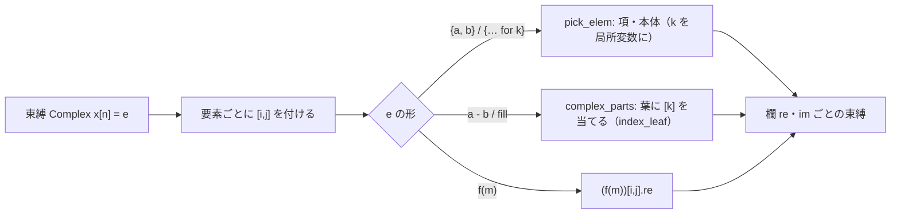

# S336 flat の配列の束縛（composite-binding）

| | |
| --- | --- |
| セッション | S336 |
| 日付 | 2026-11-15 |
| ブランチ | `feature/s336-flat-composite-binding` |
| Phase | Track B（B3 の続き） |
| スライド | [slides.html](slides.html) |
| 作業記録 | `log/work/2026-11-15-s336-flat-composite-binding.md` |

## 1. 目的

自前の flat（`globe-mode-flat`）が、MSL の例題 25 本を理由 `composite-binding` で断っている。原因ごとに分けて、`Complex`・レコードの**配列**の束縛を要素ごとに平坦化できるようにする。Rumoca の flat と変数の名前・方程式の数が合うことと、回帰 0 が条件。

## 2. 決定と理由

25 本の原因は 4 つだけだった（最初の理由。`diff-frontend --class … --dump` で確かめた）。

| 原因 | 本数 | 例 |
| --- | ---: | --- |
| `Complex uInternal[nin] = {… for k in 1:nin}`（内包） | 8 | `ComplexMISO`・`ComplexMIMO`（QuasiStatic の総和・対称成分） |
| `Complex v[m] = plug_p.pin.v - plug_n.pin.v`（配列の式） | 15 | `Machine.vs`・`SymmetricPolyphaseWinding.v` |
| `strayPermeance[m](G_m = {SalientPermeance(…) for k in 1:m})` | 1 | `IMC_DOL_CommonLeakage` |
| `Complex sTM[m, m] = symmetricTransformationMatrix(m)`（2 次元・関数） | 1 | `PolyphaseInductance` |

| 項目 | 決定 | 理由 |
| --- | --- | --- |
| 要素ごとの束縛 | 束縛に添字 `[i, j]` を付けて `record_value` に渡し、配列の式の項・内包の本体は `pick_elem` が選ぶ | 1 次元の `{…}` だけだった道を、内包・N 次元・関数の戻り値に一般化できる。内包の `k` は `for` の方程式と同じ `Ctx::locals` に要素の値を持つ |
| `Complex` の配列の式 | `complex_parts` の葉の参照に `[k]` を当てる（`index_leaf`）。部品の配列を通した欄 `plug_p.pin.v` は `plug_p.pin[k].v` | 配列の式 `a - b` は葉の `a`・`b` を要素にすれば、S329 の `+ - * /` の展開がそのまま使える |
| `fill(x, n)` | 要素は `x` | `Complex k[nin] = fill(Complex(1, 0), nin)` が 25 本の先に隠れていた |
| 内包の方程式の数 | 範囲の長さの積（`comp_len`） | Rumoca は `c = {a[k]*b[k] for k in 1:3}` を 3 本と数える。これまでは 1 本 |

詳しくは [ADR-0039](../../adr/0039-native-cst-parser.md) の付記（S336）。

## 3. 図



## 4. 再現手順

```bash
cargo test -p globe-mode-flat
cargo xtask diff-frontend --class Modelica.Electrical.QuasiStatic.Polyphase.Examples.TestSensors --dump
mise run msl:diff-frontend    # release、約 10 分、最大 RSS 5.8 GiB
```

## 5. 数字

MSL の例題 566 本（S334 → S336。`GlobeModeValidation` 75 本は変わらない）。回帰 0。表の「S336」は S337・S341 を取り込んだあとの再実行（794 s、最大 RSS 5.6 GiB）。取り込む前の実行（S334 の結果との差は改善 7 本、1348 s）も同じ数字だった。

| 項目 | S334 | S336 |
| --- | ---: | ---: |
| 自前で平坦化できた | 471 | **477** |
| Rumoca も flat まで通った | 463 | 468 |
| 名前の集合が一致 | 463/463 | **468/468** |
| 方程式の数が一致 | 451/463（S337 で 452/463） | **457/468** |
| DAE にできた | 471/471 | **477/477** |
| 断る理由 `composite-binding` | 25 | **0** |
| 断る理由 `unsized-array` | 28 | 47（19 本が移った） |

- 25 本のうち 6 本が平坦化でき、19 本は `indexNonPos[:] = f(m)`（`unsized-array`。S335）で次に止まる。S335 の WIP を仮に結合して（コミットせず）確かめると 25 本すべてが平坦化できた。
- 方程式の数: 新しく比べられた 5 本が一致した。`ShowTransferFunction`（14 対 16）は S337 の `record_array_len` と、この版の内包の数え方のどちらでも一致する。残り 11 本は S337 から変わらない（Rumoca の数え方の誤りとみている）。
- Rumoca の釣り合いまで通った 334 本の判定・数・正則・状態は 334/334（S337 の状態の数を含む）。新しい 6 本は Rumoca が釣り合いまで通らない。resolve は 566/566（S341）。
- 検査: `cargo test -p globe-mode-flat`（38 本）・`-p globe-mode-dae`（14）・`-p globe-mode-resolve`・`-p globe-mode-frontend`・`-p globe-mode-lsp` 通過、clippy 0、fmt 済み。

## 6. 次回

- `unsized-array` 47 本（S335）。S335 と合わせたとき、部品の配列を通した欄の方程式の数（`plug_p.pin.i + plug_n.pin.i = fill(Complex(0), m)` が 3 → 1 になる）を測り直す。
- 内包の添字が 2 つ以上（`{… for i in a, j in b}`）、`Complex` の関数に配列を渡す式（`conj(u)` の `u` が配列）は断る（MSL の例題では出ない）。
- 19 本のうち Rumoca が flat まで通るのは 7 本だけ。残りは名前・方程式の数を Rumoca と比べられない。
