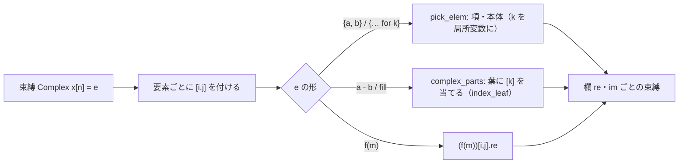

# S336 flat の配列の束縛（composite-binding）

| | |
| --- | --- |
| セッション | S336 |
| 日付 | 2026-11-15 |
| ブランチ | `feature/s336-flat-composite-binding` |
| Phase | Track B（B3 の続き） |
| スライド | [slides.html](slides.html) |
| 作業記録 | `log/work/2026-11-15-s336-flat-composite-binding.md` |

## 1. 目的

自前の flat（`globe-mode-flat`）が、MSL の例題 25 本を理由 `composite-binding` で断っている。原因ごとに分けて、`Complex`・レコードの**配列**の束縛を要素ごとに平らにできるようにする。Rumoca の flat と変数の名前・方程式の数が合うことと、回帰 0 が条件。

## 2. 決定と理由

25 本の原因は 4 つだけだった（最初の理由。`diff-frontend --class … --dump` で確かめた）。

| 原因 | 本数 | 例 |
| --- | ---: | --- |
| `Complex uInternal[nin] = {… for k in 1:nin}`（内包） | 8 | `ComplexMISO`・`ComplexMIMO`（QuasiStatic の総和・対称成分） |
| `Complex v[m] = plug_p.pin.v - plug_n.pin.v`（配列の式） | 15 | `Machine.vs`・`SymmetricPolyphaseWinding.v` |
| `strayPermeance[m](G_m = {SalientPermeance(…) for k in 1:m})` | 1 | `IMC_DOL_CommonLeakage` |
| `Complex sTM[m, m] = symmetricTransformationMatrix(m)`（2 次元・関数） | 1 | `PolyphaseInductance` |

| 項目 | 決定 | 理由 |
| --- | --- | --- |
| 要素ごとの束縛 | 束縛に添字 `[i, j]` を付けて `record_value` に渡し、配列の式の項・内包の本体は `pick_elem` が選ぶ | 1 次元の `{…}` だけだった道を、内包・N 次元・関数の戻り値に一般化できる。内包の `k` は `for` の方程式と同じ `Ctx::locals` に要素の値を持つ |
| `Complex` の配列の式 | `complex_parts` の葉の参照に `[k]` を当てる（`index_leaf`）。部品の配列を通した欄 `plug_p.pin.v` は `plug_p.pin[k].v` | 配列の式 `a - b` は葉の `a`・`b` を要素にすれば、S329 の `+ - * /` の展開がそのまま使える |
| `fill(x, n)` | 要素は `x` | `Complex k[nin] = fill(Complex(1, 0), nin)` が 25 本の先に隠れていた |
| 内包の方程式の数 | 範囲の長さの積（`comp_len`） | Rumoca は `c = {a[k]*b[k] for k in 1:3}` を 3 本と数える。これまでは 1 本 |

詳しくは [ADR-0039](../../adr/0039-native-cst-parser.md) の付記（S336）。

## 3. 図



## 4. 再現手順

```bash
cargo test -p globe-mode-flat
cargo xtask diff-frontend --class Modelica.Electrical.QuasiStatic.Polyphase.Examples.TestSensors --dump
mise run msl:diff-frontend    # release、約 10 分、最大 RSS 5.8 GiB
```

## 5. 数字

@@NUMBERS@@

## 6. 次回

@@NEXT@@
