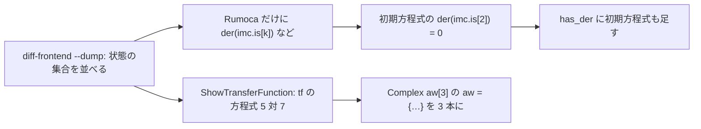

# S337 初期方程式の der と状態の数

| | |
| --- | --- |
| セッション | S337 |
| 日付 | 2026-11-15 |
| ブランチ | `feature/s337-dae-states-imc` |
| Phase | Track B（B3・B4 の続き） |
| スライド | [slides.html](slides.html) |
| 作業記録 | `log/work/2026-11-15-s337-dae-states-imc.md` |

## 1. 目的

S334 が残した、状態の数の食い違い 2 本（`IMC_DCBraking` 18 対 23、`IMC_Initialize` 18 対 22）と、余力で `ShowTransferFunction` の flat の方程式の数（14 対 16）の原因を、自前の誤りか Rumoca の誤りかを先に確かめて直す。

## 2. 決定と理由

| 項目 | 決定 | 理由 |
| --- | --- | --- |
| 状態の数 2 本 | 初期方程式の `der(x)` も `x` を状態にする（`globe-mode-dae`） | Rumoca の `analyze_model_roles` は `flat.equations` と `flat.initial_equations` の両方から `der` の対象を集める。自前は連続側しか見ていなかった。差は `der(imc.is[2]) = 0`（`is` 3 + `idq_rs` 2 = 5）と `der(aimc.idq_sr) = zeros(2)` ほか（2 + 2 = 4）の変数の大きさと一致 |
| Rumoca の誤りか | 誤りとはしない | [MLS 8.6](https://specification.modelica.org/master/equations.html)（2026-11-15 確認）は、初期方程式にだけ現れる `der` の変数が状態かを決めていない。Rumoca の規則は意図して書かれている（初期方程式を明示的に走査する）。上流へは出さない |
| `ShowTransferFunction` | 左辺が変数でない方程式は、要素ごとに展開したレコードの配列 `t[k].x` の要素の数を数える（`globe-mode-flat` の `record_array_len`） | `Complex aw[3]` の `aw = {… for i in …}` は Rumoca では 3 本。自前は左辺の大きさが引けず 1 本と数えていた |

詳しくは [ADR-0039](../../adr/0039-native-cst-parser.md) の付記（S337）。

## 3. 図



## 4. 再現手順

```bash
cargo test -p globe-mode-flat -p globe-mode-dae
cargo xtask diff-frontend --class Modelica.Electrical.Machines.Examples.InductionMachines.IMC_DCBraking --dump
mise run msl:diff-frontend    # release、約 9 分、最大 RSS 5.8 GiB
```

注意: 共有の target では、`cargo xtask` が走らせる `release/xtask` を別の worktree のビルドが上書きすることがある（`--dump` の出力が変わって気付いた）。確かめるときは、ビルドの直後に `cp` で自分の分を取っておいて、それを走らせる。

## 5. 数字

MSL の例題 566 本（S334 → S337。`GlobeModeValidation` 75 本は変わらず 73/73・73/73・73/73・正則 72/72）: 状態の数 332/334 → **334/334**、flat の方程式の数 451/463 → **452/463**（残り 11 本は Rumoca の数え方の誤りとみている）、DAE の判定・方程式と未知数の数・構造の正則は 334/334 のまま。**回帰 0、改善 3 本**（`IMC_DCBraking`・`IMC_Initialize`・`ShowTransferFunction`）。`msl:diff-frontend` と同じ引数で 744 s（ほかの担当と並行。S334 は 554 s）、最大 RSS 5.2 GiB。

## 6. 次回

- flat の方程式の数の残り（Rumoca の数え方の誤りと見ている 12 本）。
- レコードを渡す incidence を、関数の本体を見て欄ごとに絞るか。
