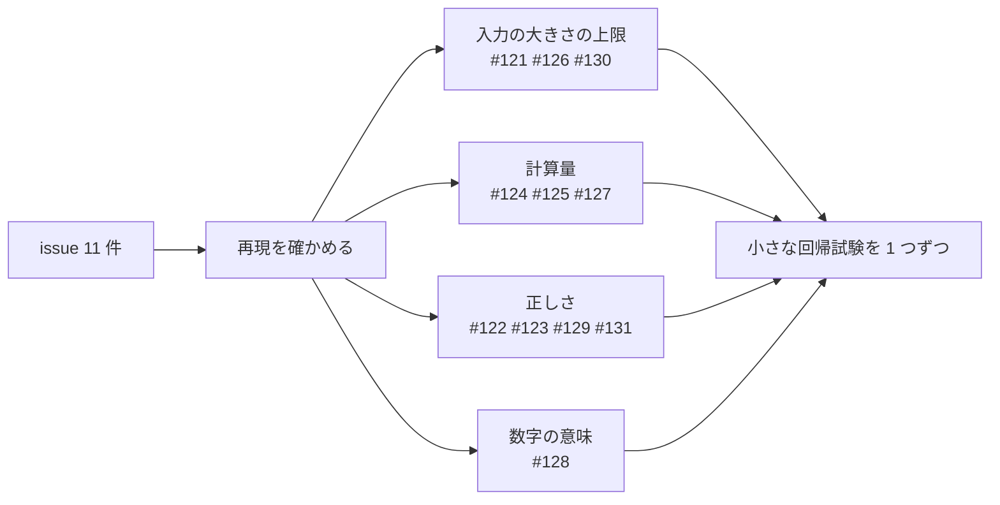

# S339 5 回目のレビューの issue（#121〜#131）

| | |
| --- | --- |
| セッション | S339 |
| 日付 | 2026-11-15 |
| ブランチ | `feature/s339-review5-fixes` |
| Phase | Track B（B3 の続き）・P8（複数ソルバの比較）・CLI |
| スライド | [slides.html](slides.html) |
| 作業記録 | `log/work/2026-11-15-s339-review5-fixes.md` |
| レビュー履歴 | `log/review/2026-11-15-s324-s333-review5.md` |

## 1. 目的

5 回目のレビュー（S324〜S333 の変更）が立てた issue 11 件（#121〜#131）を、1 件ずつ**再現を自分で確かめてから**直す。**issue の題は本文より 1 つずれている**（#122 の題は #121 の本文のもの、…、#121 と #126 の題は `x`）。番号は本文の指摘の番号で扱う。issue は閉じない（ユーザーが閉じる）。

## 2. 決定と理由

| issue | 結果 | 決定 | 理由 |
| --- | --- | --- | --- |
| #121 | 直した | `Complex` の式の長さ（実部＋虚部）が 64 KiB を超えたら展開せず `composite-binding` で断る（`CX_MAX_LEN`） | `*`・`/` は被演算子ごとに式が 2 倍。`a*a*…` の 40 個で 2^40 文字になる。再現: 14 個 1.7 s・18 個 27 s、40 個は 60 s で終わらない。直したあと 1.5 ms |
| #122 | 直した | 通常・初期の方程式の積み直しを 1 つの関数 `restack` にした | 初期方程式だけ `splice` で、先の `if` が数を変えると後の位置がずれ、別の `initial equation`（`z = 3`）が消えて空の方程式が残った。再現どおり |
| #123 | 直した | 展開に入る条件に「最上位の `Complex` で、欄が `re`・`im` だけ」を足した（`is_msl_complex`） | 名前だけ同じユーザー定義のレコードの束縛が黙って落ちた（`z.a`・`z.b` に束縛が無い）。今は `composite-binding` |
| #124 | 直した | `{…}` の項と「内包でない」の判定を、配列の式ごとに 1 回だけ集める | issue の指摘の項の作り直しに加え、**内包の判定が要素ごとに全項を走査**していた（こちらが支配的）。debug の n = 3000 で 10.2 s → 0.26 s（項の作り直しだけでは 9.6 s のまま） |
| #125 | 直した | 潜在的な根を節点 → 優先度の表にし、成分ごとの根を 1 回だけ決めて引く | `isRoot` ごとに成分と `potential` の全部を走査（O(N³)）。debug の N = 1200 で 13.6 s → 0.68 s |
| #126 | 直した | `equation` の入口で、方程式（`when`・初期・`connect` を含む）が 100 万本を超えたら `too-large`（`MAX_EQS`） | 2000×2000 の `for` が 400 万本・3 重で終わらない。`MAX_VARS` の 5 倍。1 本 50 µs（debug）なので試験では `cfg(test)` で 1 万本にした |
| #127 | 直した | 葉の名前 → 番号を `BTreeMap` で引き、集合の位置は名前順の範囲だけを見る。`outside` の `own` の線形探索も表にした | `id`・`origins`・`outside` が線形探索で O(N²)。debug の N = 3000 で 6.7 s → 0.9 s。接続が無い基準の 3.9 s（N = 8000）は別の費用で、範囲外 |
| #128 | 直した | `deviations` に管の閾値を渡し、**同じ瞬間でなく δt 以内にずれた**イベントの前後 δt の基準の点を比べない | 補間が跳びをまたぐと、合格なのに相対差が 4〜5 桁大きく出る。δt を超えてずれたイベント・片方だけのイベント・同じ瞬間のイベントは比べ続ける（管でも落ちるずれを隠さない）。実機の `Ball` で 7.659e4 → 2.562e-4（残りは基準が 0 に近い点。ゼロ交差の既知の限界）。[ADR-0040](../../adr/0040-multi-solver-compare.md) の付記 S339 |
| #129 | 直した | `resolve` を、最も近い存在する祖先を `canonicalize` して残りの部品を足す形にした（`..` は字面で畳む） | 未作成のフォルダが 2 階層以上あると相対のまま返り、`-o lib1/sub/deeper` がライブラリの中を素通りした |
| #130 | 直した | 次元の積を `dims_product`（`checked_mul`）にした | 巨大な宣言で debug は panic・release は巻き戻った（再現: 1e10 × 1e10 の戻り値で `attempt to multiply with overflow`） |
| #131 | 直した | `without_elem_subs` が個数と深さも持ち、同じ深さで展開した名前は個数も比べる（`same_elems`） | 要素が欠けても `a.x` 1 つに畳まれて一致と数えていた。Rumoca が展開しない（深さ 0）ときは個数を比べない |

詳しくは [ADR-0039](../../adr/0039-native-cst-parser.md)・[ADR-0040](../../adr/0040-multi-solver-compare.md) の付記（S339）。

## 3. 図



## 4. 再現手順

```bash
cargo test -p globe-mode-flat -p globe-mode-sim -p xtask
cargo test -p globe-mode-cli --bin globe
mise run msl:diff-frontend    # release、回帰 0 を確かめる
```

## 5. 数字

DIFF_FRONTEND_NUMBERS

## 6. 次回

- 部品の配列の展開そのもの（接続が無くても N = 8000 で 3.9 s、2 倍で約 2.7 倍）。
- `rooted` の `branches.iter().rfind(…)` は呼ぶたびに枝を走査する（今の再現では支配的でない）。
- `MAX_EQS` の値（100 万本）は MSL の最大の例題より十分大きいとみて置いた。実測の最大を `msl:diff-frontend` の出力に出すかは未定。
