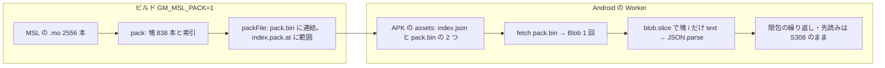

# S340 Android の束を 1 本のパックにした

| | |
| --- | --- |
| セッション | S340 |
| 日付 | 2026-11-15 |
| ブランチ | `feature/s340-android-split-pack` |
| Phase | P6 |
| スライド | [slides.html](slides.html) |
| 作業記録 | `log/work/2026-11-15-s340-android-split-pack.md` |

## 1. 目的

[S308](../S308-split-delivery-followups/解説書.md) で Android の APK から `MSL.json` を外して分割配信の塊 838 本にしたら、APK が arm64 で +1.24 MB（+9.1%）増えた。実行時の利点（読み込み後の wasm の線形メモリ 62 → 14 MiB）は残したまま、APK の大きさを S308 の前（arm64 release 13,616,490 B）程度に戻す。

ユーザーの指示（2026-11-15）で、**案 A（塊を 1 本のパックにして slice で切り出す）と案 B（Android だけ塊の cap を上げる）を両方実装して同じ表で比べ、優れた方を採り、採らなかった方は外す**。

## 2. 決定と理由

詳細は [ADR-0023 の S340](../../adr/0023-desktop-and-web-process-layout.md)。

| 項目 | 決定 | 理由 |
| --- | --- | --- |
| 採用 | **案 A**。Android の束だけ `msl/pack.bin`（塊の JSON を連結）と、索引の `pack: { url, at }` にする。Worker はパックを `fetch().blob()` で 1 回取り、塊を `blob.slice(at[i], at[i+1]).text()` で切り出す | APK が +1.7%（B は +6.0%）。読む塊・往復・線形メモリは S308 と同じ |
| 外したもの | 案 B（cap を上げる）。`pack-msl.mjs` の環境変数と `android.yml` の `variant` を消した。測るための `split.mjs --cap` は残した | cap を上げても塊は 446 本から減らず（ディレクトリごとに分けるため）、先読みも効かせにくい |
| Blob | パックは Blob のまま持ち、Worker の JS ヒープに載せない | ArrayBuffer を握ると 15.2 MiB の外部メモリ。Blob はブラウザの blob 管理に置かれる |
| ブラウザ版 | 変えない（`GM_MSL_PACK` を付けるのは `android.yml` だけ。`web.yml` の束は `MSL.json` なし・`c/*.json` 838 本のまま） | 依頼は Android だけ。ブラウザは回線から要る塊だけ取れるのが利点 |

原因は Tauri の圧縮にある。Tauri は frontend の asset を 1 つずつ brotli（quality 9。debug ビルドは 2）で圧縮して Rust の binary に埋める（`tauri-codegen` 2.7.4 の `embedded_assets.rs`、確認日 2026-11-15）。塊は 16 KiB で 1 本ずつ圧縮されるので辞書が持ち越されない。brotli（quality 9、窓 4 MiB）で見積もると次のとおりで、見積もりの差は APK の実測の差とほぼ合う。

| 束 | 圧縮後の合計（見積もり） |
| --- | ---: |
| `MSL.json`（15.95 MB） | 2,077,527 B |
| 塊 838 本（cap 16 KiB）+ 索引 | 3,055,369 + 194,779 = 3,250,148 B |
| 案 A: パック 1 本 + 索引（`at` つき） | 2,078,267 + 197,912 = 2,276,179 B |
| 案 B: cap 64 KiB（514 本）+ 索引 | 2,720,688 + 191,306 B |
| 案 B: cap 256 KiB（461 本）+ 索引 | 2,645,998 + 190,385 B |
| 案 B: cap 無限（446 本）+ 索引 | 2,612,337 + 190,261 B |

つまり、塊を連結して 1 本にすれば `MSL.json` と同じ圧縮になり、増えるのは索引（木の見出し `stubs` と塊の表）の約 0.2 MB だけ。cap を上げる案 B は、同じディレクトリでしか塊をまとめないので、446 本より減らない。

## 3. 図



## 4. 再現手順

```bash
cargo xtask fetch-msl
mise run wasm:build                                                                   # release の wasm（先に）
node src/Rust/mod/globe-mode-wasm/node/broken-chunks.mjs                              # MSL 不要。パックが無ければ誤り、置けば通る
node src/Rust/mod/globe-mode-wasm/node/split.mjs --msl data/msl                       # S308 の束（20 本の一致）
node src/Rust/mod/globe-mode-wasm/node/split.mjs --msl data/msl --pack                # 案 A（同じ 20 本）
node src/Rust/mod/globe-mode-wasm/node/split.mjs --msl data/msl --cap 262144 --prefetch 0   # 案 B（cap 256 KiB）
gh workflow run android.yml --ref feature/s340-android-split-pack                     # APK の大きさとエミュレータの smoke
gh workflow run web.yml --ref feature/s340-android-split-pack                         # ブラウザ版の束が変わらないこと
```

### Node の測定（20 本。release の wasm、`split.mjs`）

Worker の JS ヒープは `worker.getHeapStatistics()` の `used_heap_size + external_memory` から wasm の線形メモリを引いた値（ArrayBuffer を握ると外部メモリに出る）。同時に他の作業が走っていたので、時間は載せない。

| 設定 | 塊 | ChuaCircuit の往復 | ChuaCircuit の塊・取る量 | ChuaCircuit の後の線形メモリ | 20 本の往復・塊・取る量 | 20 本の線形メモリ（最大） | JS ヒープ（最大） | 一致 |
| --- | ---: | ---: | --- | ---: | --- | ---: | ---: | --- |
| S308（先読み 2、cap 16 KiB） | 838 | 3 | 179 塊・5.16 MiB | 80.6 MiB | 17 往復・258 塊・9.4 MiB | 289.3 MiB | 41.8 MiB | 20 / 20 |
| **案 A（パック 1 本）** | 838 | 3 | 179 塊・5.16 MiB | 80.6 MiB | 17 往復・258 塊・9.4 MiB | 289.3 MiB | 43.2 MiB | 20 / 20 |
| 案 B（cap 256 KiB・先読み 0） | 461 | 8 | 95 塊・5.29 MiB | 81.1 MiB | 25 往復・133 塊・10.2 MiB | 294.6 MiB | 44.0 MiB | 20 / 20 |
| 案 B（cap 256 KiB・先読み 2） | 461 | 3 | 105 塊・5.79 MiB | 82.4 MiB | 9 往復・160 塊・11.0 MiB | 341.2 MiB | 42.8 MiB | 20 / 20 |
| 案 B（cap 64 KiB・先読み 2） | 514 | 3 | 126 塊・5.66 MiB | 82.1 MiB | 11 往復・193 塊・10.5 MiB | 296.7 MiB | 44.9 MiB | 20 / 20 |

読み込み直後の線形メモリは、どの設定も索引だけで 13.7 MiB（`MSL.json` 全部は 62.1 MiB）。案 A のパックは Blob のまま持つので JS ヒープにはほぼ載らない（ArrayBuffer を握る案なら +15.2 MiB。パックのバイト数）。案 A と S308 の JS ヒープの差 1.4 MiB は測定のばらつき（読む塊は同じ）。

### APK（CI の run）

| APK | `MSL.json`（S301 の前。main の run 43663027170） | S308（塊 838 本。run 43665628896） | 案 A（run 43699981144） | 案 B（cap 256 KiB・先読み 0。run 43699990294） |
| --- | ---: | ---: | ---: | ---: |
| arm64 release | 13,616,490 B | 14,859,242 B | **13,847,114 B** | 14,432,522 B |
| x86_64 release | 14,202,127 B | 15,444,927 B | **14,432,687 B** | 15,018,143 B |
| universal debug | 259,532,967 B | 261,050,263 B | 260,116,999 B | 260,184,183 B |
| smoke（`msl=ok` を含む全項目） | ok | ok | ok | ok |
| `msl_ms`（release / debug） | 9.3 / 11.0 s | 10.6 / 11.2 s | 11.3 / 8.2 s | 13.1 / 7.7 s |

案 A は `MSL.json` 時代より +230,624 B（+1.7%。見積もりは +198,652 B。残りの約 32 KB の内訳は確かめていない）、S308 より −1,012,128 B。案 B は +816,032 B（+6.0%）。debug は brotli の quality が 2 なので、差が小さく出る。`msl_ms` は共有ランナーの目安で、前後のばらつきの内。

案 B を外した最終のコミットの `android.yml`（run 43701068806）も success。APK は arm64 release 13,847,114 B・x86_64 release 14,432,687 B・universal debug 260,116,999 B（案 A の run と同じ）、エミュレータの smoke は debug・release とも `msl=ok` を含む全項目 ok、`msl_ms` は 12.9 / 12.0 s（共有ランナーのばらつき。run ごとに 7.7〜13.1 s）。

## 5. 次回

- 実機の Android（WebView）での Blob の置き場・メモリ・速度の確認（今回はエミュレータの smoke まで。ブラウザの Blob のメモリは測っていない）。
- APK をさらに縮めるなら索引（約 0.2 MB。`stubs` は木の見出しに要る）。
- ブラウザ版も 1 本のパックにするかは、回線から塊を取れる利点とのトレードで、今回は変えていない。
