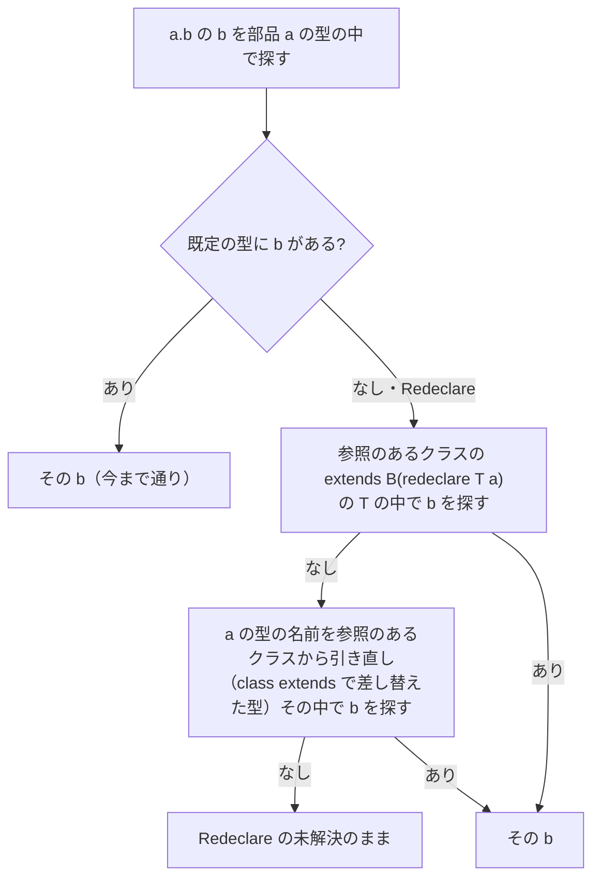

# S341 resolve の Redeclare

| | |
| --- | --- |
| セッション | S341 |
| 日付 | 2026-11-15 |
| ブランチ | `feature/s341-resolve-redeclare` |
| Phase | Track B（B2 の続き） |
| スライド | [slides.html](slides.html) |
| 作業記録 | `log/work/2026-11-15-s341-resolve-redeclare.md` |

## 1. 目的

`xtask diff-frontend` の resolve の列（未解決の参照が 0）が、MSL の例題 566 本のうち 99 本（未解決の参照 1330 件）と `GlobeModeValidation` の 1 本（13 件）で 0 にならない。理由はすべて `Redeclare` だった。S297 で flat は `redeclare`・`replaceable` を扱えるようになったが、`globe-mode-resolve` は差し替えた後の型を引かず、成分参照の続き（`a.b`）が既定の型に無いと `Redeclare` の未解決としていた。差し替えた後の型でも引いて、これを 0 にする。

## 2. 決定と理由

| 項目 | 決定 | 理由 |
| --- | --- | --- |
| 原因の確かめ方 | 99 本のクラスから、`diff-frontend` と同じ手順（入れ子のクラス・`extends`・部品の型をたどる）で未解決の参照を全部出し、形ごとに数えた | 1330 件がどの形かを先に分けないと、直しの範囲が決まらない |
| 部品の再宣言 | `extends B(redeclare [final] T x [(…)] [constrainedby C])` を `globe-mode-syntax` の AST（`RedeclaredComponent`）に取り出し、`PathRef::comp_redecls` に持つ。成分参照の続きが既定の型で引けないとき、参照のあるクラスの受け継ぎを外側から（外側が勝つ）たどって `x` を差し替えるものを探し、`T`・`C` の順にその型の中で続きを引く | `internalThermalPort.heatPortRotorWinding`（`redeclare final …ThermalPortIMC internalThermalPort`）・`cellData.nRC`（`redeclare …TransientData.CellData cellData`）の形。flat の S297 と同じ考え方 |
| 型の名前の見直し | 参照のあるクラスが部品の持ち主を受け継ぐとき、部品の型の名前を参照のあるクラスから引き直し、その型の中で続きを引く | Media の `state.T`・`state_a.p` は、型 `ThermodynamicState` が基底では空の `replaceable record` で、受け継いだ側の外側のパッケージが `redeclare record extends ThermodynamicState` で差し替えているため |
| 順序 | 既定の型で引けたものは変えない。差し替えた型は引けないとき（理由が `Redeclare` のとき）だけ使う | 回帰 0 を保つ。flat は先頭で止める `resolve_head` と型名だけを使うので、結果が変わらない。LSP の定義ジャンプの突き合わせも保つ |

詳しくは [ADR-0039](../../adr/0039-native-cst-parser.md) の付記（S341）。

## 3. 図



## 4. 再現手順

```bash
cargo test -p globe-mode-resolve -p globe-mode-syntax -p globe-mode-flat -p globe-mode-lsp
cargo test -p globe-mode-resolve --test resolve msl_stats -- --ignored --nocapture   # MSL 全体の未解決（既定は data/msl）
mise run msl:diff-frontend    # release、約 9 分、最大 RSS 5.8 GiB
```

## 5. 数字

MSL の例題 566 本（S334 → S341）: resolve 467/566 → 566/566、未解決の参照の総数 1330 → 0。`GlobeModeValidation` 75 本: resolve 74/75 → 75/75、未解決の参照 13 → 0。ほかの段（flat・dae）は変わらない。回帰 0。MSL の全 `.mo`（2556 本、参照 161869 件）の成分参照の続き 45463 件は、S275 に残った 639 件の `Redeclare` が 0 になり、すべて解決する。

## 6. 次回

- 部品の修飾の中の部品の再宣言 `A a(redeclare T x)`（MSL の例題には出ていない）。
- LSP の補完（`members_of`）は、`state.` の候補を既定の型の要素のままにしている。差し替えた型の要素を出すか。
- 差し替えの条件は名前と受け継ぎだけ。型の差し替えの正しさ（差し替え先が `constrainedby` に合うか）は見ていない。
