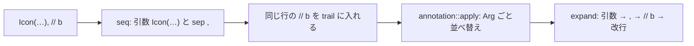

# S343 引数の行コメントと整形

| | |
| --- | --- |
| セッション | S343 |
| 日付 | 2026-11-15 |
| ブランチ | `feature/s343-fmt-annotation-comment` |
| Phase | 整形（`globe-mode-fmt`） |
| スライド | [slides.html](slides.html) |
| 作業記録 | `log/work/2026-11-15-s343-fmt-annotation-comment.md` |

## 1. 目的

issue #63「annotation の引数を並べ替えると、後ろの行コメントのせいで `,` が次の行の頭に出る」を直す。S226（2026-11-08）では「コメントを引数にぶら下げる作りの変更になる」ので見た目だけのために入れないと決めていた。この WP で、その作りの変更を最小の形（`Arg` に 1 つの欄）で入れた。

## 2. 決定と理由

| 項目 | 決定 | 理由 |
| --- | --- | --- |
| 持ち方 | `layout::Arg` に `trail: Vec<Token>`（引数と同じ行の末尾の行コメント）を足す | 並べ替えは `Arg` ごと動かす（`sort_by_key`）ので、欄を 1 つ足せばコメントは引数と一緒に動く。`flatten`・`flat_into`・`expand` に数行ずつ |
| 入れる所 | 木を作る `seq` で、(1) 区切り（`,` `;`）の直後の同じ行の行コメント（`newlines_before == 0`）、(2) 引数の末尾の行コメント（`,` の前にあったもの）を `trail` に移す | (1) は今まで次の引数の頭に付いていた。(2) は `,` がコメントの後ろに出る原因 |
| 描画 | 引数 → `,` → コメントの順。コメントの後ろは必ず改行 | 行コメントは行末までなので、続きは次の行 |
| 1 行に収める判定 | `trail` があれば収めない | 行コメントの後ろに `)` などを続けると、コメントに飲まれる |
| 範囲 | annotation に限らず、すべての括弧の引数 | 原因が `layout` の木の作り方にあり、`annotation` だけに直しを入れる方が大きくなる。`src/Modelica` に `, //` は無く、MSL でも 1 ファイルだけ |
| 対象外 | コメントだけの行にあるコメント、引数と同じ行のブロックコメント | 次の引数の頭に付いたまま（今までと同じ）。依頼の範囲は「後ろの行コメント」 |

## 3. 図



## 4. 再現手順

```bash
# 前（main）と後（この feature）で同じ入力を通す
cat > /tmp/a.mo <<'EOM'
model M "m"
  Real x;
  annotation(
    Documentation(info = "d"), // a
    Icon(graphics = {}), // b
    experiment(StopTime = 1) // c
  );
end M;
EOM
globe fmt - < /tmp/a.mo
cargo test -p globe-mode-fmt trailing_line_comments
globe fmt --check src/Modelica
```

後の出力は `experiment(StopTime = 1), // c` / `Icon(graphics = {}), // b` / `Documentation(info = "d") // a`。`,` がコメントの前にあり、もう 1 回通しても変わらない。

## 5. 次回

- コメントだけの行にあるコメント（`// このアイコンは…` が次の引数の前の行）は、次の引数の頭に付く。そういう引数は名前で位置を決められず、並べ替えでは「その他」（後ろ）に回る。直すなら `annotation::position_in` が先頭のコメントを飛ばす（1 行）。
- 引数と同じ行のブロックコメント（`a, /* x */`）は今までどおり。
