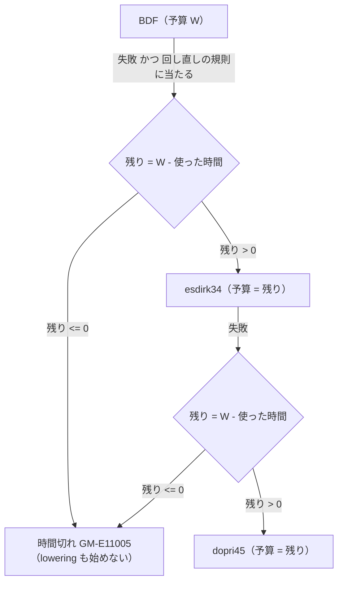

# S344 ソルバの予算と回し直しの issue（#6・#46・#45・#4）

| | |
| --- | --- |
| セッション | S344 |
| 日付 | 2026-11-15 |
| ブランチ | `feature/s344-solver-budget-issues` |
| Phase | P3（実行系） |
| スライド | [slides.html](slides.html) |
| 作業記録 | `log/work/2026-11-15-s344-solver-budget-issues.md` |

## 1. 目的

open のソルバの issue 4 件を、直す前に自分で再現してから扱う。

- #6: `auto` は回し直しにも時間の予算をまるごと渡し、制限のほぼ 2 倍走る。
- #46: ネイティブの dopri45 は lowering を 2 回、`auto` の回し直しは最大 3 回やり、lowering は予算の外でトークンでも止まらない。
- #45: 型付きの BDF が初期化を 3 回解く。
- #4: tsit45 で試しの点が 1 つ断られると、刻みを縮めずに実行全体が失敗する。

#6 と #46 は「予算とキャンセル」の話なので、残りの時間を回し直しに引き継ぐ最小の変更でまとめて直す。

## 2. 決定と理由

| issue | 再現 | 扱い | 理由 |
| --- | --- | --- | --- |
| #6 | する（`run_auto` が回し直しに `opts` をそのまま渡す。実機の `TwoMass` の測定は機械の負荷で ±1 s 揺れて決め手にならず、単体試験が再現） | **直した**（[ADR-0041](../../adr/0041-auto-remaining-budget.md)。ADR-0028 (c) を改めた） | 残り = 予算 − それまでの組み立てと実行の時間。残りが 0 以下なら回し直さず時間切れ（`GM-E11005`）で返す |
| #46 の予算・キャンセル | する | **一部直した**（#6 と同じ変更 + 放置したスレッドにトークンを渡す） | 予算が尽きたあとの回し直し（と lowering）は始めない。呼び手が止めたあとのスレッドも、段の境目と回し直しの前で止まる |
| #46 の lowering の回数 | する（コードの読み） | 直さない | ネイティブの dopri45 の 2 回は `rk45::simulate_artifact` が `pub(crate)` で、lowering 済みを渡す口が Rumoca に無い（rev 276e82bd・9c8c56f）。session の道に替える案は #43 で測って取り消した（EngineV6 が時間切れになる） |
| #45 | する（コードの読み） | 直さない | 2 回目の呼び出し（`check_prepared_initialization`）が「初期化」の段の目印で、外すと BDF の始動の失敗が積分の失敗に混ざり、`auto` が切り替わる（#5・ADR-0014 の付記の分類） |
| #4 | する（別のモデルでも） | 直さない | issue の案（刻みを 1/4 ずつ縮めて出し直す）を実装して試したが救えない。`step()` は `Err` を返さず、受理した点を host の射影が評価できない（S193 と同じ、上流の候補 13・09） |

### #6 の変え方

`run_auto` に壁時計の予算 `max_wall` を渡し、回し直しの閉包は残りの予算を受け取る。

```text
spent = ここまでの build_seconds + run_seconds   （lowering も引く。保守的）
残り  = max_wall - spent
残り <= 0 → 回し直さず、結果を時間切れ（SimError::Timeout）にして返す
それ以外 → 残りを max_wall_seconds にした SimOptions で回し直す
```

- 0 以下を Rumoca の `max_wall_seconds` に渡すと「予算なし」になるので、渡さずにここで止める（`rumoca-solver` の `runtime/timeout.rs` が有限で正の値だけを予算にする）。
- 時間切れで返すのは、msl-sim の「時間切れ（`GM-E11005`）を予算 180 s で回し直す」に乗せるため。ADR-0028 (c) の最初の試し（run 41282411061）は、残りが無いときに BDF の失敗のまま返したとみられ【未確認】、`LightningSegmentedTransmissionLine` が回し直されなかった。
- wasm32 は壁時計を測らない（`Stopwatch` が 0 秒）ので、渡す予算は変わらない。

### ADR-0017 との関係

msl-sim の回し直し（予算 180 s、外から止めるのは 240 s）と lowering の段の上限（150 s）は変えない。変わるのは、`auto` が BDF の失敗のあとに予算をもう一度まるごと持つことがなくなり、「外から停止」と記録されていたものが時間切れとして記録されること。lowering は Rumoca の予算の外のままなので、重い lowering の歯止めは ADR-0017 の外からの停止のまま。ADR-0017 の結果の節に付記した。

## 3. 図



## 4. 再現手順

```bash
export CARGO_TARGET_DIR=…/.git-worktree/target-shared CARGO_BUILD_JOBS=2
cargo test -p globe-mode-exec --lib auto_hands_the_remaining_budget   # #6・#46（単体試験）
# 実機: BDF が失敗する TwoMass（data/msl が要る）
globe simulate -L data/msl -m Modelica.Thermal.FluidHeatFlow.Examples.TwoMass --solver auto --timeout 0.2 -o /dev/null
#   → 時間切れ GM-E11005 だけ（回し直した旨の info は出ない）
globe simulate -L data/msl -m Modelica.Thermal.FluidHeatFlow.Examples.TwoMass --solver auto --timeout 60 -v -o /dev/null
#   → BDF → esdirk34 → dopri45 で終了（GM-I11003・GM-I11002）
```

#4 の再現（直さなかった根拠）: Rumoca の `SplitCircleChart.mo` の `vy(start = 3)` を `--solver tsit45 --stop-time 20 --tolerance 2e-2` で回すと `GM-E11002`。BDF は通る。

## 5. 次回

- 全例題の CI（`msl-sim.yml`）の結果の読み: ADR-0041 の「結果」と作業記録。
- #46 の lowering の回数: Rumoca の `rk45::simulate_artifact` を公開する（lowering 済みの成果物を渡す口）、または `run_prepared_simulation` が初期化済みの状態を受け取る口（#45）を上流に頼む。
- #4: プラグインが chart の切り替えをどう扱うか（受理した点の評価）。S193 の「次回」と同じ。
