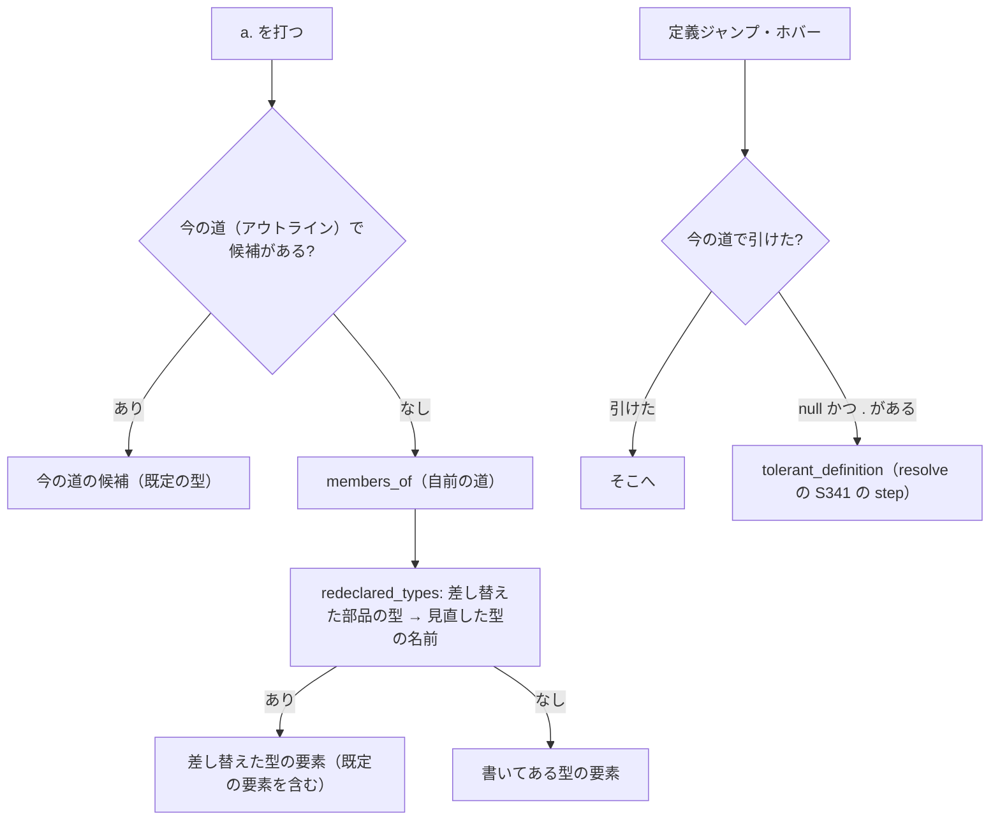

# S345 LSP の補完・定義ジャンプ・ホバーと、差し替えた後の型

| | |
| --- | --- |
| セッション | S345 |
| 日付 | 2026-11-15 |
| ブランチ | `feature/s345-lsp-complete-redeclare`（`feature/s341-resolve-redeclare` から切った） |
| Phase | Track B（B2 の続き。製品へのつなぎ） |
| スライド | [slides.html](slides.html) |
| 作業記録 | `log/work/2026-11-15-s345-lsp-complete-redeclare.md` |

## 1. 目的

S341 で `globe-mode-resolve` の `step` が、差し替えた後の型（Media の `redeclare record extends ThermodynamicState`、`extends B(redeclare T x)` の部品の再宣言）を引けるようになった（[S341 の解説書](../S341-resolve-redeclare/解説書.md)、[ADR-0039](../../adr/0039-native-cst-parser.md) の付記 S341）。LSP の補完 `a.`（S279）は `members_of` が部品の宣言の型で引くので `state.` の候補が既定の型の要素のままで、読める文書の定義ジャンプ・ホバーは今の道（アウトライン）が既定の型で引いて `null` になっていた。LSP も S341 と同じ規則で差し替えた後の型へ飛び、要素を出す。

## 2. 決定と理由

| 項目 | 決定 | 理由 |
| --- | --- | --- |
| 規則の置き場 | `step` の中の「参照のあるクラスで差し替えた部品の型 → 参照のあるクラスから見直した型の名前」を `redeclared_types(ctx, c, k)` に切り出し、`step` と `members_of` が使う | LSP 側に規則を複製しない。補完と成分参照の解決が食い違わない。`step` は今まで通り既定の型で引けず `Redeclare` のときだけ使うので、resolve の数え方は変わらない |
| 補完（`members_of`） | 最後の名前が部品のとき、`redeclared_types` の先頭、無ければ書いてある型の要素を出す | 差し替えた型は既定の型を受け継ぐか制約の下位の型なので、既定の要素を含む。`step` と違って補完は「引けたら終わり」ではなく型を 1 つ選ぶので、差し替えた型を先にした |
| 書きかけの文書の定義ジャンプ・ホバー | 変えない | S296 から `Library::resolve` で引いているので、S341 の `step` で差し替えた型に飛ぶ（試験で確かめた） |
| 読める文書の定義ジャンプ・ホバー | 今の道が `null` で、名前に `.` があるときだけ、`tolerant_definition`（自前の道）で引き直す | 今の道は既定の型で引くので `null` になる。点のない `Real`・`time` で木（MSL で debug 8.8 秒・RSS 約 75 MB。S279 の計測。#107 のコメントは 0.6 s）を作らせない |
| 補完の今の道との順序 | 変えない（今の道で候補が 1 件でも出る間は自前の道に回さない） | 毎回木を作る費用を払わないため。MSL の `ThermodynamicState` のように既定の型が空なら、読める文書でも自前の道に回る |

## 3. 図



## 4. 再現手順

```bash
cargo test -p globe-mode-resolve --test resolve members_of_follows_redeclared_types
cargo test -p globe-mode-lsp --lib completion_and_definition_follow_redeclared_types
GLOBE_MSL=<main>/data/msl cargo test -p globe-mode-lsp --test resolve_compare -- --ignored --nocapture
```

## 5. 数字

@@NUMBERS@@

## 6. 次回

- 補完は今の道が 1 件でも候補を出す間は既定の型のまま。差し替えた型にだけある要素を出すには、自前の道の結果を足し合わせる必要があるが、木を作る費用を毎回払うことになる（木を先に作っておく・使うときだけ足す、のどちらにするか）。
- 持ち主を受け継がないクラスから見る `a.state.` のような 2 段先の差し替え、部品の修飾の中の `A a(redeclare T x)` は、S341 と同じく見ない。
- VS Code の拡張は触っていない（`globe lsp` の結果が変わるだけ）。
