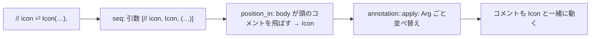

# S346 先頭のコメント行を持つ引数と整形

| | |
| --- | --- |
| セッション | S346 |
| 日付 | 2026-11-15 |
| ブランチ | `feature/s346-fmt-leading-comment` |
| Phase | 整形（`globe-mode-fmt`） |
| スライド | [slides.html](slides.html) |
| 作業記録 | `log/work/2026-11-15-s346-fmt-leading-comment.md` |

## 1. 目的

[S343](../S343-fmt-annotation-comment/解説書.md) の「次回」を直す。コメントだけの行にあるコメント（次の引数の前の行の `// このアイコンは…`）は、括弧の木（`layout::seq`）では次の引数の最初の字句になる。名前で並べる `annotation::position_in` は先頭の字句を見るので、そういう引数は名前を引けず「その他」（後ろ）に回り、`annotation(…)` の並べ替えから外れていた。

## 2. 決定と理由

| 項目 | 決定 | 理由 |
| --- | --- | --- |
| 直し方 | `annotation.rs` に `body`（引数の中身から頭のコメントを除いた節）を足し、`position_in` と `arg_name` が `body` から名前を引く | 並べ替えは `Arg` ごと動かすので、名前さえ引ければコメントは引数と一緒に動く。`layout.rs` は変えない |
| 範囲 | `annotation(…)`・`Documentation(…)`（`position_in`）と、図形プリミティブ（`arg_name`）。lint の `annotation-order` は `position_in` を使うので同じ | `arg_name` は同じ「先頭の字句を見る」で、先頭にコメントがあると「名前のない引数」とみなして図形全体の並べ替えと `origin` の補完をやめていた |
| コメントの種類 | 行コメントもブロックコメントも飛ばす（`Token::is_comment`） | コメントだけの行のブロックコメントも同じ形で次の引数の頭に付く |
| 対象外 | 字下げ、`Documentation` の `info = "…"` の HTML 整形 | 字下げは `layout::push_token` の「行コメントの次は 1 段深く」の規則で、引数の頭のコメントにも効く（今までと同じ。直すと整形の出力が全体で変わる）。HTML 整形は `mark_html` が引数を `[名前, =, 文字列]` の 3 字句で見ており、頭にコメントがあると外れる（並べ替えが外れていたころと同じで、退行ではない） |

## 3. 図



## 4. 再現手順

```bash
cat > /tmp/a.mo <<'EOM'
model M "m"
  Real x;
  annotation(
    // doc
    Documentation(info = "d"),
    // icon
    Icon(graphics = {}),
    // exp
    experiment(StopTime = 1)
  );
end M;
EOM
globe fmt - < /tmp/a.mo
cargo test -p globe-mode-fmt leading_line_comments
globe fmt --check src/Modelica
```

前（main）は 3 つの引数とも元の順のまま（`Documentation` → `Icon` → `experiment`）。後は `experiment` → `Icon` → `Documentation` の順で、各コメントが引数の前の行に付いてくる。もう 1 回通しても変わらない。

## 5. 次回

- コメントだけの行にあるコメントの次のトークンが 1 段深く字下げされる（`// c` の次の行の `Icon(…)`）。コメントが行頭なら次のトークンは同じ段に置くのが自然だが、`layout::push_token` の規則を変えると、括弧の引数すべての出力が変わる。
- `Documentation` の `info = "…"` は、頭にコメントがあると HTML 整形されない（`mark_html`）。
- 引数と同じ行のブロックコメント（`a, /* x */`）は今までどおり。
