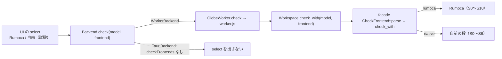

# S347 wasm とブラウザの UI から native の検査を選ぶ

| | |
| --- | --- |
| セッション | S347 |
| 日付 | 2026-11-15 |
| ブランチ | `feature/s347-native-check-wasm-ui` |
| Phase | Track B（自前コア）の製品へのつなぎ |
| スライド | [slides.html](slides.html) |
| 作業記録 | `log/work/2026-11-15-s347-native-check-wasm-ui.md` |

## 1. 目的

S305 の `globe check --frontend native`（自前の parse → resolve → flat → dae。S0〜S6）は、S313 で facade の `Workspace::check_with`・LSP の `[check] frontend = "native"`・Python の `check(model, frontend="native")` から選べるようになったが、wasm と UI からは選べなかった（[ADR-0039](../../adr/0039-native-cst-parser.md) の付記 S313 の持ち越し。「wasm のビルドの大きさの測定が先」）。ブラウザ（と Android）の UI から選べるようにする。既定は Rumoca のまま。

## 2. 決定と理由

| 項目 | 決定 | 理由 |
| --- | --- | --- |
| wasm に入れるか | 測って、**既定の feature に入れた**（`globe-mode-wasm` の `default = ["native"]`） | `wasm-bindgen` 後の `.wasm` は 19,242,637 → 19,597,599 バイト（+354,962、+1.84%）、gzip -9 は 5,891,577 → 5,998,898（+107,321、+1.82%）。外部依存は増えない。小さいので止めて聞く理由が無い。既定に入れると CI・android・web・release の wasm の組み方（`cargo build -p globe-mode-wasm`）を変えずに済む |
| wasm の口 | 新しいメソッド `Workspace.check_with(model, frontend)`。`check(model)` は変えない | facade の `check` / `check_with` の組と同じ名前。既存の呼び出し（試験・Worker・smoke）が 1 つも変わらない。知らない名前は例外 |
| Worker・client | `check({model, frontend})`、`GlobeWorker.check(model, frontend?)` | `frontend` を省くと `check`（Rumoca）に落ちる |
| UI の置き場所 | 検査ボタンの横に select「Rumoca / 自前（試験）」（`aria-label="検査のフロントエンド"`） | 検査にだけ効く選択なので、実行の設定（`SimSettings`）ではなく検査のボタンの隣。FMI の版の select と同じ作り |
| Desktop | select を出さない（`Backend.checkFrontends` を持つ実行環境だけ） | sidecar の LSP `globe/check` は `frontend` を取らない。取らない要求に選択を出すと黙って Rumoca になる。LSP は S345 と並行なので触っていない |
| ブラウザの MSL | native から見えないので、名前が引けない診断（`GM-E1001`・`GM-E1002`）に注を足す | MSL を使うモデルを native で検査すると、モデルが正しくても名前の誤りに見える。診断の種類は変えず、注で Rumoca へ誘う |
| 表示 | native で検査したら Rust の要約を 1 行（`data-native-note`）。`GM-U0006` の原文の見出しは「自前の段の原文」 | 通っても診断が空になるので、どちらで検査したか・S7 以降は見ていないことが分かる文が要る。文は Rust が作る（UI に業務ロジックを置かない） |

## 3. 図



## 4. 再現手順

```bash
export CARGO_TARGET_DIR=<main>/.git-worktree/target-shared CARGO_BUILD_JOBS=2
cargo test -p globe-mode-wasm                 # check_with_selects_the_frontend
mise run wasm:node                            # smoke.mjs: check_with(Decay, "native") と「知らない名前は例外」
node src/Rust/mod/globe-mode-wasm/web/worker-node.mjs   # Worker 越しの frontend
mise run wasm:compare
mise run ui:check                             # svelte-check・build・test_ui.py（check_frontend_select）
```

大きさの測り方は [ADR-0039](../../adr/0039-native-cst-parser.md) の付記 S347。

## 5. 次回

- Desktop の UI: LSP の `globe/check` が `params.frontend` を読むようにして、`TauriBackend` が `check(model, frontend)` で渡し `checkFrontends = true` にする（S345 の後）。
- ブラウザで MSL を読んだワークスペースは、native から MSL のクラスが見えない（ライブラリのファイルが DB の外の `Checker` にあるため。S313 と同じ制限）。`ChuaCircuit` は native で `GM-E1002` になるので、facade が `GM-E1001`・`GM-E1002` に「native はライブラリのクラスを見られない。Rumoca で確かめる」の注を足した（`with_library_sources` のワークスペースだけ）。見せるには facade が MSL の本文の写しを持つ必要があり、今回はやらない。
- `simulate`・BLT・段・グラフは Rumoca のまま。
