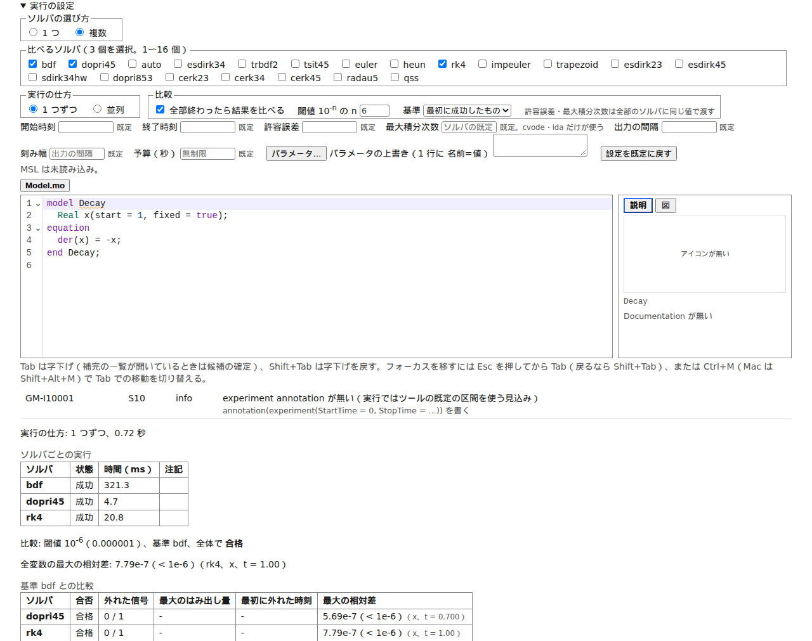

# S348 複数ソルバの結果を実ブラウザで通す

| | |
| --- | --- |
| セッション | S348 |
| 日付 | 2026-11-15 |
| ブランチ | `feature/s348-many-ui-e2e` |
| Phase | P8（UI の確認） |
| スライド | [slides.html](slides.html) |
| 作業記録 | `log/work/2026-11-15-s348-many-ui-e2e.md` |

## 1. 目的

S323・S327・S328 の複数ソルバの比較（[ADR-0040](../../adr/0040-multi-solver-compare.md)）について、レビュー第 5 回が「`ManyResult` を実ブラウザで見ていない」と残した。S323 の `multi_solver`（Decay を bdf・rk4・euler で）は表の存在と列の数までしか見ておらず、画面を人の目で見てはいなかった。ブラウザ版（wasm の `WorkerBackend`）で、設定から結果の表までを本物の Chromium で通す試験を `test_ui.py` に 1 本足し、スクリーンショットを撮って目で確かめ、見つかった不具合を最小の修正で直す。

## 2. 決定と理由

| 項目 | 決定 | 理由 |
| --- | --- | --- |
| 試験の置き場 | `src/Svelte/tests/test_ui.py` の `many_result_view`（`multi_solver` の次に呼ぶ） | 既存の UI 試験の形（Playwright・`dist/` を localhost で配る・console の error は失敗）に合わせる |
| 通す内容 | 選ぶ前の既定（1 つずつ・比較 off・何も選ばない・n = 6）、Decay を bdf・dopri45・rk4 で比較 on・閾値 6 で回す、並列にして回し直す | 依頼の「既定は逐次」「自動で比べる既定は false」を実画面で確かめる。S323 の試験と違う組（dopri45）で、n を入力欄に打つところまで通す |
| 表の確認 | 実行の表 3 行（`bdf:ok`・`dopri45:ok`・`rk4:ok`、一覧の順）、比較の表 2 行（基準 bdf 以外）、全体の合否は行の合否の AND、「全変数の最大の相対差」は行の最大と等しい | 値が出ているだけでなく、表と見出しの行が食い違わないことを見る。合否の値そのもの（Decay で rk4 が 7.79e-7）は閾値 1e-6 に近く、ソルバの既定が変わると変わるので固定せず、書式と整合だけを見る |
| 並列 | 並列を選ぶと欄に「ブラウザでは 1 つずつ回す」、結果に「1 つずつ」と `mode_note`（「スレッドが無いので、逐次に回した」）が出る | wasm は並列を頼まれても逐次に落ちる（ADR-0040）。応答の `mode_note` が画面に届くことまで確かめる |
| 表示崩れの検出 | 設定欄の `label` の外接矩形が複数（行をまたいで折り返した）でないこと、横にはみ出さないこと | 画面で見つけた崩れを試験に残す。修正を戻すと落ちることを確かめた |
| スクリーンショット | 環境変数 `GM_UI_SHOT` に PNG のパスを渡すと、設定から比較の表までを撮る | 試験が doc/ に書き込まないように、撮るときだけ渡す |

### 見つかったこと

| 現象 | 判断 |
| --- | --- |
| **直した**: 設定欄の `label`（欄の名前・入力欄・出どころ）がインラインで、行の端で名前と入力欄が別の行に泣き別れる（「開始時刻」の入力欄が次の行の頭、「刻み幅」「予算（秒）」、チェックボックスの箱と名前 `sdirk34hw` など。幅 1280 でも 3 か所、390 では 9 か所）。複数のとき、チェックボックスの列と `fieldset` が増えて折り返しが目立つ | `SimSettings.svelte` の `.settings label` に `display: inline-block` を足した 1 行。ラベル全体が 1 つの塊として折り返す。幅 390 でも横にはみ出さない |
| 直さない: 「複数」を選んだ直後、ワーカーからソルバの一覧が届くまでの間はチェックボックスが空で、「比べるソルバを 1 つ以上選ぶ」の警告が出る | 一覧は wasm の初期化のあとに届く。選ぶ前の警告は仕様どおり（0 個で実行できない）。選択の既定（何も選ばない）は依頼に書かれていないので変えない |
| 確かめた（要望どおり）: 実行の仕方の既定は「1 つずつ」、比較は off、n は 6、基準は「最初に成功したもの」、ソルバは 3 つ以上選べる（上限 16） | 変更なし |
| 確かめた: 比較の表は基準を除く行だけ（3 つ選んで 2 行）で、基準は見出しとキャプション（「基準 bdf との比較」）に出る。実行の表には 3 行とも出る | 変更なし。基準自身との比較は意味がない |

## 3. 図



Decay を bdf・dopri45・rk4 で、比較 on・閾値 10^-6 で回した画面（Chromium、幅 1280）。上が設定（ソルバのチェックボックス・実行の仕方・比較・数値の欄。名前と入力欄が離れない）、下が実行の表（3 行・成功）と比較の表（基準 bdf との 2 行・合格・最大の相対差 5.69e-7 と 7.79e-7、どちらも `< 1e-6`）。

```text
SimSettings（複数・n = 6）→ App.simulateMany → WorkerBackend（wasm・逐次）
  → ManyResult（実行の表 3 行・比較の表 2 行・最大の相対差）
  → Plot（x [bdf]・x [dopri45]・x [rk4] の 3 本）
```

## 4. 再現手順

```bash
cd src/Svelte && pnpm install --frozen-lockfile && pnpm build   # 先に mise run wasm:build
cd ../..
uv run python src/Svelte/tests/test_ui.py   # many_result_view を含む。全体で数分
# 結果の画面を撮る（この解説書の図）。test_ui.py の中の関数だけを回すには import して browser を渡す
GM_UI_SHOT=doc/sessions/S348-many-ui-e2e/many-result.png uv run python -c \
  "import sys; sys.path.insert(0, 'src/Svelte/tests'); import test_ui as t; from playwright.sync_api import sync_playwright; t.click_without_stable(); s = t.serve(); o = f'http://127.0.0.1:{s.server_port}/'; p = sync_playwright().start(); b = p.chromium.launch(); t.many_result_view(b, o, []); b.close(); p.stop()"
```

## 5. 次回

- Desktop（sidecar の並列）の実機での画面は未確認。
- 複数のときの「それでも実行する」・ソルバごとの許容誤差（S323 の持ち越しのまま）。
- 表示崩れの検査は設定欄の `label` だけ。結果の表の幅・狭い画面での折り返しは見ていない（幅 390 で横にはみ出さないことだけ確かめた）。
