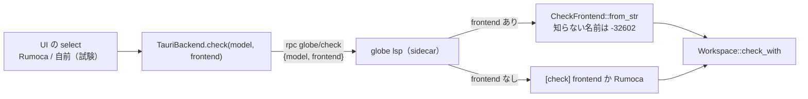

# S349 Desktop の UI から native の検査を選ぶ

| | |
| --- | --- |
| セッション | S349 |
| 日付 | 2026-11-15 |
| ブランチ | `feature/s349-native-check-desktop` |
| Phase | Track B（自前コア）の製品へのつなぎ |
| スライド | [slides.html](slides.html) |
| 作業記録 | `log/work/2026-11-15-s349-native-check-desktop.md` |

## 1. 目的

S347 でブラウザ・Android の UI から、検査に native（自前の段。S0〜S6）を選べるようにしたが、Desktop（Tauri の sidecar の LSP）は `globe/check` が `frontend` を取らないので select を出さなかった（[ADR-0039](../../adr/0039-native-cst-parser.md) の付記 S347）。LSP が `params.frontend` を読み、`TauriBackend` が渡して、Desktop でも選べるようにする。既定は Rumoca のまま。

## 2. 決定と理由

| 項目 | 決定 | 理由 |
| --- | --- | --- |
| LSP の params | `globe/check` は `{model, frontend?}`。`frontend` は `"rumoca"`・`"native"` | facade の `CheckFrontend::from_str`（CLI の `--frontend`、wasm の `check_with` と同じ名前）をそのまま使う |
| `frontend` が無いとき | `globe-mode.toml` の `[check] frontend`、それも無ければ Rumoca | `publishDiagnostics` と同じ決め方。`frontend` を渡さない古い呼び出しは、設定が無ければ今までと同じ |
| 知らない名前 | -32602（`params.model` が文字列でないときと同じ） | 黙って Rumoca にしない（S347 が「取らない要求に選択を出すと黙って Rumoca になる」を避けたのと同じ理由）。文字列でない値も同じ |
| protocol の型 | 変えない | `globe-mode-protocol` に検査の要求の型は無い（応答の `CheckResponse` だけ）。TS の `CheckFrontend` は S347 のまま |
| UI | `TauriBackend.check(model, frontend?)` が `params.frontend` に乗せ、`checkFrontends = true` | S347 の select と要約の 1 行がそのまま出る。Svelte に業務ロジックを置かない |
| VS Code | 変えない | 拡張は `globe/check` を使わない |

## 3. 図



## 4. 再現手順

```bash
export CARGO_TARGET_DIR=<main>/.git-worktree/target-shared CARGO_BUILD_JOBS=2
cargo test -p globe-mode-lsp --lib check_selects_the_frontend
node src/Svelte/tests/test_tauri.mjs
mise run ui:check        # svelte-check・build・test_ui.py（check_frontend_select）
```

## 5. 次回

- 実機の Desktop（Tauri）での目視は【未確認】（偽の `window.__TAURI__` と LSP の単体試験まで）。
- Desktop の「検査」ボタンは、select が `rumoca` のあいだは `[check] frontend = "native"` を使わない（select が最初から `rumoca` を渡すため）。エディタの波線の診断は設定どおり。
- `simulate`・BLT・段・グラフは Rumoca のまま。ブラウザで MSL を読んだワークスペースが native から見えない制限は S347 のまま。
