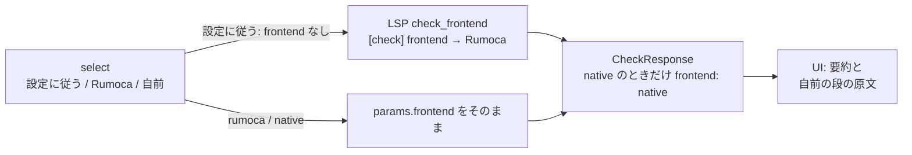

# S350 検査の select の既定を「設定に従う」に

| | |
| --- | --- |
| セッション | S350 |
| 日付 | 2026-11-15 |
| ブランチ | `feature/s350-frontend-select-default`（base は `feature/s349-native-check-desktop`。S349 が main に未着だったため） |
| Phase | Track B（自前コア）の製品へのつなぎ |
| スライド | [slides.html](slides.html) |
| 作業記録 | `log/work/2026-11-15-s350-frontend-select-default.md` |

## 1. 目的

S347・S349 で検査ボタンの横に「Rumoca / 自前（試験）」の select ができたが、Desktop では select が最初から `rumoca` を渡すため、`globe-mode.toml` の `[check] frontend = "native"` があっても、select を変えない限り「検査」ボタンは Rumoca で検査した（エディタの波線の診断は設定どおり native）。select に「設定に従う」を足して既定にし、それを選んでいるあいだは `frontend` を渡さない。

## 2. 決定と理由

| 項目 | 決定 | 理由 |
| --- | --- | --- |
| select | 「設定に従う（`config`）/ Rumoca / 自前（試験）」、既定は設定に従う | 波線と「検査」ボタンが同じ設定に従う |
| 渡す値 | 設定に従うあいだは `check(model)`（`frontend` なし） | S349 の LSP が、無ければ `[check] frontend` → Rumoca の順で決める。UI に設定の読み方を置かない |
| ブラウザ・Android | 設定ファイルが無いので「設定に従う」は Rumoca と同じ。select の形は変えない | `WorkerBackend` は `frontend` なしで Rumoca。実行環境ごとに選択肢を変えると Backend の印が増える |
| 応答の `frontend` | `CheckResponse` に、自前の段で検査したときだけ `"native"` を足した（`native_response` が付ける） | 設定に従った結果が native かを UI が知らないと、要約を出せず、`GM-U0006` の原文の見出しが「Rumoca の原文」になる。S349 は型を変えなかったが、足すのは欄 1 つで、Rumoca の応答は変わらない |
| 要約を出す条件 | 選んだ値が `native`、または応答の `frontend` が `native` | 応答に `frontend` が無い古い wasm・sidecar でも、自前を選んだときの要約は今までどおり出る |

## 3. 図



## 4. 再現手順

```bash
export CARGO_TARGET_DIR=<main>/.git-worktree/target-shared CARGO_BUILD_JOBS=2
cargo test -p globe-mode-lsp --features native --lib -- config_frontend_native check_selects
cargo test -p globe-mode --features native --test check_with
node src/Svelte/tests/test_tauri.mjs
(cd src/Svelte && pnpm check && pnpm build)
uv run python src/Svelte/tests/test_ui.py   # check_frontend_select（Desktop は偽の window.__TAURI__）
```

## 5. 次回

- 実機の Desktop（Tauri）での目視は【未確認】（偽の `window.__TAURI__` と LSP の単体試験まで）。
- `simulate`・BLT・段・グラフは Rumoca のまま。ブラウザで MSL を読んだワークスペースが native から見えない制限は S347 のまま。
- 正典: [ADR-0039](../../adr/0039-native-cst-parser.md) の付記 S350（S349 の「select が最初から `rumoca` を渡す」の注を直した）。
