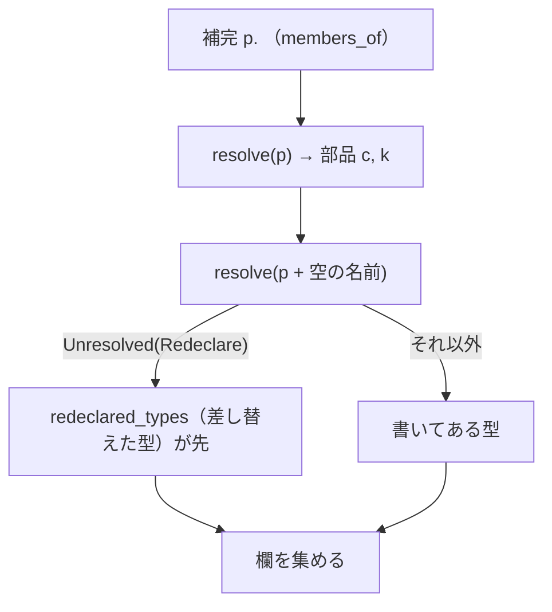

# S351 第 6 回のレビューの修正（#132・#133・#134）

| | |
| --- | --- |
| セッション | S351 |
| 日付 | 2026-11-15 |
| ブランチ | `feature/s351-review6-fixes`（base は main） |
| Phase | Track B（B2 の補完・B4 の数え方）と P6（Android のパック） |
| スライド | [slides.html](slides.html) |
| 作業記録 | `log/work/2026-11-15-s351-review6-fixes.md` |
| レビュー履歴 | `log/review/2026-11-15-s337-s350-review6.md` |

## 1. 目的

5 回目のレビューの後の変更（S337・S340〜S349）を見た第 6 回のレビューが、3 件の issue を立てた。1 件ずつ、直す前に自分で再現して、指摘どおりなら直す（再現しない・誤りなら直さず根拠を issue に書く）。3 件とも再現し、指摘どおりだった。

| issue | 重さ | 直した所 |
| --- | --- | --- |
| #132 | Should | `globe-mode-resolve` の `members_of`（補完） |
| #133 | Should | `globe-mode-dae` の `build`（方程式の数え方） |
| #134 | Nice | `globe-mode-wasm/web/worker.js` の `fetchChunks`（Android のパック） |

## 2. 決定と理由

| 項目 | 決定 | 理由 |
| --- | --- | --- |
| #132 の門 | `members_of` は、`scope` で引いた参照に空の名前を足した参照（`p.` の続き）を `resolve` に引かせ、結果が `Unresolved(Redeclare)` のときだけ `redeclared_types` を先にする。それ以外は書いてある型 | S341 の `step` が「既定の型で続きの名前が引けず `Redeclare` になる」ときだけ差し替えた型を使うのと**同じ判定**にするため。道の途中の `extends` の `redeclare`・型の `replaceable` を `members_of` に書き写さず、`step` に答えさせる（規則の複製を避ける。S345 の方針と同じ） |
| #132 の案 | レビューの案 1（`replaceable` か `Walk.redecl` のとき）を、`resolve` への問い合わせで実現した | `Walk` は `resolve_path` の中にあり `members_of` から見えない。判定を書き写すと `step` と食い違う |
| #133 の展開 | `record_leaves` が、`t.` の欄（スカラーのレコード）で引けなかったときだけ、`t[k].x` の変数すべてを集める（`array_leaves`）。`t` が変数そのもの・末尾が `]` のときは対象外 | flat の `count` は S337 で Rumoca の数に合わせてあるので変えない。DAE だけが欄の変数の数（要素 × 欄のスカラー）で数える。既存の `t.` の展開は `count == 1` のときだけのまま |
| #133 の長さ 1 | `Complex aw[1]` の `aw = {…}`（flat の数 1）も 2 本と数える | `array_leaves` は `count` を見ないので、`leaves_of` が空のときの手段として同じ道を通る |
| #134 の捨て方 | 壊れた塊（JSON が読めない）と索引に合わない塊（`missing`）のときに `lazy.blob = null` | 取れなかったときの捨て方（S340）と同じ。次の呼び出しがパックを取り直す。c/*.json の束は `getText` を毎回呼ぶので変えない |

## 3. 図



## 4. 再現手順

```bash
cargo test -p globe-mode-resolve --test resolve members_of
cargo test -p globe-mode-lsp --lib completion_and_definition_follow_redeclared_types
cargo test -p globe-mode-dae record_array_equation_counts_per_field
node src/Rust/mod/globe-mode-wasm/node/broken-chunks.mjs        # CARGO_TARGET_DIR の wasm-pkg/web が要る
```

## 5. 数字

- 試験: `cargo test -p globe-mode-resolve --test resolve`（9 本 pass・2 本 ignored。新規 `members_of_ignores_unrelated_same_name_types`）、`cargo test -p globe-mode-dae`（15 本 pass。新規 `record_array_equation_counts_per_field`）、`cargo test -p globe-mode-frontend -p globe-mode-lsp`（全部 pass。lsp の lib は 73 本 pass・1 ignored で、`completion_and_definition_follow_redeclared_types` を含む）。`node src/Rust/mod/globe-mode-wasm/node/broken-chunks.mjs` は壊れたパックの節を含めて通る。clippy（resolve・dae・lsp の `--all-targets -D warnings`）0 件、`cargo fmt --all --check` 差分なし。新しい 3 本の試験は、直す前なら落ちる（#132 は `x` が出る、#133 は 8 に対し 5、#134 は `The blob could not be read`）。
- `msl:diff-frontend` 相当（ビルド直後に写した `xtask`、`flock` の下。582 s、最大 RSS 5.7 GiB）: MSL の例題 566 本と `GlobeModeValidation` 75 本の表は、main の `doc/frontend-diff.md` と**全行同じ**（resolve 566/566、flat 471/566・Rumoca も通った 463/471・名前 463/463・方程式の数 452/463、DAE 471/471、Rumoca の釣り合いまで通った 334 本で判定・数・状態・正則とも 334/334。検証 75 本は resolve 75/75・flat 74/75・DAE 74/74・数 73/73・正則 72/72）。**回帰 0 本**。前回の JSON が S339 の古いもの（S337・S341 の前）だったので「改善 101 本」と出たが、中身は resolve 100 本（S341）・状態 2 本と `ShowTransferFunction` の flat_eqs（S337）で、今回の変更ではない（モデルごとの JSON を比べて、`dae` の数・釣り合いの旗は 1 本も動いていないことを確かめた）。報告 `doc/frontend-diff.md` は、表が同じなので更新していない。
- Rumoca との関係: 小さな模型で比べると、`Complex aw[3]` を for 文で 1 要素ずつ書いた形は Rumoca の釣り合いまで通り自前と 8/8 で一致するが、`aw = {…}`・`aw = bw` の形は Rumoca が釣り合いまで通らない（`rumoca_balance` 0/2）。MSL の `ShowTransferFunction` も 0/1。MSL の突き合わせは、この形の数を比べられない。

## 6. 次回

- Rumoca は `Complex aw[3]` への `aw = {…}` で釣り合いまで通らない（`GlobeModeValidation` に近い小さな模型 2 本で 0/2。MSL の `ShowTransferFunction` も同じ）。MSL の突き合わせでは DAE の数が比べられないので、MLS の意味（要素ごとのレコードの方程式 = スカラー 6 本）で数えた。
- 左辺が配列の式で、右辺だけがレコードの配列の形（`{…} = aw`）は見ない。
- #134 は、壊れた応答のあとの 1 回の取り直し（パック全体）の費用を払う。APK の assets は変わらないので、起きるのは取得が短く終わるなどの一時的な失敗だけと見ている。
