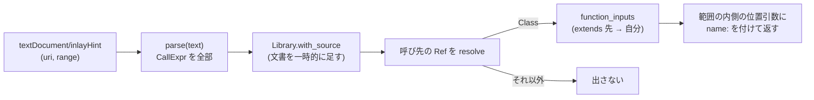

# S352 LSP の inlay hint（関数の呼び出しの引数の名前）

| | |
| --- | --- |
| セッション | S352 |
| 日付 | 2026-11-15 |
| ブランチ | `feature/s352-lsp-inlay-hints` |
| Phase | Track B（自前コア）の製品へのつなぎ（IDE の機能の穴） |
| スライド | [slides.html](slides.html) |
| 作業記録 | `log/work/2026-11-15-s352-lsp-inlay-hints.md` |

## 1. 目的

[features.md](../../features.md) の「アウトライン・inlay hint・call hierarchy」は △（アウトラインだけ）。LSP に `textDocument/inlayHint` の最小版を足す。出すのは 1 種類で、関数の呼び出しの位置引数の前に引数の名前（`f(x, y)` → `f(a: x, b: y)`）。名前は呼び先の関数の `input` の並びから取り、引けなければ出さない。書きかけの文書でも出す。

## 2. 決定と理由

| 項目 | 決定 | 理由 |
| --- | --- | --- |
| 道 | 自前の構文の木（`globe-mode-syntax`）と名前解決（`globe-mode-resolve`）だけ。Rumoca のアウトラインは使わない | 今の道を持たない新しい機能。書きかけの文書でも同じ道で出せる（S276・S279 と同じ） |
| 呼び先の引き方 | 呼び先の `ComponentRef` と同じ範囲の `Ref` を `Library::resolve`。`Resolution::Class` だけ採る | 組み込み・部品・引けない名前を推測で出さない。式の成分参照の `Ref` は S272 から全部ある |
| 名前の取り方 | `Library::function_inputs(class)`: `input` の前置きの部品を宣言の順に、`extends` の基底のものが先。基底が引けなければ None | 位置引数は `input` の宣言の順で、継承した分が先に並ぶ。引けない基底を飛ばすと名前がずれる |
| `Component.input` | `ComponentClause` の直下の字句に `input` があるか（resolve の `build.rs`） | syntax の API を増やさず、名前解決の規則も変えない |
| 対象外 | 名前つき引数、`for` 内包、組み込み、レコードの構築子、`annotation` の中、`input` より多い引数 | 名前つきは名前が書いてある。レコードの構築子の欄は `input` でなく宣言の順で別の規則。`annotation` は resolve が読まない |
| VS Code の拡張 | 変更なし | `vscode-languageclient` 9.0.1 が capability を見て登録する。`documentSelector` は `modelica` |

## 3. 図



## 4. 再現手順

```bash
export CARGO_TARGET_DIR=<main>/.git-worktree/target-shared CARGO_BUILD_JOBS=2
cargo test -p globe-mode-lsp --lib inlay
cargo test -p globe-mode-lsp -p globe-mode-resolve
cargo clippy -p globe-mode-lsp -p globe-mode-resolve --all-targets -- -D warnings
```

## 5. 次回

- レコードの構築子（`Complex(1, 2)`）と、同じ名前の引数（`f(x)` の `x:`）を省くかは未決。
- 別の開いた文書の関数は引けない（S279 と同じ。ライブラリ `-L` と同じ文書だけ）。
- 本物の VS Code での表示は【未確認】（手元では起動しない。`vscode.yml` の起動試験にも足していない）。
- call hierarchy は未。正典: [ADR-0039](../../adr/0039-native-cst-parser.md) の付記 S352。
