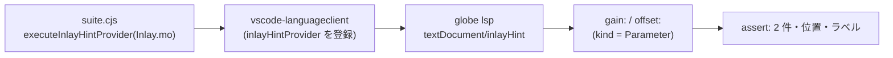

# S353 VS Code の e2e に inlay hint を足した

| | |
| --- | --- |
| セッション | S353 |
| 日付 | 2026-11-15 |
| ブランチ | `feature/s353-vscode-e2e-inlay`（base は `feature/s352-lsp-inlay-hints`。S352 が main に未着だったため） |
| Phase | P4（VS Code の拡張）× Track B の製品へのつなぎ |
| スライド | [slides.html](slides.html) |
| 作業記録 | `log/work/2026-11-15-s353-vscode-e2e-inlay.md` |

## 1. 目的

[S352](../S352-lsp-inlay-hints/解説書.md) で LSP に `textDocument/inlayHint`（関数の呼び出しの位置引数の前に引数の名前）を足した。VS Code の拡張は capability で自動で使うので変更しなかったが、本物の VS Code での表示は【未確認】のまま残っていた。S165・S233 の [`vscode.yml`](../../../.github/workflows/vscode.yml) は本物の VS Code（stable）を `@vscode/test-electron` で 3 OS で起動し、言語 ID・activate・診断・アウトライン・rename などを確かめている。そこに inlay hint の確認を 1 本足して、【未確認】を消す。

## 2. 決定と理由

| 項目 | 決定 | 理由 |
| --- | --- | --- |
| 確かめ方 | `vscode.commands.executeCommand("vscode.executeInlayHintProvider", uri, range)` | 拡張が登録した（`vscode-languageclient` の）プロバイダを VS Code の API 越しに呼ぶ。画面の描画（`editor.inlayHints.enabled`）は拡張ホストから見えないので、確かめるのはプロバイダが返すところまで |
| 文書 | 新しい fixture `Inlay.mo`（関数 `Scale` の `input` が `gain`・`offset`。モデルが `Scale(2, 3) + sin(time)` を呼ぶ） | 既存の fixture に関数が無い。ほかの試験の fixture（rename の数など）に影響させない別ファイルにした。`sin(time)` は組み込みなのでヒントが出ない |
| 期待 | ヒントがちょうど 2 つ。位置は `2` と `3` の直前、ラベルは `gain:`・`offset:`、`kind` は `InlayHintKind.Parameter` | 件数まで見るので、組み込みの `sin` に出てしまう退行も落ちる。位置は fixture の文字列から計算する（行・列を決め打ちしない） |
| 待ち方 | 既存の `until`（`h?.length > 0` の間 500 ms ごと、90 s まで） | 空配列は真なので、長さを見る。ほかの試験と同じ書き方 |
| ラベルの型 | 文字列と `InlayHintLabelPart[]` のどちらでも読む | クライアントがどちらで返しても落ちないように |
| workflow | 変更は冒頭の説明の 1 行だけ | `src/VSCode/**` の変更なので push の条件に入っており、3 OS の matrix にそのまま乗る |

## 3. 図



## 4. 再現手順

```bash
# サーバ側だけ手元で確かめる（VS Code は起動しない）。fixture のフォルダを根にして globe lsp に inlayHint を頼むと、
# inlayHintProvider = true、(6, 17) に gain:、(6, 20) に offset: が返る
cargo build -p globe-mode-cli
# 本物の VS Code での確認は Actions で回す
git push origin feature/s353-vscode-e2e-inlay
gh workflow run vscode.yml --ref feature/s353-vscode-e2e-inlay
gh run watch <run-id> -i 60 --exit-status
```

検証の結果（数字）は [作業記録](../../../log/work/2026-11-15-s353-vscode-e2e-inlay.md) に書いた。

## 5. 次回

- 画面での表示（`editor.inlayHints.enabled` に従う描画）は拡張ホストから見えないので、確かめていない。
- レコードの構築子の欄名、別の開いた文書の関数は S352 の持ち越しのまま。call hierarchy は S354 の担当。
- 正典: [features.md](../../features.md)（アウトライン・inlay hint・call hierarchy）、[ADR-0039](../../adr/0039-native-cst-parser.md) の付記 S352。
