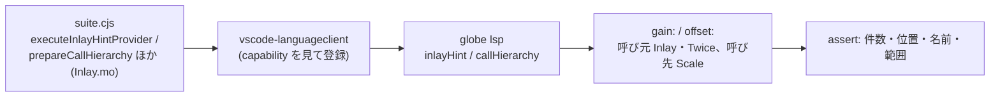

# S353 VS Code の e2e に inlay hint と call hierarchy を足した

| | |
| --- | --- |
| セッション | S353 |
| 日付 | 2026-11-15 |
| ブランチ | `feature/s353-vscode-e2e-inlay`（base は `feature/s352-lsp-inlay-hints`。S352 が main に未着だったため。のちに `feature/s354-lsp-call-hierarchy` も取り込んだ） |
| Phase | P4（VS Code の拡張）× Track B の製品へのつなぎ |
| スライド | [slides.html](slides.html) |
| 作業記録 | `log/work/2026-11-15-s353-vscode-e2e-inlay.md` |

## 1. 目的

[S352](../S352-lsp-inlay-hints/解説書.md) で LSP に `textDocument/inlayHint`（関数の呼び出しの位置引数の前に引数の名前）を、[S354](../S354-lsp-call-hierarchy/解説書.md) で call hierarchy（`prepareCallHierarchy`・`incomingCalls`・`outgoingCalls`。`function` だけ）を足した。VS Code の拡張はどちらも capability で自動で使うので変更しなかったが、本物の VS Code での表示は【未確認】のまま残っていた。S165・S233 の [`vscode.yml`](../../../.github/workflows/vscode.yml) は本物の VS Code（stable）を `@vscode/test-electron` で 3 OS で起動し、言語 ID・activate・診断・アウトライン・rename などを確かめている。そこに inlay hint と call hierarchy の確認を 1 本ずつ足して、プロバイダが返すところまでの【未確認】を消す。

## 2. 決定と理由

| 項目 | 決定 | 理由 |
| --- | --- | --- |
| 確かめ方 | `vscode.commands.executeCommand("vscode.executeInlayHintProvider", uri, range)` | 拡張が登録した（`vscode-languageclient` の）プロバイダを VS Code の API 越しに呼ぶ。画面の描画（`editor.inlayHints.enabled`）は拡張ホストから見えないので、確かめるのはプロバイダが返すところまで |
| 文書 | 新しい fixture `Inlay.mo`（関数 `Scale` の `input` が `gain`・`offset`。関数 `Twice` が `Scale(v, v)` を、モデル `Inlay` が `Scale(2, 3) + sin(time)` を呼ぶ） | 既存の fixture に関数が無い。ほかの試験の fixture（rename の数など）に影響させない別ファイルにした。`sin(time)` は組み込みなのでヒントが出ない |
| inlay の期待 | 範囲はモデルの行だけ（`Twice` の中の `Scale(v, v)` にもヒントは出るが範囲の外。`range` の絞り込みも同時に確かめる）。ヒントがちょうど 2 つ、位置は `2` と `3` の直前、ラベルは `gain:`・`offset:`、`kind` は `InlayHintKind.Parameter` |
| call hierarchy の期待 | `vscode.prepareCallHierarchy` で `Scale` が 1 件（`SymbolKind.Function`）。`vscode.provideIncomingCalls` の呼び元は `Inlay`（モデル）と `Twice`（関数）で、呼び出しの範囲が 1 つずつ。`Twice` の `vscode.provideOutgoingCalls` は `Scale`（範囲 1 つ）だけ、`Scale` の呼び先は空 | 件数まで見るので、組み込みの `sin` に出てしまう退行も落ちる。位置は fixture の文字列から計算する（行・列を決め打ちしない） |
| 待ち方 | 既存の `until`（`h?.length > 0` の間 500 ms ごと、90 s まで） | 空配列は真なので、長さを見る。ほかの試験と同じ書き方 |
| 順序 | どちらも `cases` の末尾 | S306 の試験が `Broken.mo`（構文の誤り）を直してから回るので、Workspace 全体の変換に邪魔されない |
| ラベルの型 | 文字列と `InlayHintLabelPart[]` のどちらでも読む | クライアントがどちらで返しても落ちないように |
| workflow | 変更は冒頭の説明の 1 行だけ | `src/VSCode/**` の変更なので push の条件に入っており、3 OS の matrix にそのまま乗る |

## 3. 図



## 4. 再現手順

```bash
# サーバ側だけ手元で確かめる（VS Code は起動しない）。fixture のフォルダを根にして globe lsp に頼むと、
# inlayHintProvider = true、(10, 17) に gain:、(10, 20) に offset:。Scale の呼び元は Twice と Inlay、Twice の呼び先は Scale
cargo build -p globe-mode-cli
# 本物の VS Code での確認は Actions で回す
git push origin feature/s353-vscode-e2e-inlay
gh workflow run vscode.yml --ref feature/s353-vscode-e2e-inlay
gh run watch <run-id> -i 60 --exit-status
```

検証の結果（数字）は [作業記録](../../../log/work/2026-11-15-s353-vscode-e2e-inlay.md) に書いた。

## 5. 次回

- 画面での表示（`editor.inlayHints.enabled` に従う描画）は拡張ホストから見えないので、確かめていない。
- レコードの構築子の欄名、別の開いた文書の関数は S352 の持ち越しのまま。call hierarchy の呼び元は構文の誤りでアウトラインが引けないファイルの関数に届かない（S354 の shortcut）。
- 正典: [features.md](../../features.md)（アウトライン・inlay hint・call hierarchy）、[ADR-0039](../../adr/0039-native-cst-parser.md) の付記 S352・S354。
