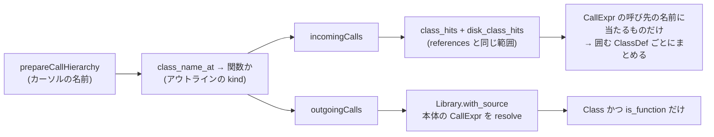

# S354 LSP の call hierarchy（関数の呼び元・呼び先）

| | |
| --- | --- |
| セッション | S354 |
| 日付 | 2026-11-15 |
| ブランチ | `feature/s354-lsp-call-hierarchy`（base は S352 の `feature/s352-lsp-inlay-hints`） |
| Phase | Track B（自前コア）の製品へのつなぎ（IDE の機能の穴） |
| スライド | [slides.html](slides.html) |
| 作業記録 | `log/work/2026-11-15-s354-lsp-call-hierarchy.md` |

## 1. 目的

[features.md](../../features.md) の「アウトライン・inlay hint・call hierarchy」のうち、call hierarchy だけが未だった。LSP に最小版を足す。対象は Modelica の `function` だけで、`textDocument/prepareCallHierarchy`（カーソルの関数）、`callHierarchy/incomingCalls`（その関数を呼ぶクラスと呼び出しの範囲）、`callHierarchy/outgoingCalls`（その関数の本体が呼ぶ関数）を出す。

## 2. 決定と理由

| 項目 | 決定 | 理由 |
| --- | --- | --- |
| 呼び元の集め方 | `textDocument/references` と同じ `class_name_at`・`class_hits`・`disk_class_hits`（開いた文書・根の下の `.mo`・ライブラリ）で関数に行き着く識別子を集め、自前の構文の `CallExpr` の呼び先の名前の終わりに当たるものだけ採る | 新しい規則を作らない。宣言・`end f`・`extends f(…)` を字面で除くより、構文の木に当てるほうが確か |
| 呼び元の単位 | 呼び出しを囲む一番内側の `ClassDef`（関数とは限らない。`kind` は関数が 12、ほかが 5） | 「その関数を呼ぶ関数・モデル」 |
| 呼び先の引き方 | S352 と同じ。`Library::with_source` に文書を足し、本体の `CallExpr` の `Ref` を `resolve`。`Resolution::Class` かつ関数のものだけ | 引けない名前・組み込みを出さない（推測しない）。書きかけの文書でも出る |
| 関数かどうか | 呼び元の探索はアウトラインの `ClassKind::Function`、呼び先は resolve の `Class.is_function`（新しい欄。`function` の字句があれば真） | resolve に `kind` が無かった。1 欄だけ足し、解決の規則は変えない |
| 状態 | 持たない（項目の `selectionRange` の位置から毎回引き直す） | `data` に何も入れず、`uri` と位置だけで足りる |
| 対象外 | モデル・部品・レコード（`null`）、レコードの構築子・`operator function` の呼び先 | 依頼の範囲 |
| VS Code の拡張 | 変更なし | `vscode-languageclient` が capability `callHierarchyProvider` を見て登録する（本物の VS Code では【未確認】） |

## 3. 図



## 4. 再現手順

```bash
export CARGO_TARGET_DIR=<main>/.git-worktree/target-shared CARGO_BUILD_JOBS=2
cargo test -p globe-mode-lsp --test call_hierarchy
cargo test -p globe-mode-lsp -p globe-mode-resolve
cargo clippy -p globe-mode-lsp -p globe-mode-resolve --all-targets -- -D warnings
```

## 5. 次回

- 構文の誤りで Rumoca のアウトラインが引けないファイルで宣言した関数は、呼び元の探索の対象外（呼び先は出る）。
- 呼び元の探索は `references` と同じ費用（名前の字面が部分文字列で入るファイルを全部字句に分ける。索引は持たない）。
- 別の開いた文書の関数は呼び先に引けない（S352 と同じ）。レコードの構築子・`operator function` は対象外。
- 本物の VS Code での表示は【未確認】（手元では起動しない。`vscode.yml` の起動試験にも足していない）。
- 正典: [ADR-0039](../../adr/0039-native-cst-parser.md) の付記 S354。
