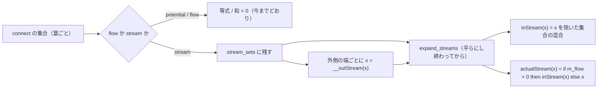

# S355 flat の stream（inStream・actualStream）

| | |
| --- | --- |
| セッション | S355 |
| 日付 | 2026-11-16 |
| ブランチ | `feature/s355-flat-stream`（S335 の `feature/s335-flat-unsized-array` から切った） |
| Phase | Track B（B3 の続き） |
| スライド | [slides.html](slides.html) |
| 作業記録 | `log/work/2026-11-16-s355-flat-stream.md` |

## 1. 目的

自前の flat（`globe-mode-flat`）が、MSL の例題 21 本と `GlobeModeValidation.Connect.MediumFlow` を理由 `stream` で断っている。MLS 15 の stream コネクタ（`stream` 変数・`inStream`・`actualStream`・接続集合の混合）を平らにできるようにし、Rumoca の flat と変数の名前・方程式の数を合わせる。全部でなくてよいが回帰 0 が条件。

## 2. 決定と理由

| 項目 | 決定 | 理由 |
| --- | --- | --- |
| 集合 | `gen_connects` が `stream` の葉の集合を作り、等式にせず `stream_sets` に残す。端は（葉の名前、外側のコネクタの端か） | potential・flow と同じ union-find を使える。内側と外側で同じ変数が 2 つの集合に入る（親の階層の内側の端と、自分の階層の外側の端） |
| 外側の端の方程式 | 外側の端ごとに `x = __outStream(x)` を 1 本（数は葉の大きさ。大きさ 0 の欄は端にしない） | Rumoca の `generate_outside_stream_equations` と同じ。内側の端・つながない端には作らない |
| 展開 | 平らにし終わってから、全部の印字の `inStream(x)`・`actualStream(x)`・`__outStream(x)` を置き換える（`flatten/stream.rs`） | 集合は階層の上で決まる（外側の端の値は 1 段上の `inStream`）ので、全部の集合がそろってからでないと展開できない |
| 混合 | 端 0 なら自分、1 つなら相手の値、2 つ以上なら `max(∓m_flow, ε)` の重みの平均（`ε` = 最小の nominal の `1e-7` 倍）。外側の端の値は 1 段上の `inStream` | Rumoca の `in_stream_expression` と同じ形。incidence（どの変数がどの式に出るか）が合えば DAE の構造の正則も合う |
| 断るもの | 添字が定数でない `inStream(ports[i].h)`、流量が 1 つに決まらないコネクタ、`stream` 変数でない引数 | MSL の例題では出ない。出たら `stream` で断る（誤った式を作らない） |
| shortcut | `smooth(0, m_flow * actualStream(x))` は作らない | DAE の構造・数は変わらない |

`stream` を通したあと、Fluid の例題で 2 つの穴が見えた（どちらも `stream` の展開そのものではない）。

| 穴 | 直し |
| --- | --- |
| `Examples` の `inner system(energyDynamics = …)` は部品より後ろに宣言される。`System.massDynamics = energyDynamics` のように、既定値が同じ部品の別の欄を引くと、`pending_bind` が「修飾された欄を使うので決めない」と止まり、`tank.massDynamics == Dynamics.FixedInitial` の `if` の全部の枝（初期方程式の `der(medium.p) = 0` も）が残って、状態が 8 本（Rumoca は 4 本）になった | 既定値が別の欄そのものなら、その欄の修飾か既定値にたどる |
| `for i in 1:n loop zeros(Medium.nXi) = mbXi_flows[i,:]; end for`（`nXi = 0`）を、`if`・`for` の中だけ 1 本と数えていた（`IncompressibleFluidNetwork` で +44） | `eq_count`（`shape` のあと `dims_of` の積）で数える。入れ子でない方程式と同じ |

詳しくは [ADR-0039](../../adr/0039-native-cst-parser.md) の付記（S355）。

## 3. 図



## 4. 再現手順

```bash
cargo test -p globe-mode-flat
cargo xtask diff-frontend --class GlobeModeValidation.Connect.MediumFlow --dump
cargo xtask diff-frontend --class Modelica.Fluid.Examples.Tanks.EmptyTanks --dump
mise run msl:diff-frontend    # release、約 23 分（今回）、最大 RSS 5.8 GiB
```

## 5. 数字

MSL の例題 566 本（S335 → S355。`GlobeModeValidation` は 74 → 75 本が平らになった）。**回帰 0 本、改善 21 本**（MSL 20 本と `MediumFlow`）。1383 s、最大 RSS 5.8 GiB。

| 項目 | S335 | S355 |
| --- | ---: | ---: |
| 自前で平らにできた | 518 | **538** |
| Rumoca も flat まで通った | 491 | 511 |
| 名前の集合が一致 | 491/491 | **508/511** |
| 方程式の数が一致 | 480/491 | **498/511** |
| DAE にできた | 518/518 | **538/538** |
| Rumoca の釣り合いまで通った | 351 | 367 |
| 判定・方程式と未知数の数・状態・構造の正則 | 351/351（4 つとも） | 365/367・364/367・366/367・363/367 |
| 断る理由 `stream` | 21 | **0** |
| 断る理由 `connect` | 9 | 10（`BatchPlant_StandardWater` が移った） |

新しく比べられた 20 本で合わない項目:

- 名前 3 本（`InverseParameterization`・`RoomCO2`・`RoomCO2WithControls`）: `Res`・`m_flows_turbulent`・`dps_fg_turbulent` が自前にだけある。`redeclare model FlowModel = DetailedPipeFlow(show_Res = true)` で条件つき宣言 `… if show_Res` の条件を真にする修飾を、Rumoca は条件の評価に使わない。`replaceable model M = Impl` と `redeclare model M = Impl(show = true)` の小さなモデルで確かめた（自前は条件つきの `y` を作り、Rumoca は作らない）。自前が正しいとみている。
- 方程式の数 2 本（`BranchingDynamicPipes` +4・`IncompressibleFluidNetwork` +1）: 部品の配列 `heat2[5]`・`heat8[2]` の方程式を、Rumoca は 1 本と数える。
- DAE 5 本: 行の incidence の食い違いは `Medium.ThermodynamicState` のレコードの方程式と束縛で、Rumoca は欄ごとの行にする【推測。`stream` の差ではない】。

## 6. 次回

- `connect` 10 本: `StateGraph` の `outer` のコネクタ（`stateGraphRoot.subgraphStatePort`）への `connect` は、`inner` が後ろで宣言されていて葉がまだ無い（9 本。`BatchPlant_StandardWater` を含む）。
- DAE のレコードの欄ごとの行（Fluid の 5 本）。
- 添字が定数でない `inStream(ports[i].h)`、`smooth(0, m_flow * actualStream(x))`。
