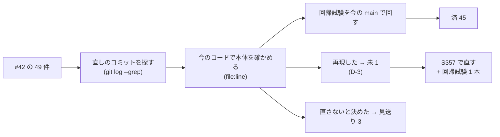

# S357 親 issue #42 の 49 件の確かめ直し

| | |
| --- | --- |
| セッション | S357 |
| 日付 | 2026-11-16 |
| ブランチ | `feature/s357-audit42-triage` |
| Phase | 運用（レビューの issue の整理） |
| スライド | [slides.html](slides.html) |
| 作業記録 | `log/work/2026-11-16-s357-audit42-triage.md` |
| 結果の表 | [doc/research/audit42-status-2026-11-15.md](../../research/audit42-status-2026-11-15.md) |

## 1. 目的

親 issue #42「ponytail-audit 2026-11-08 の結果（49 件の一覧）」は、S218・S223・S226 で直したあとも open のまま残っている。その後の WP（S230・S241・S320・S343・S344 など）で変わったものもある。**「済」を推測で言わない**ために、49 件を今の main のコードと試験で 1 件ずつ確かめ、済・未・見送りに分けた。未のうち小さく直せるものは直す。

## 2. 決定と理由

| 項目 | 決定 | 理由 |
| --- | --- | --- |
| 数え方 | 49 = issue 46 件（#43〜#88）+ #37 のコメント（A-5）+ #41 のコメント 2 件（D-3・E-2） | 親の本文の「状態」節のとおり。B-1 は #33 にも知らせたが、数えるのは #43 |
| 「済」の根拠 | (1) 直しのコミットが main の祖先、(2) 直しの本体が今のコードにある（`file:line`）、(3) 回帰試験が main にある。Rust は変えた crate に絞って今の main で回した | 後から別の WP が直しを壊していないことを見る |
| 手元で回さなかったもの | Svelte（Playwright）・Astro・CI の定義・Zig・Julia・Elixir・Gleam・wasm の `worker-node.mjs`。表に【コードのみ】と付けた | 重く、並行の WP と RAM を取り合う。コードの読みと、直しのコミットの試験の内容で確かめた |
| D-3 を直す | 自前の `walk` を消し、frontend の `collect_mo_files`（`fmt`・LSP と同じ規則）を呼ぶ | #41 の「走査の規則が違うもの」の 1 つ。直し方は #41 のコメントにあった |
| 新しく見つけた 1 件 | `cargo test -p globe-mode-protocol` が単体だと落ちる（`preserve_order` が有効にならず、鍵が辞書順）。dev-dependency に明示 | #89（`globe-mode` 単体が通らない）と同じ種類。`cargo test --workspace` では通っていたので CI は気づかなかった |
| 見送り | #45・#46 の lowering の回数（上流の口が要る）、A-5（見立てが【未確認】。測ってから） | 理由は表と #45・#46 の issue コメント |

## 3. 図



## 4. 再現手順

```bash
export CARGO_TARGET_DIR=<main>/.git-worktree/target-shared CARGO_BUILD_JOBS=2
# D-3: 直す前の main の globe では exit 1（Duplicate class）
mkdir -p /tmp/p/.history && printf 'model Decay\n  Real x(start=1,fixed=true);\nequation\n  der(x)=-x;\nend Decay;\n' > /tmp/p/Decay.mo
cp /tmp/p/Decay.mo /tmp/p/.history/Decay_old.mo
globe check /tmp/p -m Decay
# 直したあとの試験
cargo test -p globe-mode-cli --test review_fixes check_dir_input_skips_hidden_directories
cargo test -p globe-mode-protocol
```

## 5. 次回

- #42 を閉じるかどうかはユーザーの判断（直さないと決めた 3 件は、issue コメントに理由が残っている）。
- A-5 は、分割読み込み 100 本で `loaded.len()` と RSS を並べて記録すれば決められる（`msl:*`・wasm の計測が要る）。
- #45・#46 の lowering の回数は、上流（Rumoca）に初期化済みの状態を受け取る口と `rk45::simulate_artifact` の公開を頼む候補（[doc/upstream.md](../../upstream.md)）。
- 正典: [doc/research/audit42-status-2026-11-15.md](../../research/audit42-status-2026-11-15.md)。
