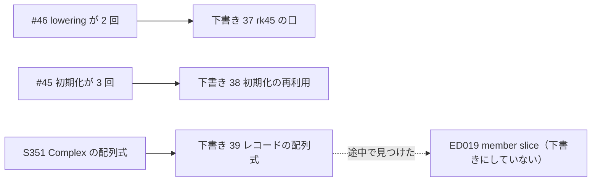

# S359 上流の下書き 37〜39: rk45 の口・初期化の再利用・レコードの配列式

| | |
| --- | --- |
| セッション | S359 |
| 日付 | 2026-11-16 |
| ブランチ | `feature/s359-upstream-drafts` |
| Phase | 文書（上流への報告の下書き） |
| スライド | [slides.html](slides.html) |
| 作業記録 | `log/work/2026-11-16-s359-upstream-drafts.md` |

## 1. 目的

S344（#46・#45）と S351（#133）で「上流（Rumoca）に頼む候補」として貯めた 3 件を、[doc/upstream.md](../../upstream.md) の流儀の 4 点セット（英語 `.md`・再現の `.mo`・日本語 `_jp.md`・スライド 1 枚の `_jp.html`）にする。Rumoca v0.10.2（GlobeMode の固定）と最新のリリース v0.10.4 の両方で確かめ、一覧に足す。**出さない**（issue も PR も作らない。提出はユーザーの判断）。Rust のコードは変えない。

## 2. 決定と理由

| 下書き | 種類 | 内容 | v0.10.4・main での扱い |
| --- | --- | --- | --- |
| [37](../../research/upstream/37-rk45-no-public-entry-for-a-lowered-model.md) | API の要望 | `rk45::simulate_artifact` が `pub(crate)` で、lowering 済みのモデルで rk45 を回せない。呼び手が自分の用途で lowering すると `rk45::simulate` の中でもう一度 lowering する（BDF には `build_simulation_with_stage_timing_and_lowered_model` がある） | v0.10.4（`rk45.rs:71`）・main（`b55eafce`、`:115`）も `pub(crate)`。ソースを読んだ |
| [38](../../research/upstream/38-bdf-initialized-state-not-reusable.md) | API の要望 | 公開の BDF の 3 段（build の warm-up・`check_prepared_initialization`・`run_prepared_simulation`）が保持した部品を 3 回 lease（Rumoca の doc は「each one an initialization」）。初期化済みの状態を実行に渡す口が無い | 同じ。v0.10.4 は 1 回目を warm-up と書き、1 回きりの道だけ warm-up を飛ばす。ソースを読んだ。**費用は測っていない** |
| [39](../../research/upstream/39-array-equation-of-record-array-constructor-counts-elements.md) | バグ | レコードの配列と、レコードのコンストラクタの配列式・内包表記の方程式を、フィールドごとでなく要素ごとに数える（6 本のところ 3 本）。v0.10.2 は ED008、v0.10.4 は ED001 | **一部は v0.10.4 で直った**（MSL の `Complex`、大きさ 3）。普通のレコードと `size(a, 1)` の `Complex` は再現。omc 1.27.2 は 6 と 6 |

- 39 は、S351 の「`Complex aw[3]` への `aw = {…}` を Rumoca が釣り合いまで通せない」を二分法で最小にした。表の 8 つの形（レコードの種類 × 大きさの書き方 × 右辺の書き方）を両版で回し、for 文と `aw = bw`（もう一方を for 文で決める）が通る対照を付けた。v0.10.4 で MSL の `Complex.mo` と大きさ 3 の形が通るのは、v0.10.4 の flatten に operator record のベクトルを扱う新しい節（`operator_records/arrays.rs`）があるためと見られる【推測。追っていない】。
- 37・38 は「バグでなく要望」と本文の先頭に書いた。効果の数字が無い（38 は費用を測っていない）ので、提出の順では 15 位の「残り」に置いた。
- 39 の途中で別の限界が見つかった。MSL の `ShowTransferFunction` は、方程式の数の前に `sum(bw.re)` で ED019 `record-array member slice` に当たる（部品の中でレコードの配列の成分を切り出すと、v0.10.2・v0.10.4 とも。omc は通す）。S351 の「Rumoca の釣り合いまで通らない（`ShowTransferFunction` 0/1）」は、この ED019 が先に止めたと見られる。別の下書きにはしていない（本文 39 の備考に再現を書いた）。

## 3. 図



## 4. 再現手順

```bash
# Rumoca の CLI は data/rumoca（v0.10.2）と data/rumoca-latest（v0.10.4）。.mo だけを置いたディレクトリで回す
rumoca compile 39-array-equation-of-record-array-constructor-counts-elements.mo -m Rep39.A --emit dae-mo
rumoca sim 37-rk45-no-public-entry-for-a-lowered-model.mo -m Rep37.A --solver rk-like
rumoca sim 38-bdf-initialized-state-not-reusable.mo -m Rep38.A --solver bdf
# MSL の Complex（Complex.mo だけをソースの根に）
rumoca compile ComplexForms.mo -m P --source-root data/msl/Complex.mo --emit dae-mo
```

検証の結果（数字）:

- 39 の 6 モデル × 2 版: `A`・`B`・`C` は v0.10.2 が ED008・ED001・ED008、v0.10.4 が ED001（3 本・6 個、3 本・6 個、9 本・12 個）。対照の `D`・`E`・`F` は両版で通る。MSL の `Complex` は `L`（大きさ 3）が v0.10.4 で通り、`P`（`size(a, 1)`）は両版で ED001。omc 1.27.2 は `A` 6/6、`B` 6/6、`C` 12/12、`D` 6/6、`L`・`P` 6/6。
- 37・38 のモデルは両版・rk-like と bdf で回る（501 点）。
- Rumoca main は `b55eafce`（2026-11-13）のソースを GitHub の contents API で読んだ。ビルドしていない。

## 5. 次回

- 提出するかはユーザーが決める。37・38 は一緒に出してもよい。39 は「普通のレコード」と「`size(a, 1)` の `Complex`」に絞る。
- GlobeMode の Rumoca の rev を上げる版の最初に、39 の `Complex` の形（`msl:diff-frontend` の `ShowTransferFunction` など）がどう変わるかを見る。ED019 の別件を下書きにするかも決める。
