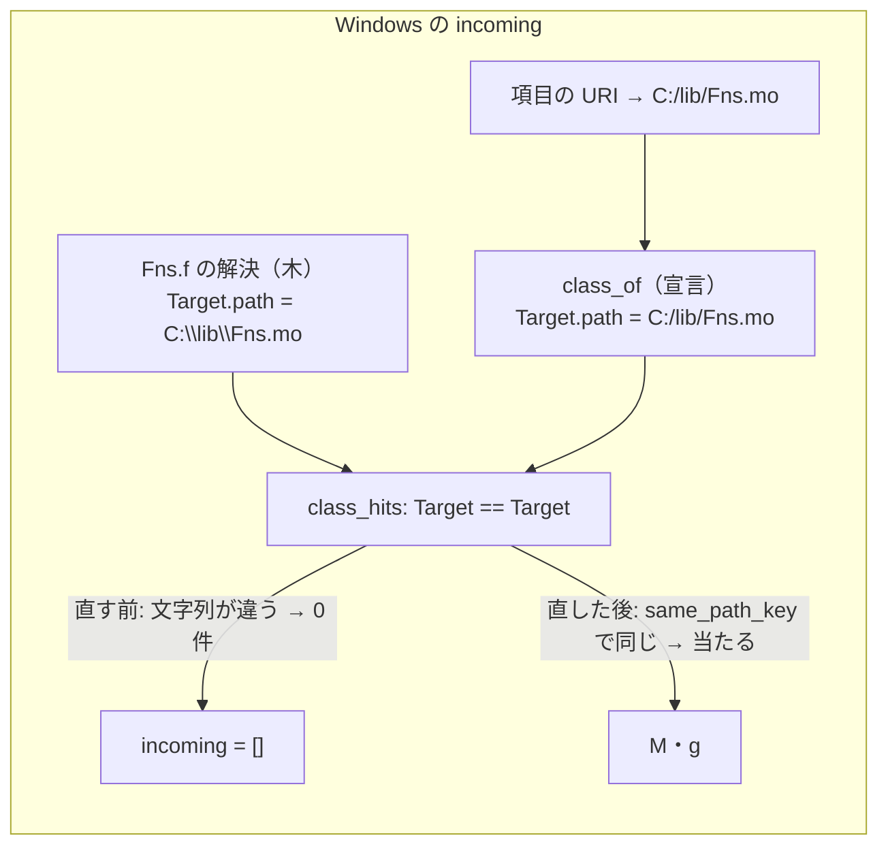
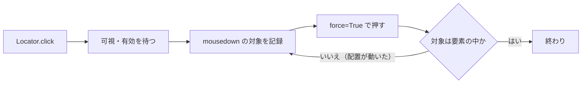

# S360 main の CI の 2 つの失敗（Windows の call hierarchy・UI の試験のタブ）

| | |
| --- | --- |
| セッション | S360 |
| 日付 | 2026-11-16 |
| ブランチ | `feature/s360-ci-windows-call-hierarchy`（base は main） |
| Phase | P4（試験の安定）・Track B の製品へのつなぎ（S354 の続き） |
| スライド | [slides.html](slides.html) |
| 作業記録 | `log/work/2026-11-16-s360-ci-windows-call-hierarchy.md` |

## 1. 目的

main の CI（run 43727293319、S353 のマージ `ce38ea4f`）が 2 つのジョブで落ちた。

1. `rust-windows`: `globe-mode-lsp/tests/call_hierarchy.rs:75`（S354 が入れた試験）で、`incomingCalls` の呼び元が空 `[]`（期待は `[("M", 2), ("g", 2)]`）。S354 の CI は `rust-windows` が skipped だったので、main で初めて Windows で走った。
2. `ui`: `src/Svelte/tests/test_ui.py` の 2371 行（文書ごとの診断。タブを戻したあと `table.diagnostics tr` が 0 行）。S353 の変更は VS Code と文書だけで、直前の CI では通っていた。

どちらも根の原因を 1 か所で直し、直す前なら落ちる回帰試験を足す（試験を Windows で緩めない）。

## 2. 決定と理由

| 項目 | 決定 | 理由 |
| --- | --- | --- |
| Windows: 原因 | `Target`（`globe-mode-lsp/src/definition.rs`）の `==` がパスの**文字列**比較だった | `incomingCalls` は項目の URI から戻したパス `C:/lib/Fns.mo` で関数を決める。宣言の名前の上の `class_of` はそのパスを `Target.path` に入れ、`Fns.f` の解決はライブラリの木のパス（`display()` の `C:\lib\Fns.mo`）を入れる。同じファイルなのに `class_hits` の `== Some(target)` が 1 件も当たらず、呼び元が空になった。Linux は区切りが `/` だけなので一致していた |
| Windows: 直し | `PartialEq for Target` を `same_path_key`（`lib.rs`。`\` と `/`・ドライブ文字の大文字小文字を畳む）で比べるものにした | 比べる場所（`class_hits`・`component_hits`・`references`・`rename`）が 1 つの `==` を通る。VS Code が出す小文字のドライブ（`c:`）でも同じ。呼び元ごとに正規化するより 1 か所 |
| Windows: 回帰試験 | `call_hierarchy.rs` の単体試験。木のパスをバックスラッシュで綴り（`C:\lib\Fns.mo`）、項目のパスをスラッシュで渡す。incoming は `[("M", 2)]`、outgoing は `[("f", 2)]` | 直す前は Linux でも `[]` で落ちる（手元で確かめた）。Windows の CI を待たずに原因を固定できる |
| UI: CI での再現 | 再現せず。`ci.yml -f full=true`（feature、run 43730056976）と main の S356 のマージ（run 43729347424）の `ui` はどちらも success | 失敗は 1 回だけ。S347〜S350（検査ボタン・フロントエンドの select・「設定に従う」）の変更は検査の結果の表示に効いていない（`check()` の `diagnostics = bySeverity(...)`・`activate()` の保存と戻しは変わっていない） |
| UI: 原因 | 手元で再現した（負荷あり、タブの切り替えを 60 回回して 2 回）。S310 の `click_without_stable()` が既定のクリックを `force=True` だけで押すので、**押す直前に配置が動くと別の要素を押す** | 失敗した押下の mousedown の対象は `p.note`（座標 (69, 372)。そこにあるはずのタブのボタンは y = 398 にあった）。検査の終わりとタブの切り替えのあと、`SimSettings` の高さが非同期に 6〜47 px 動く（5 ms ごとにタブ列の上端を記録して確かめた）。Playwright の既定の「押す点に当たるか」の確認を S310 が外した |
| UI: 直し | 押す前に `mousedown` の対象を記録する listener を足し、対象が要素の外（`__gmHit === false`）なら押し直す（3 回まで）。可視・有効のポーリングと `force=True` は S310 のまま | S310 の目的（rAF が出ない負荷でも 30 秒詰まらない）を保つ。Playwright の既定に戻すと、frame が出ない手元で毎回 3 秒詰まる（rAF はこの機械の空いたページで出ない） |
| UI: 回帰試験 | `check_click_survives_shift(page)`: マウスが動いた時点でアプリの上に足したボタンを 200 px 下げ、`click()` が 1 回だけ当てる | `force=True` だけの押下は 0 回で落ちる（S310 の版で確かめた）。`main()` の冒頭で回る |
| 見送り | UI の配置のずれ（検査の終わり・タブの切り替えで `SimSettings` の高さが動く）は直さない | 利用者にも見える layout shift だが、依頼は CI の失敗。残したことに書く |

## 3. 図





## 4. 再現手順

```bash
export CARGO_TARGET_DIR=<main>/.git-worktree/target-shared CARGO_BUILD_JOBS=2
cargo test -p globe-mode-lsp                      # call_hierarchy の単体試験を含む
cargo clippy -p globe-mode-lsp --all-targets -- -D warnings
gh workflow run ci.yml --ref feature/s360-ci-windows-call-hierarchy -f full=true   # rust-windows と ui

# UI の再現（手元。負荷をかけてタブを回す）
cd src/Svelte && pnpm install --frozen-lockfile && CARGO_TARGET_DIR=<main>/.git-worktree/target-shared pnpm build
for i in $(seq 8); do (timeout 400 sh -c 'while :; do :; done' &); done
uv run python <scratchpad>/tabs_repro.py 60       # 検査 → タブ 1 → タブ 0 を 60 回
```

検証の結果（数字）:

- `cargo test -p globe-mode-lsp`: 全部通った（lib 76 本と ignored 1 本、統合 call_hierarchy 1・cross_file 5・folding 2・tolerant_outline 2）。単体試験は直す前は `[]` で落ちる。clippy・fmt 0 件。
- Windows の CI（run 43730056976、feature の `a119e384`）: `rust-windows` が success（`cargo test --workspace` に call_hierarchy の統合試験を含む）。全ジョブ success。最後の版（`5064db4d`）も run 43734279788 で全ジョブ success（`ui` は押し直しの版と回帰試験 `check_click_survives_shift` で通った）。
- UI の再現（負荷 8 本のループ）: 直す前の版は 60 回中 2 回で押下が `p.note` に当たり落ちた（12 本のとき別の 1 回はタブ 1 の押下が外れた）。最終版（押し直す）は 150 回（10 本）で 0 回、そのうち 4 回で押し直しが働いた（直す前の版ならその 4 回が落ちる）。
- `test_ui.py` を手元で全部回した（`data/msl` 無し）: 冒頭から smoke の手前まで通り、押し直しは回帰試験の 1 回だけ（ほかの押下が要素の外を押している所は無い）。smoke の `msl=ng` は `data/msl` が無いための手元の都合で、CI（MSL を取得する）では別。

## 5. 次回

- 検査の終わり・タブの切り替えのあと、`SimSettings` の高さが動いて下の要素（タブ列・診断の表）が 6〜47 px ずれる。試験は押し直しで吸収したが、利用者にも見える layout shift（押す直前にずれると別の場所を押す）。直すなら `SimSettings` の領域（上書きできるパラメータの一覧）の高さを先に確保するか、一覧を非同期で出さない。
- `Target` 以外にもパスの文字列を比べている箇所（`definition.rs` の `t.path == path`、`call_hierarchy.rs` の `p == path`）は、開いた文書の本文を使うかの判定で、開いた文書は `ws` のパス（`\` を `/` にしたもの）で引く。Windows の CI で通ったが、ドライブ文字が小文字の URI（VS Code）での実機は【未確認】。
- 正典: [ADR-0039](../../adr/0039-native-cst-parser.md) の付記 S354 に S360 の修正を足した。
