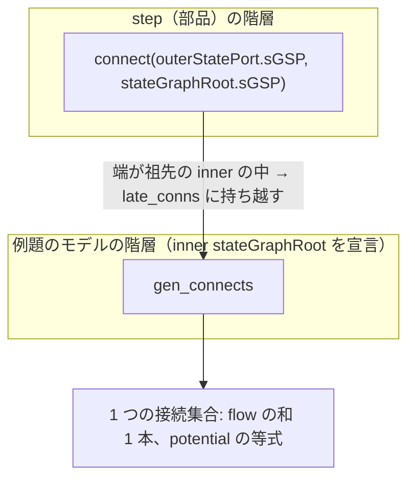

# S361 flat の外側の `inner` への `connect`

| | |
| --- | --- |
| セッション | S361 |
| 日付 | 2026-11-16 |
| ブランチ | `feature/s361-flat-outer-connect`（S355 の `feature/s355-flat-stream` から切った。S355 が main に未着のため） |
| Phase | Track B（B3 の続き） |
| スライド | [slides.html](slides.html) |
| 作業記録 | `log/work/2026-11-16-s361-flat-outer-connect.md` |

## 1. 目的

S355 のあと、自前の flat が MSL の例題で断るのは 28 本。うち `connect` が 10 本で、9 本は `StateGraph` の `outer` のコネクタ（`stateGraphRoot.subgraphStatePort`）への `connect`、残る 1 本は `Modelica.Clocked.Examples.Elementary.ClockSignals.LogicalSample`（大きさの違う配列の `connect`）。`inner` が部品より後ろで宣言されていて、`connect` を処理する時点では葉がまだ無い。

後ろで宣言された `inner` に `outer` のコネクタを `connect` できるようにし、`LogicalSample` も通す。Rumoca の flat と変数の名前・方程式の数を合わせ、回帰 0 を条件にする（S284・S329・S355 の `pending`・後ろの `inner` の扱いを再利用）。

## 2. 決定と理由

| 項目 | 決定 | 理由 |
| --- | --- | --- |
| 外側の階層の `inner` につなぐ `connect` | `inner` を宣言する階層の `gen_connects` まで持ち越す（`late_conns`）。持ち越す前の階層で各端が外側のコネクタだったか（flow の和の符号）も一緒に持ち越す | 接続集合は階層をまたいで 1 つ（Rumoca も全部の `connect` を集めてから集合にする）。部品ごとの集合にすると、`inner` のコネクタの flow の和が部品の数だけできる。持ち越した端は元の階層の「つながない内側の flow = 0」の対象にしない |
| `inner outer` | 実体を作る。同じ階層の `connect` の端だけ、外側の `inner` に付け替える（`bridge`） | Rumoca の flat が `compositeStep.stateGraphRoot.*` を作り、`connect` の端は外側へ付け替える（MLS 5.4）。MSL の使用は `StateGraph.PartialCompositeStep` の 1 か所 |
| `if cardinality(c) …` | 枝ごとに平らにして目印の 1 行を置き、全部の `connect` がそろってから、`c` が `connect` の端に出た数で枝を選ぶ（`resolve_card_ifs`） | `Step` の `if cardinality(inPort[i]) == 0 then inPort[i].set = false; end if;` は親の階層で決まる。Rumoca の `compute_cardinality_counts` と同じ数え方。選ばないと方程式が 1 部品あたり 2 本多い |
| `constrainedby C(nu = nu)` | 差し替えた部品に、元の宣言の constraining clause の修飾も掛ける（差し替えた側の明示した修飾が勝つ） | `LogicalSample` の `combinator.u[nu]` が大きさ 0 になっていた（MLS 7.3.2）。差し替えていない既定の型には掛けない |
| 内包の中の `inStream` | 印字のとき、`{e for j in r}` を `{e(1), e(2), …}` に展開する（本体に `inStream`・`actualStream` があるものだけ） | `BatchPlant_StandardWater` が `connect` を通ると `inStream(multiPort.ports_b[j].h_outflow)` で止まった（S355 の「添字が定数でない `inStream` は断る」） |

詳しくは [ADR-0039](../../adr/0039-native-cst-parser.md) の付記（S361）。

## 3. 図



## 4. 再現手順

```bash
cargo test -p globe-mode-flat          # 53 本（新しい 5 本を含む）
cargo xtask diff-frontend --class Modelica.StateGraph.Examples.FirstExample --dump
mise run msl:diff-frontend             # release、約 17 分（今回）、最大 RSS 5.8 GiB
```

## 5. 数字

MSL の例題 566 本（S355 → S361）。**回帰 0 本、改善 10 本**。1009 s、最大 RSS 5.8 GiB。`GlobeModeValidation` 75 本は変わらず。

| 項目 | S355 | S361 |
| --- | ---: | ---: |
| 自前で平らにできた | 538 | **548** |
| Rumoca も flat まで通った | 511 | 521 |
| 名前の集合が一致 | 508/511 | **518/521** |
| 方程式の数が一致 | 498/511 | **508/521** |
| DAE にできた | 538/538 | **548/548** |
| Rumoca の釣り合いまで通った | 367 | 377 |
| 判定 | 365/367 | 374/377 |
| 方程式と未知数の数 | 364/367 | 373/377 |
| 状態の数 | 366/367 | 376/377 |
| 構造の正則 | 363/367 | 369/377 |
| 断る理由 `connect` | 10 | **0** |

新しく通った 10 本は、名前・方程式の数が 10/10 一致。DAE は 6 本が 4 項目とも一致し、4 本が食い違う。

- 構造の正則 3 本（`ExecutionPaths`・`ShowCompositeStep`・`ShowExceptions`）: `join.occupied = fill(outPort.occupied, nBranches)`（印字は `{a.join[1].occupied, a.join[2].occupied} = fill(…)`）の行の incidence が自前の DAE では空になる（`ExecutionPaths` で 7 行）。unknown のない行は構造の正則を落とす。行が空になる理由は `globe-mode-dae` の側で**確かめていない**。
- `BatchPlant_StandardWater`（方程式の数 2365 対 2389、構造の正則）: S355 の「DAE のレコードの欄ごとの行」と同じ種類【推測】。

## 6. 次回

- DAE の 4 本（上の `{…} = fill(…)` の incidence と、`ThermodynamicState` のレコードの欄ごとの行）。`globe-mode-dae` の側。
- 断る 18 本: `composite-binding` 6・`expandable` 5・`non-constant-dim` 4・`connect-array` 1・`non-constant-for` 1・`unsized-array` 1。
- 差し替えていない既定の型への `constrainedby` の修飾、`cardinality` の入れ子、`smooth(0, m_flow * actualStream(x))`。
