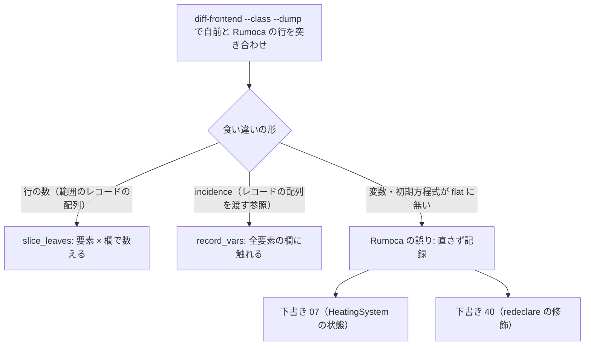

# S362 DAE のレコードの欄ごとの行（範囲・レコードの配列を渡す参照）

| | |
| --- | --- |
| セッション | S362 |
| 日付 | 2026-11-16 |
| ブランチ | `feature/s362-dae-record-rows`（`feature/s355-flat-stream` の 4d916cb0 から切った。S355 が main に未着のため） |
| Phase | Track B（B4 DAE） |
| スライド | [slides.html](slides.html) |
| 作業記録 | `log/work/2026-11-16-s362-dae-record-rows.md` |

## 1. 目的

S355 で `stream` が平らになり、Rumoca の釣り合いまで通った 367 本で、判定 365・方程式と未知数の数 364・状態 366・構造の正則 363 になった。合わない 5 本（`Modelica.Fluid.Examples.HeatingSystem`・`NonCircularPipes`・`Tanks.ThreeTanks`・`AST_BatchPlant.Test.TankWithEmptyingPipe1`・`InverseParameterization`）を、S355 の担当は「`ThermodynamicState` などのレコードの方程式を自前の DAE が欄ごとの行にしないため」とみていた【推測】。`cargo xtask diff-frontend --class <名前> --dump` で自前と Rumoca の DAE の行を突き合わせ、原因を確かめて、自前の誤りは直し、Rumoca の誤りは直さずに根拠を記録する。

## 2. 決定と理由

5 本の原因は 3 つに分かれ、推測は半分だけ当たった。

| 例題 | 食い違い | 原因 | 扱い |
| --- | --- | --- | --- |
| `NonCircularPipes` | 方程式 375 対 391 | `statesFM[1 : n] = mediums[1 : n].state`（レコードの配列の範囲への方程式）が、要素の数（2）のままで、欄の数（5）を掛けていない。2 本の管で 2 × 4 × 2 = 16 | 自前の誤り。直した |
| `HeatingSystem` | 方程式 534 対 538 | 同じ形（`statesFM[2 : n + 1] = mediums[1 : n].state`）。部品 3 つで 1 + 1 + 2 = 4 | 自前の誤り。直した |
| `ThreeTanks`・`TankWithEmptyingPipe1` | 構造の正則（自前 false、Rumoca true） | レコードの配列を関数に渡す参照（`states`・`states[i + 1]`）が、未知数の参照にならない。`Fs_p = {… Medium.pressure(states[i + 1]) …}` の行が `states[k].p` に触れず、管 3 本ぶんの 64 行が未知数 63 に収まる（ホールの条件が破れ、完全マッチングが無い） | 自前の誤り。直した |
| `HeatingSystem` | 状態 20 対 11 | `inner System system(energyDynamics = SteadyStateInitial)` の修飾を、Rumoca の flat は `system.energyDynamics` の束縛には入れるのに、容積の `if energyDynamics == SteadyStateInitial then … der(medium.T) = 0` の初期方程式には使わない（`initial_equations` は 8 本で `der` が 1 本も無い）。自前は残すので、Rumoca の規則（初期方程式の `der` の変数も状態）で状態が 9 本増える | Rumoca の誤り（[上流の下書き 07](../../research/upstream/07-outer-reference-ignores-inner-modification.md) と同じ族）。直さない |
| `InverseParameterization` | 変数 513 対 507、方程式と未知数 287 対 279 | `redeclare model FlowModel = DetailedPipeFlow(show_Res = true)` の修飾を、Rumoca は短いクラス定義ごと捨てる（`h.m.show` が `false` のまま）。自前は `Res`・`m_flows_turbulent`・`dps_fg_turbulent`（2 本の管で 4 × 2 = 8 スカラー）を作る。omc も `show = true` | Rumoca の誤り。直さない。[上流の下書き 40](../../research/upstream/40-redeclare-class-modification-dropped.md)（出さない） |

直し（`globe-mode-dae` の `lib.rs`）は 2 つ。

- **範囲 `t[2 : n + 1]` のレコードの配列への方程式**（`slice_leaves`）: 始まりが整数のリテラルなら、flat の方程式の数（要素の数）だけ `t[lo]`、`t[lo + 1]`、… の欄の変数を取る。方程式の数は欄のスカラーの和になり、行の「自分の未知数」も正確になる。
- **レコードの配列を関数に渡す参照**（`record_vars`）: `a.R`（欄。S334）に加えて、配列そのもの（`states`）、添字が決まらない `states[i + 1]`、範囲 `states[1 : n]`・`mediums[1 : n].state` を、全要素の欄に触れる参照にする。shortcut: 範囲と添字は見ない（広めの incidence。構造の正則は甘く出る方に傾く）。

`resolve` の最後の添字を探す処理は `last_subscript` に括り出して 2 か所で使う（コードは増えない）。

## 3. 図



## 4. 再現手順

```bash
cargo test -p globe-mode-dae                         # 17 本（新しい 2 本。直す前は 2 本とも落ちる）
cargo xtask diff-frontend --class Modelica.Fluid.Examples.Tanks.ThreeTanks --dump
cargo xtask diff-frontend --class Modelica.Fluid.Examples.NonCircularPipes --dump
cargo xtask diff-frontend --class Modelica.Fluid.Examples.HeatingSystem --dump
mise run msl:diff-frontend                           # release、約 17 分（1031 s）、最大 RSS 5.8 GiB
```

`--dump` は、構造特異のときマッチしなかった行と未知数（`unmatched row`・`unmatched unknown`）も印字する（今回足した）。

検証の数字（MSL の例題 566 本、S355 → S362。**回帰 0 本、改善 4 本**。1031 s、最大 RSS 5.8 GiB）:

| 項目 | S355 | S362 |
| --- | ---: | ---: |
| 自前で平らにできた | 538 | 538 |
| Rumoca も flat まで通った（名前・方程式の数が一致） | 511（508・498） | 511（508・498） |
| DAE にできた | 538/538 | 538/538 |
| Rumoca の釣り合いまで通った | 367 | 367 |
| 釣り合いの判定 | 365/367 | **367/367** |
| 方程式と未知数の数 | 364/367 | **366/367**（残り: `InverseParameterization`） |
| 状態の数 | 366/367 | 366/367（残り: `HeatingSystem`） |
| 構造の正則 | 363/367 | **367/367** |

`GlobeModeValidation` 75 本は変わらない（Rumoca も通った 74 本で名前・方程式の数・判定・数・状態 74/74、正則 73/73）。改善の 4 本は `NonCircularPipes`・`HeatingSystem`（判定・数・正則）、`ThreeTanks`・`TankWithEmptyingPipe1`（正則）。

詳しくは [ADR-0039](../../adr/0039-native-cst-parser.md) の付記（S362）。

## 5. 次回

- 残る 2 本の食い違い（`InverseParameterization` の方程式と未知数の数、`HeatingSystem` の状態の数）は Rumoca の側で、自前を合わせない。上流の下書き 40・07 に根拠がある（提出しない）。
- 関数の本体を見て欄を絞る incidence は作らない（自前は欄すべてに触れるとみなす広めの incidence。構造の正則が Rumoca より甘く出うるが、MSL の例題では 367/367 で食い違いは無い）。
- 範囲の始まりが整数のリテラルでない `t[n + 2 : …]` は今までどおり（要素の数のまま）。MSL の例題には出ない。
- B3 が断る 28 本（`connect` 10・`composite-binding` 6・`expandable` 5・`non-constant-dim` 4 ほか）。
