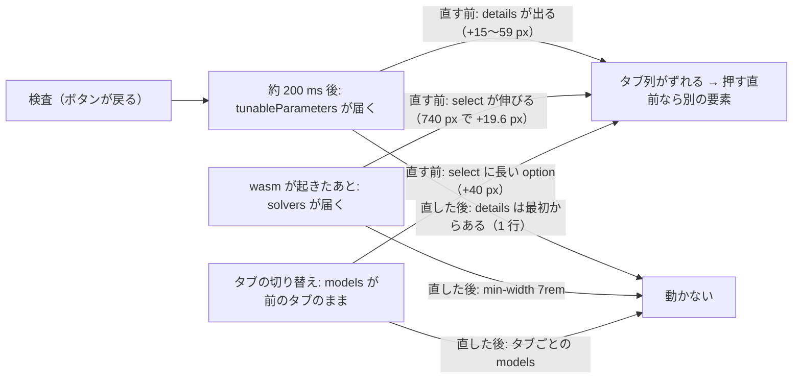

# S363 UI の配置のずれ（検査の終わり・タブの切り替え）

| | |
| --- | --- |
| セッション | S363 |
| 日付 | 2026-11-16 |
| ブランチ | `feature/s363-ui-layout-shift`（base は `feature/s360-ci-windows-call-hierarchy`。S360 が main に未着だったため） |
| Phase | P4（試験の安定）・UI の使い心地 |
| スライド | [slides.html](slides.html) |
| 作業記録 | `log/work/2026-11-16-s363-ui-layout-shift.md` |

## 1. 目的

S360（[解説書](../S360-ci-windows-call-hierarchy/解説書.md)）は、UI の試験がたまに落ちる原因を「押す直前に配置が動いて別の要素を押す」と突き止め、試験の押下を押し直すことで試験だけを直した。利用者が押す直前にずれても別の場所を押すので、UI の layout shift そのものを直す。

方針は、高さ・幅を先に確保する（出し入れで配置が動かないようにする）最小の CSS・マークアップの変更。`src/Svelte` だけを触り、Rust は触らない。

## 2. 決定と理由

何が動かしているかを、タブ列の上端（文書の座標）を 5 ms ごとに記録して調べた（検査・ファイルを開く・タブの切り替え・実行を順に。幅 1280・800・390 px）。

| 項目 | 直す前 | 原因 | 直し |
| --- | --- | --- | --- |
| 検査のあと（初回） | 1280 px で **+15.2 px**、390 px で +58.8 px | 「パラメータ」の `details` が `{#if listedModel}` の中にあり、検査のあと `tunableParameters` が届いて初めて出る。検査のボタンが戻った約 200 ms 後なので、押す直前にずれる | `details` を検査の前から出す（まだ一覧が無いときの 1 行は「パラメータ（検査すると、上書きできる一覧が出る）」）。本体の表だけ `{#if listedModel}` に残す |
| 検査のあと（狭い幅・長いモデル名） | 390 px で `summary` が 2 行に折り返す | 文が長い（`パラメータ（モデル名。N 本。…） 注記`）。モデルを替えて検査するたびに折り返しが変わる | `summary` を `white-space: nowrap; overflow: hidden; text-overflow: ellipsis`（1 行に固定。全文は `title`）。注記（「上書きできるパラメータは無い」「一覧を取れない」）は文の終わりでなく括弧の中に入れ、省略記号に隠れにくくした |
| 初回の検査（ソルバの一覧） | **740 px で +19.6 px**（1280 では動かない） | `backend.solvers()` が wasm から後で届き、選択欄が「既定」だけの幅（48 px）から 21 個の選択肢の幅（83 px）に伸びて、同じ行の欄が折り返す | `select { min-width: 7rem }`（いちばん長い名前 `sdirk34hw` も収まる） |
| タブの切り替え | 2 つのモデルのファイルのタブから単一のモデルのタブへ戻ると、バーが 64 → 104 px（**+40 px**）になって約 2 ms 後に戻る | `models`（そのファイルのモデルの候補）は 1 つの変数で、切り替えた直後は前のタブの候補が残る。`model` が候補に無いので select に「（このファイルのモデルから選ぶ）」が足され、バーが折り返す。`refreshModels`（非同期）が終わるまで続く | 候補をタブごとに持つ（`Tab.models`）。離れるとき写し、戻るとき入れる（3 行） |
| 実行の開始・終了 | 実行の開始で `p.run` が +19.6〜23.6 px、終わりで `p.last` が出る（+23.6〜59 px） | どちらも利用者の押した操作の直後。`lastSettings` は `run()` の中（`busy` が戻る前）で入るので、タブのボタンが無効のうちに終わる | 直さない（押した結果が見える場所に出す設計。S170） |

3 つの直しはどれも単独で必要（直しを 1 つずつ外すと、それぞれ試験が落ちる）。選択欄の `min-width` だけ、手元の Chromium・Arial では 1280 px に影響が出ない幅があるが、CI のフォントでは折り返しの位置が変わるので、幅 740 px も試験に入れた。

### 試験

`test_ui.py` の `layout_shift`（`check_frontend_select` の後）。タブ列の上端（`.tabs` の `getBoundingClientRect().top + scrollY`）を `add_init_script` の記録器で 5 ms ごとに取り、`reset()` から先の最大と最小の差を各段の 300 ms 後に見て、**1 px を超えたら落とす**。

- 幅は 1280・740・390 px。
- 段: 初回の検査（wasm の読み込み・ソルバとパラメータの一覧が届くまで）、2 つのモデルのファイルを開いたあとの タブ 1 の検査、タブ 0 への切り替えと検査、タブ 1 への切り替えと検査、もう 1 周。
- 「開く」操作そのもの（新しいタブとモデルの select が出る）の動きは数えない。

## 3. 図



## 4. 再現手順

```bash
export CARGO_TARGET_DIR=<main>/.git-worktree/target-shared CARGO_BUILD_JOBS=2
cd src/Svelte && pnpm install --frozen-lockfile && pnpm check && pnpm build   # wasm は target-shared/wasm-pkg/web
ln -s <main>/data/msl data/msl        # MSL を使う部分（ビルド前に張る）
cd ../.. && uv run python src/Svelte/tests/test_ui.py
```

直す前に落ちることの確かめ方: `git stash push -- src/Svelte/src` して `pnpm build`、`layout_shift` だけを回す（`test_ui.layout_shift(browser, origin, [])` を呼ぶ小さなスクリプト）と、1280 px の初回の検査で 15.2 px 動いたと出て落ちる。3 つの直しを 1 つずつ外すと、それぞれ別の段で落ちる（App.svelte の `models` を外すと 1280 のタブ 0 への切り替えで 40.0 px、`min-width` を外すと 740 px の初回の検査で 19.6 px、`summary` の `nowrap` を外すと 390 px の初回の検査で 19.6 px）。

## 5. 次回

- ソルバの選び方を「複数」にして閉じて開き直す（保存された設定が複数）と、ソルバの一覧が届くまでチェックボックスの欄が空で、届くと伸びる。「検査の終わり・タブの切り替え」ではないので直していない（複数のソルバの一覧を静的に持つと業務ロジックの複製になる。直すなら欄の最小の高さを確保する）。
- 実行の開始（`p.run`）と終了（`p.last`）の表示は、押した操作の結果として出る設計のまま。
- CI のフォントでの値は【未確認】（手元の Chromium・Arial）。`ci.yml -f full=true` の `ui` で確かめる。
