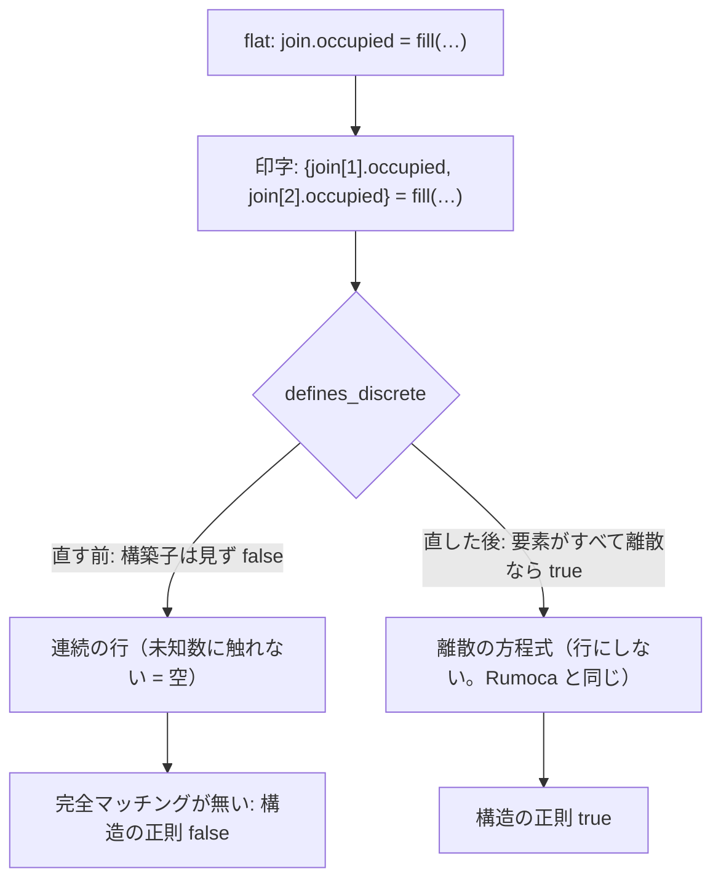

# S364 DAE の `{…} = fill(…)` の行（離散の方程式）

| | |
| --- | --- |
| セッション | S364 |
| 日付 | 2026-11-16 |
| ブランチ | `feature/s364-dae-fill-incidence`（`feature/s361-flat-outer-connect` から切り、S361 が main に入ったあと `origin/main` を取り込んだ） |
| Phase | Track B（B4 DAE） |
| スライド | [slides.html](slides.html) |
| 作業記録 | `log/work/2026-11-16-s364-dae-fill-incidence.md` |

## 1. 目的

S361・S362 のあと、Rumoca の釣り合いまで通った 377 本で構造の正則が 373/377 だった。合わない 4 本は、`Modelica.StateGraph.Examples.ExecutionPaths`・`ShowCompositeStep`・`ShowExceptions`（`join.occupied = fill(outPort.occupied, nBranches)` の行の incidence が自前の DAE で空になる。理由は未確認）と、`Modelica.Fluid.Examples.AST_BatchPlant.BatchPlant_StandardWater`（構造の正則だけ。原因は未確認）。`cargo xtask diff-frontend --class <名前> --dump` で原因を確かめ、自前の誤りなら直す。

## 2. 決定と理由

4 本の原因は**同じ 1 つ**で、自前の誤りだった。

- `BatchPlant_StandardWater` の制御部は `StateGraph.Parallel`（`controller.Parallel1`）を含み、`ExecutionPaths` と同じ形の行（`{controller.Parallel1.split[1].set, controller.Parallel1.split[2].set} = fill(controller.Parallel1.inPort.set, controller.Parallel1.nBranches)` ほか 4 行）が自前の DAE にだけ空の行として残っていた（自前の `unmatched row` が 4 行。直す前の `xtask-s361d` の `--dump` で確かめた）。
- `split[k].set`・`join[k].occupied`・`join[k].reset` は `Boolean`（離散の変数）。flat は部品の配列への方程式 `join.occupied = fill(…)` を `{a.join[1].occupied, a.join[2].occupied} = fill(…)` と印字する。
- DAE が方程式を連続の行にするか離散の方程式にするかは `defines_discrete`（左辺が離散の変数か。Rumoca と同じ規則）で決める。ここは**最初の式が成分参照のときだけ**調べ、配列の構築子 `{…}` は見ずに偽にしていた。そのため左辺が離散だけの構築子の方程式が連続の行になり、連続の未知数に触れないので incidence が空になった（`ExecutionPaths` の行は自前 47 本・Rumoca 40 本。差の 7 本が `fill` の行）。空の行は完全マッチングを作れず、構造の正則が落ちる。
- 直し: `defines_discrete` が、左辺が配列の構築子のとき、要素がすべて離散の変数なら離散の方程式にする。数の計算（`discrete_equations += count`）は元のまま。左辺が離散と連続の混ざった構築子は、今までどおり（MSL に出ない。shortcut）。

| 例題 | 食い違い | 原因 | 扱い |
| --- | --- | --- | --- |
| `ExecutionPaths`・`ShowCompositeStep`・`ShowExceptions`・`BatchPlant_StandardWater` | 構造の正則（自前 false、Rumoca true） | 左辺が離散の変数の配列の構築子 `{a[1], a[2]} = fill(…)` を連続の行にして、incidence が空 | 自前の誤り。直した |

## 3. 図



## 4. 再現手順

```bash
cargo test -p globe-mode-dae                         # 18 本（新しい 1 本。直す前は落ちる）
cargo xtask diff-frontend --class Modelica.StateGraph.Examples.ExecutionPaths --dump
cargo xtask diff-frontend --class Modelica.Fluid.Examples.AST_BatchPlant.BatchPlant_StandardWater --dump
mise run msl:diff-frontend                           # release、約 17 分、最大 RSS 5.8 GiB
```

試験 `fill_into_discrete_array_constructor_is_discrete_equation`: `join.occupied = fill(b, 2)`（`P join[2]`、`P` は `Boolean occupied` のコネクタ）の行が、連続の行 2 本・離散 1 本ではなく、連続 0 本・離散 3 本になり、構造が正則。

検証の数字（MSL の例題 566 本、S361 → S364。**回帰 0 本、改善 4 本**。1003 s、最大 RSS 5.5 GiB）:

| 項目 | S361 | S364 |
| --- | ---: | ---: |
| 自前で平坦化できた | 548 | 548 |
| Rumoca も flat まで通った（名前・方程式の数が一致） | 521（518・508） | 521（518・508） |
| DAE にできた | 548/548 | 548/548 |
| Rumoca の釣り合いまで通った | 377 | 377 |
| 釣り合いの判定 | 377/377 | 377/377 |
| 方程式と未知数の数 | 376/377 | 376/377（残り: `InverseParameterization`） |
| 状態の数 | 376/377 | 376/377（残り: `HeatingSystem`） |
| 構造の正則 | 373/377 | **377/377** |

`GlobeModeValidation` 75 本は変わらない（Rumoca も通った 74 本で名前・方程式の数・判定・数・状態 74/74、正則 73/73）。改善の 4 本は構造の正則だけ。詳しくは [ADR-0039](../../adr/0039-native-cst-parser.md) の付記（S364）。

## 5. 次回

- 左辺が離散と連続の混ざった構築子（`{x, b} = …`）は、今までどおり連続の行にする。MSL には出ない。
- 方程式と未知数の数・状態が 376/377 の残り 1 本ずつは Rumoca の側（`InverseParameterization`・`HeatingSystem`。上流の下書き 40・07。提出しない）。
- B3 が断る 18 本（`composite-binding` 6・`expandable` 5・`non-constant-dim` 4 ほか）。
