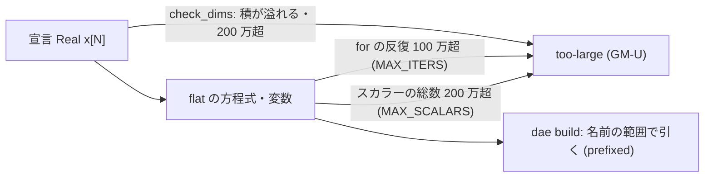

# S365 7 回目のレビューの issue #135〜#140

| | |
| --- | --- |
| セッション | S365 |
| 日付 | 2026-11-16 |
| ブランチ | `feature/s365-review7-fixes`（main の `7c7712b0`〔S361 のマージ〕から切った） |
| Phase | Track B（B3 flat・B4 DAE の資源の上限と計算量）・文書 |
| スライド | [slides.html](slides.html) |
| 作業記録 | `log/work/2026-11-16-s365-review7-fixes.md` |
| レビュー履歴 | `log/review/2026-11-16-s351-s363-review7.md` |

## 1. 目的

6 回目のレビューの後の変更（S335〜S363）を読んだ 7 回目のレビューの issue #135〜#140 を、1 件ずつ自分で再現してから直す。コードの 5 件は native の検査（`--frontend native`、LSP で設定したとき）だけに届き、Rumoca の道（既定）は変わらない。

## 2. 決定と理由

| # | 何が起きていたか | 直し | 試験 |
| --- | --- | --- | --- |
| #135 | 変数でない参照（`time`・列挙値）のたびに DAE の `leaves_of`・`array_leaves` が全変数を 2 回なめる。部品 16000 個で 69 s（O(N²)） | `Ctx::index` を `BTreeMap` にして、前置きが同じ名前を範囲 `prefixed` で引く | 部品 8000 個で `build` が 4 s 未満（直す前は 13 s） |
| #136 | 方程式を作らない入れ子の `for`（空の本体・偽の `if`）は `MAX_EQS` に数えられず、1000×1000 で 9 s | `for_eq` の反復を数え、`MAX_ITERS`（100 万）を超えたら `too-large` | 偽の `if` と空の本体の 200×200 が `too-large`、50×50 は通る |
| #137 | 内包の要素数・`vector`・`for` の反復の数・変数の次元の積が検査なしで、debug は panic、release は巻き戻る | 変数の次元は宣言の所で検査（#139 と共通の `check_dims`）。変数から来ない積は `capped_mul`（`MAX_SCALARS + 1` で頭打ち）にして、総数の検査で断る | 4 重の内包・`vector(zeros(2^32, 2^32))`・`when` の中の 4 重の `for` が `too-large`（`attempt to multiply with overflow` で落ちていた） |
| #138 | レコードの配列の内包の束縛 `R r[n] = {R(k, 2*k) for k in 1:n}` が要素ごとに範囲全体を作り直す（O(n²)） | `a:b`・`a:s:b` の i 番目を `a + (i - 1) * s` で直接出す（`range_abc`） | n = 40000 の束縛が宣言だけの 4.5 倍未満（直す前は 8.7 倍）。刻み・降順・範囲より多い要素 |
| #139 | 配列は 1 つと数える `MAX_VARS`・`MAX_EQS` では `Real x[10000000]` が通り、DAE の `build` が 4 GB・92 s | `MAX_SCALARS`（200 万）: 変数 1 つの次元の積と、変数・方程式のスカラーの総数が超えたら `too-large` | 1000 万 × 2 本・150 万 × 2 本（総数）・900 万本の内包の方程式・`Real x[2^32, 2^32]` が `too-large`、100 万は通る |
| #140 | 上流の下書き 40 ほか 6 か所の `InverseParameterization` の説明が MSL と違う | MSL の本文を読んで直した（下の表） | 文書だけ |

### #137 の形を変えた理由

issue の案は、報告された場所を `dims_product`（`checked_mul`。S339）にそろえて、`None` なら `too-large` で断る形だった。そのまま使うと、`dims_of`・`shape` のような `Option` を返す関数の `None` は「分からない」の意味なので、黙って 1 本と数えてしまう（S339 の #130 はそれで足りた）。そこで、

- 変数の次元の積は宣言の所で 1 回だけ `dims_product` に通し、溢れたら `too-large` にする。これで以降の `dims.iter().product()`（flat の `shape`・`leaves`、`binding_equations`、dae の `Ctx::n`）は溢れない。issue 自身が「flat が断った後でしか呼ばれない」と書いた箇所と同じ考え。
- 変数から来ない積（内包の範囲の長さの積、`vector` の次元、`for` の反復の数）は `capped_mul`（`MAX_SCALARS + 1` で頭打ち）にする。頭打ちの値は方程式のスカラーの総数の検査（`> MAX_SCALARS`）で断られる。

### #139 の上限を flat に置いた理由

`globe-mode-dae` は `globe-mode-flat` の出力（`FlatModel`）だけを受ける。flat の入口なら、DAE の前に断れて、別の上限を持たなくて済む。200 万は `MAX_VARS`（20 万）の 10 倍で、1 スカラー約 300 バイトの `build` で約 600 MB。MSL の例題で平らにできる本数が変わらないことは、全体の検査で確かめた（4 節）。

### #140 の MSL の中身

| | `pipe1` | `pipe2` |
| --- | --- | --- |
| 差し替え | `…FlowModels.NominalTurbulentPipeFlow(show_Res = true, …)` | `…FlowModels.NominalLaminarFlow(show_Res = true, …)` |
| `Res[2]`・`m_flows_turbulent[1]`（`PartialStaggeredFlowModel` の `if show_Res`） | あり（3 スカラー） | あり（3 スカラー） |
| `dps_fg_turbulent[1]`（`NominalTurbulentPipeFlow`） | あり | なし |
| `pathLengths_nominal[1]`（`NominalLaminarFlow` では `if show_Res`、`NominalTurbulentPipeFlow` では常にある） | 元からある | あり（Rumoca は捨てる） |
| 自前にだけ多い | 4 スカラー | 4 スカラー |

6 変数・8 スカラーの数は合っていた（名前の内訳が違った）。`DetailedPipeFlow(show_Res = true)` を使うのは `Fluid.Examples.TraceSubstances` の `RoomCO2`・`RoomCO2WithControls` で、増えるのは `Res`・`m_flows_turbulent` だけ（`DetailedPipeFlow` に `dps_fg_turbulent` は無い）。出典は MSL 4.1.0 の `Fluid/Pipes.mo`（901〜1079・1081〜1118・1319〜1409・1451 行）と 2 つの例題（2026-11-16 に読んだ）。

## 3. 図



## 4. 再現手順

```bash
cd <worktree>
export CARGO_TARGET_DIR=<main>/.git-worktree/target-shared CARGO_BUILD_JOBS=2
cargo test -p globe-mode-flat -p globe-mode-dae          # 追加した試験 5 本を含む
# 全体の検査（写したバイナリを flock の下で。回帰があれば終了コード 1）
flock <lock> <xtask のコピー> diff-frontend --report doc/frontend-diff.md --json target/frontend-diff.json
```

検証の結果（数字）:

@@RESULT@@

## 5. 次回

- 反復の上限 100 万・スカラーの上限 200 万は、MSL の例題の大きさ（最大の例題でも桁が 2 つ以上下）から決めた。実際のライブラリ（Buildings など）で `too-large` が出たら見直す。
- #139 の dae 側の費用（1 スカラー約 300 バイト）そのものは減らしていない。上限は 600 MB 程度までは通す。
- 上流の下書き 40 の数字（513 対 507）は、今の `diff-frontend` の報告（S365 の実行）でも同じで、変えていない。
