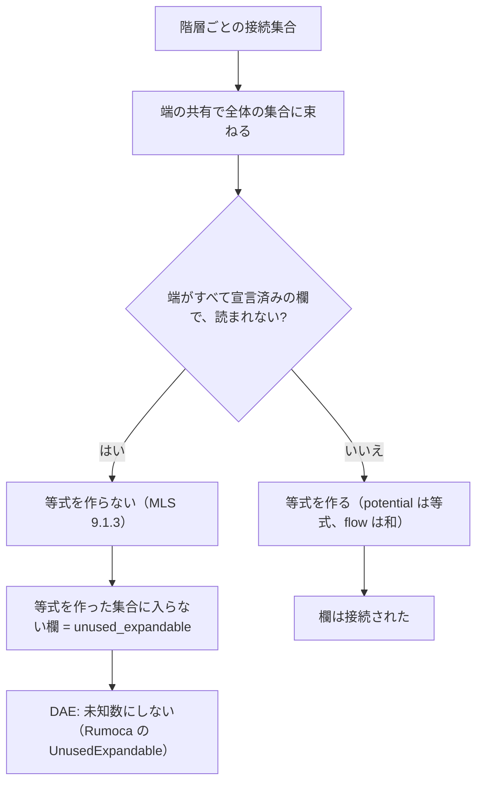

# S367 flat が expandable connector と、レコードの配列の束縛を平らにする

| | |
| --- | --- |
| セッション | S367 |
| 日付 | 2026-11-16 |
| ブランチ | `feature/s367-flat-expandable`（`main`〔S365 を取り込み済み〕から切った） |
| Phase | Track B（B3 flatten・B4 DAE） |
| スライド | [slides.html](slides.html) |
| 作業記録 | `log/work/2026-11-16-s367-flat-expandable.md` |

## 1. 目的

S365 のあと、自前の flat が断る MSL の例題は 18 本だった（`composite-binding` 6・`expandable` 5・`non-constant-dim` 4・`connect-array` 1・`non-constant-for` 1・`unsized-array` 1）。多い順に、`expandable` の 5 本（`BusUsage`・`BusUsage_Utilities.Part`・`CCCV_Cell`・`OneAxis`・`FullRobot`）と `composite-binding` の 6 本（`rcData[] = cellData` の 5 本と `CCCV_Stack`）を平らにして、Rumoca の flat と変数の名前・方程式の数を突き合わせる。余力で `non-constant-dim` と、`connect-array`・`non-constant-for` の 1 本ずつ。回帰 0 が条件で、S365 の上限（`MAX_ITERS`・`MAX_SCALARS`）は壊さない。

## 2. 決定と理由

### 2.1 expandable connector（MLS 9.1.3）

Rumoca の flat と DAE の動きを、`rumoca-phase-flatten`（`connections/equation_generation.rs`）と `rumoca-phase-dae`（`model_roles.rs`）のソースで確かめて合わせた。

- **宣言済みの欄は、ふつうのコネクタと同じように変数にする**。Rumoca の flat も、つながっていない欄（`BusUsage` の `controlBus.realSignal2`）を変数の名前に残す。だから名前の集合は一致する。
- **使われない欄は DAE が数えない**。Rumoca は、接続集合の端がすべて「宣言済みの欄（束縛なし）」で、集合の外のどの方程式・algorithm・束縛からも読まれないとき、その集合の等式を作らない（MLS 9.1.3 は残さない）。等式を作った集合に入らなかった欄は、DAE の `model_roles` が `UnusedExpandable` にして未知数に数えない。自前も同じ規則にした。
  - flat（`flatten.rs`）: 変数に `unused_expandable` を足した。階層ごとに作る接続集合を、端の共有で全体の集合に束ね（`settle_expandable`）、全体の集合の端がどれも読まれなければ等式を落とす。読まれるかは、方程式・`when`・初期方程式・algorithm・変数の束縛の文字列から成分参照を拾って調べる（`ref_paths`。shortcut: 引用符つきの名前と、添字の中の参照は見ない）。
  - DAE（`globe-mode-dae`）: `unused_expandable` の変数は `Role::Known`（未知数にしない）。
- **欄を足す接続は断る**。宣言していない欄への接続（`connect(y, bus.z)`）と、欄の違う expandable どうしの接続は、`expandable` の GM-U で断る。Rumoca も `unsupported_expandable_connector_augmentation` で断る。

### 2.2 `composite-binding`（`rcData[] = cellData` ほか）

| 原因 | 直し |
| --- | --- |
| `r = other` の欄がレコードの配列（`rcData[nRC]`。束縛は `cellData` に添字なしの接尾辞 `.rcData`）で、大きさの付く束縛の分岐が接尾辞なしだけ受けていた | 要素ごとに接尾辞を `.rcData[k]` にして、同じ `record_value` で束縛する |
| `nRC` の束縛が `cell.cellData` → `cellData` と 2 段の `r = other`（接尾辞 `.nRC`）で、`eval` が 1 段しかたどらなかった | 接尾辞が空になるまで `field_bind` をたどる（上限 16 段） |
| `cellData[Ns, Np] = {{if anyTrue({ks == kDegraded[i, 1] and …}) then … else … for kp …} for ks …}` を評価できなかった | `eval` に、parameter の配列の束縛への添字（`kDegraded[i, 1]`。`{…}`・`[a, b; c, d]` の要素）と、`anyTrue`（MSL の関数。名前を引いて確かめる shortcut）を足した |
| `cell[Ns, Np](cellData = stackData.cellData)` の値が配列への参照で、要素の添字 `[i,j]` が付かなかった | 次元が足りる配列の変数・レコードの配列への参照は、要素ごとに `[ix]` を付ける（`split_kind`） |
| 要素の欄の大きさ `OCV_SOC[:, 2]`（束縛が `stackData.cellData` の `[1,1].OCV_SOC`）を引けなかった | `bind_dims`・`field_bind` が `[1,1].f` の形も受ける |
| `connect(cell.cellBus, stackBus.cellBus)`（2 次元の部品の配列）・`connect(gainV.y, stackBusArrays.v)`（2 次元の変数）が展開されなかった | `expand_end` と `split_array_var` が 2 次元を行ごとに展開する。DAE の `parts` も 2 次元の部品の配列を通した欄 `port_a.T` を行ごとに引く |

`non-constant-dim` の 4 本のうち、`PolyphaseRectifier`（`1:data.Par` の `Par = if isPowerOf2(ParDesired) …`）は `isPowerOf2` を `anyTrue` と同じ shortcut で評価して通した。`HeatExchangerSimulation`（`connect(pipe_2.heatPorts[nNodes:-1:1], wall.heatPort_a[1:nNodes])`）は、`connect` の端の最後の添字が評価できる範囲なら要素ごとの接続にして通した。

### 2.3 native が断る例の差し替え

`expandable connector` を native が平らにするので、「native が断り、Rumoca は通る」例として使っていた 7 か所（CLI・`globe-mode`・wasm・LSP の試験、Python・Svelte の試験）を `model E extends Real; end E;`（`GM-U0006`、`extends-builtin`）に替えた。長い形の `redeclare model` は自前の構文が読めず `GM-E0001` になるので使えなかった。

### 2.4 Rumoca の側の食い違い（直さない）

| 例題 | 食い違い | 原因 |
| --- | --- | --- |
| `CCCVcharging`・`CCCV_CellRC` | 方程式の数が 111 対 101・138 対 128（名前は一致） | `resistor[cellData.nRC]`・`capacitor[cellData.nRC]` の大きさを Rumoca が評価せず、名前は `battery.resistor.R`（要素なし）のまま、方程式を 1 要素分（6 本・4 本）しか作らない。自前は 2 要素（12 本・8 本）で、差の 10 本が 2 つの配列。ADR-0039 の S332 の措置と同じ種類（要素に展開しない） |
| `CCCV_Stack`・`CCCV_StackRC` | Rumoca の flat が通らない | `connect(gainV.u, stackBus.cellBus.v)`（`stackBus.cellBus` は expandable の配列。その欄 `v`）を Rumoca が「欄を足す接続」と見て `unsupported member augmentation` で断る。MLS の読みでは欄は宣言済みで、断る理由は無い（上流には出さない） |

## 3. 図



## 4. 再現手順

```bash
cargo test -p globe-mode-flat -p globe-mode-dae     # 新しい試験: flatten.rs の expandable_connector_drops_unused_members、flat.rs の record_arrays_bound_through_record_fields_and_2d_connector_arrays
cargo xtask diff-frontend --class Modelica.Blocks.Examples.BusUsage --dump
cargo xtask diff-frontend --class Modelica.Electrical.Batteries.Examples.CCCV_Stack --dump
mise run msl:diff-frontend                          # release、全体の検査
```

検証の数字（MSL の例題 566 本、S365 → S367。**回帰 0 本、改善 13 本**。1332 s、最大 RSS 5.8 GiB）:

| 項目 | S365 | S367 |
| --- | ---: | ---: |
| 自前で平らにできた | 548 | **561** |
| Rumoca も flat まで通った（名前・方程式の数が一致） | 521（518・508） | 532（529・517） |
| DAE にできた | 548/548 | 561/561 |
| Rumoca の釣り合いまで通った | 377 | 382 |
| 釣り合いの判定 | 377/377 | 382/382 |
| 方程式と未知数の数 | 376/377 | 381/382（残り: `InverseParameterization`） |
| 状態の数 | 376/377 | 381/382（残り: `HeatingSystem`） |
| 構造の正則 | 377/377 | 382/382 |

改善の 13 本:

| 例題 | 平らにしたあと |
| --- | --- |
| `BusUsage`・`BusUsage_Utilities.Part`・`CCCV_Cell`・`OneAxis`・`FullRobot`（expandable 5 本） | 名前・方程式の数・判定・数・状態・正則がすべて一致 |
| `BatteryDischargeCharge`・`ShowImpedance`（`composite-binding`） | 名前・方程式の数が一致（Rumoca の釣り合いは通らない） |
| `CCCVcharging`・`CCCV_CellRC`（同） | 名前は一致。方程式の数は Rumoca の側（2.4） |
| `CCCV_Stack`・`CCCV_StackRC`（同） | 自前だけが通る（Rumoca の flat が通らない。2.4）。自前の DAE は釣り合い・構造の正則 |
| `PolyphaseRectifier`・`HeatExchangerSimulation`（余力） | 名前・方程式の数が一致（Rumoca の釣り合いは通らない） |

断る残りは 5 本（`non-constant-dim` 4・`unsized-array` 1）。`GlobeModeValidation` 75 本は変わらない（Rumoca も通った 74 本で名前・方程式の数・判定・数・状態 74/74、正則 73/73）。詳しくは [ADR-0039](../../adr/0039-native-cst-parser.md) の付記（S367）。

## 5. 次回

- `non-constant-dim` の 4 本（`Rectifier12pulseFFT`・`Rectifier6pulseFFT`・`RealFFT1`・`RealFFT2`）は `Modelica.Math.FastFourierTransform.realFFTsamplePoints`（アルゴリズムのある関数）の評価が要る。関数の評価器ができたら置き換える（`anyTrue`・`isPowerOf2`・`numberOfSymmetricBaseSystems` の shortcut も）。
- `unsized-array` の 1 本（`ReadRealMatrixFromFile`。ファイルを読む外部関数の戻り値の大きさ）は決められない。
- expandable の「欄を足す接続」は断ったまま（MSL の例題に出ない）。
- `settle_expandable` の「読まれるか」は文字列の走査（引用符つきの名前・添字の中は見ない）。
