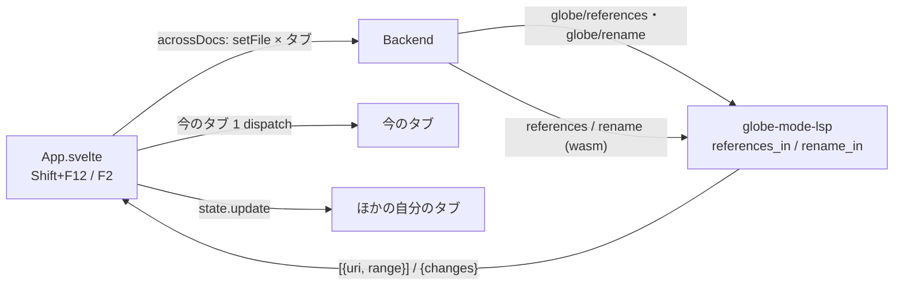

# S368 UI の参照・リネームが開いているタブの全部に届く

| | |
| --- | --- |
| セッション | S368 |
| 日付 | 2026-11-16 |
| ブランチ | `feature/s368-ui-cross-file-refs` |
| Phase | P4（エディタの言語サービス） |
| スライド | [slides.html](slides.html) |
| 作業記録 | `log/work/2026-11-16-s368-ui-cross-file-refs.md` |

## 1. 目的

[S366 の解説書](../S366-features-cleanup/解説書.md)で確かめたとおり、LSP の `textDocument/references`・`rename` は S230・S235 で開いていないファイル・ライブラリ・継承した部品まで届くが、UI（ブラウザ・Desktop・Android）の Shift+F12・F2 は開いている 1 文書の中だけだった。`App.svelte` が現在のタブだけを `setFile` して `Backend.references`・`rename` を呼び、wasm の `references_at`・`rename_at` も sidecar の `globe/references`・`globe/rename` も 1 文書で、`globe/rename` は他の開いた文書に参照があれば断っていた。

最小版として、UI の参照・リネームを**開いている自分のタブの全部**に広げる（ライブラリの参照は一覧に出すだけで変えない）。開いていないファイル（ディスクの根の下）は広げない。

## 2. 決定と理由

| 項目 | 決定 | 理由 |
| --- | --- | --- |
| 応答の形 | `globe/references`・wasm `references` は `[{uri, range}]`、`globe/rename`・wasm `rename` は `{changes: {名前: [TextEdit]}}` | 配列の応答は複数ファイルを表せなかった（S230 が広げなかった理由の 1 つ）。`textDocument/*` と同じ形にして、UI の利用者は `Backend` だけなので旧形は残さない |
| 規則 | `definition::references_in`・`rename_in` が `textDocument/*` と同じ部品（`component_name_at`・`component_hits`・`check_component_name`・`class_name_at`・`class_hits`・`rename`）を文書の組に回す | 新しい規則を作らない。クラス名は同じクラスに行き着くほかの文書の識別子（S166）、部品は継承した先と `b.x`（S235）、別名はその文書の中 |
| 文書の組 | wasm は `inner.files()` と `Workspace::text`（facade に足した 3 行）、sidecar は `didOpen` 済みの `texts`。キーで並べて応答の順を決める | 計算は Rust、UI は組を作るだけ |
| ディスク | `globe/*` はディスク（根の下の開いていない `.mo`）を見ない。ライブラリのクラスの参照だけ `library: true` で足す | UI の本文が正でディスクの版と食い違う。Desktop は作業フォルダが根になるので、`changes` に UI で適用できないファイルが入る。ライブラリは読み取り専用なので、見せるだけなら食い違わない |
| ライブラリで宣言した部品 | リネームは断る（`component_rename_blocked` と同じ理由の文） | 組の外のファイルは書き換えない |
| 離れたタブの本文 | 呼ぶ間だけ `setFile`、終わったら（断られても）空に戻す（`lib/cross-file.ts`） | S141 で、タブを離れるとファイルを Workspace から外している（同じクラスの二重定義を避ける） |
| リネームの適用 | 今のタブは 1 回の dispatch（undo 1 回、モデル名の追従は S186 のまま）、ほかの自分のタブは `state.update` で本文に当てる（そのタブの undo で戻る） | CodeMirror の履歴は文書ごと。全タブを 1 回の Ctrl+Z で戻すには UI の履歴を束ねる仕組みが要る |
| 参照の一覧 | ファイル名の列を足し（複数ファイルのときだけ）、別のタブの行を押すとそのタブへ移る。ライブラリの行は押せない | 開いていないライブラリのファイルは UI にタブが無い |
| 実行中 | `busy` なら参照・リネームに入らない | Workspace を書き換えるため |

## 3. 図



## 4. 再現手順

```bash
# LSP・wasm の単体試験（2 ファイルにまたがる参照・リネーム）
cargo test -p globe-mode-lsp -p globe-mode-wasm
# UI（Node の試験と Playwright）
node src/Svelte/tests/test_tauri.mjs
mise run wasm:build && uv run python src/Svelte/tests/test_ui.py
# wasm を変えたとき
mise run wasm:node
mise run wasm:compare
```

検証の結果は作業記録（`log/work/2026-11-16-s368-ui-cross-file-refs.md`）に数字で残した。

## 5. 次回

- 開いていないファイル（ディスクの根の下）の参照・リネームを UI に入れるなら、UI が「開いていないファイルを開く」操作を持つか、Rust が根の下のファイルの変更を UI の未保存の本文と突き合わせる設計が要る。
- 全タブの変更を 1 回の Ctrl+Z で戻す（UI の履歴を束ねる）。
- 同じクラスを 2 つのタブが定義しているときの扱い（今は `Resolver` が片方に寄せる）。
- `redeclare`・`replaceable` の先は LSP も未のまま。
