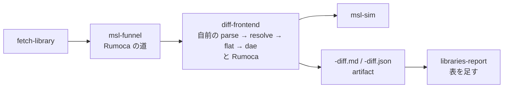

# S369 diff-frontend-libraries

| | |
| --- | --- |
| セッション | S369 |
| 日付 | 2026-11-16 |
| ブランチ | `feature/s369-diff-frontend-libraries`（base は main） |
| Phase | Track B（検査の道具） |
| スライド | [slides.html](slides.html) |
| 作業記録 | `log/work/2026-11-16-s369-diff-frontend-libraries.md` |

## 1. 目的

`cargo xtask diff-frontend`（[S300](../S300-diff-frontend/解説書.md)）は、自前の parse → resolve → flat → dae を Rumoca と MSL の例題 566 本・`GlobeModeValidation` で突き合わせる。[S365](../S365-review7-fixes/解説書.md) で自前の flat に上限（反復 100 万 `MAX_ITERS`・スカラー 200 万 `MAX_SCALARS`）を入れたが、MSL でしか確かめていなかった。MSL 以外の公開ライブラリの検査 `libraries.yml`（[S058](../S058-extra-libs-ci/解説書.md)）は `msl-funnel` で Rumoca の道だけを回し、自前のフロントエンドを通らない。

そこで `diff-frontend` を公開ライブラリの例題にも回せるようにして、`libraries.yml` に載せ、実在のモデル 2132 本で自前の flat・DAE と上限を確かめた。

## 2. 決定と理由

| 項目 | 決定 | 理由 |
| --- | --- | --- |
| 引数 | `--library <dir>`（何度でも）・`--package <根>`・`--examples-in <段>`・`--shard i/n`。例題は `funnel::library_examples`、分割は `funnel::parse_shard` | `msl-funnel` と同じ名前・同じ選び方なので、`libraries.yml` の matrix の値をそのまま渡せ、funnel の本数と並べて読める |
| モード | `--package` が `Modelica`（既定）なら今まで通り。ほかなら、そのライブラリの例題だけ（MSL は読むだけ、`GlobeModeValidation` は読まない）。`group` は `library` | MSL の例題・`GlobeModeValidation` の本数が、ライブラリの run に混ざらない |
| 回帰の判定 | ライブラリごとの JSON（`--json`・`--baseline-json`）で、規則は S300 のまま（通っていた旗が通らなくなったら回帰）。`--shard` は基準の JSON を守る対象にしない | 分割ごとに別のファイルへ書く前提。守る対象にすると CI が JSON を出せない |
| 自前の panic | `catch_row` で 1 本の行（flat の理由 `panic: …`）にして先へ進む | MSL 566 本では 0 本だったが、Buildings 809 本で 1 本の panic が分割の結果を全部捨てるのは割に合わない |
| `too-large` | 報告に例題名と理由を節として出す（先頭 50 本） | 理由の表は先頭の語と例 1 つだけで、どの例題がどの上限に当たったかが読めない |
| `libraries.yml` | funnel と sim の間に `diff-frontend` のステップ（`continue-on-error`、100 分）。要約に「自前の段」の行。artifact に `<id>-diff.md`・`.json` | sim は 1 ジョブの上限に最も近いので、後ろに置くと間に合わないとき最初に削られる。上限は Buildings の 4 分割目（51 分）から決めた |
| `libraries-report` | `-diff.json` を足し算して、別の表（自前で平坦化できた・`too-large`・DAE・Rumoca と一致）を足す | 既存の表の列を変えない。funnel・sim・diff を拡張子の前の語で見分ける |

## 3. 図



### 結果（run 43755915341、全ジョブ success。base は S366 の main で、S367 の前）

| ライブラリ | 例題 | 自前で平坦化できた | `too-large` | 自前の panic | Rumoca も flat | 名前の集合が一致 | 方程式の数が一致 | 自前で DAE | Rumoca も釣り合い | 釣り合い・数・状態・正則が一致 |
| --- | ---: | ---: | ---: | ---: | ---: | ---: | ---: | ---: | ---: | --- |
| AixLib | 642 | 314 | 0 | 0 | 183 | 181 | 179 | 314 | 113 | 113・113・113・112 |
| Buildings | 809 | 351 | 0 | 0 | 197 | 197 | 194 | 351 | 116 | 116・116・115・116 |
| Chemical | 76 | 10 | 0 | 0 | 8 | 8 | 8 | 10 | 8 | 8・8・8・8 |
| ClaRa | 5 | 0 | 0 | 0 | 0 | 0 | 0 | 0 | 0 | - |
| DeltaRobot | 21 | 13 | 0 | 0 | 9 | 9 | 9 | 13 | 8 | 8・8・8・8 |
| IBPSA | 457 | 249 | 0 | 0 | 147 | 147 | 144 | 249 | 85 | 85・85・85・85 |
| ThermofluidStream | 122 | 117 | 0 | 0 | 25 | 23 | 25 | 117 | 4 | 4・4・4・4 |
| 計 | 2132 | 1054 | 0 | 0 | 569 | 565 | 559 | 1054 | 334 | 334・334・333・333 |

- **自前の panic は 0 本、`too-large` は 0 本**。上限（`MAX_ITERS`・`MAX_SCALARS`）が実在のモデルを断った例は無かった。ただし、平坦化できなかった 1078 本は別の理由で断られた（`unsized-array` 371、`expandable` 266、`composite-binding` 141、`inner-outer` 63、`redeclare` 58、`connect-array` 58、`non-constant-dim` 53、`connect` 29、`conditional-component` 22、`unresolved` 10、`stream` 5、`non-constant-for` 1、`break` 1）。**`expandable`・`composite-binding` の 407 本は S367 が通す範囲**なので、上限の確かめは S367 が入った main で回し直すとより効く。
- **自前の flat は、Rumoca も通った 569 本のうち 556 本で、変数の名前の集合も方程式の数も一致**。食い違いは 13 本（下）。DAE は Rumoca の釣り合いまで通った 334 本で、釣り合い・方程式と未知数の数が 334/334、状態 333/334、構造の正則 333/334。
- **Rumoca が flat まで通らない例題が多い**（ThermofluidStream は自前が 117 本、Rumoca が 25 本）。自前の道は Rumoca が断る例題も平坦化できる。
- 時間と RSS: diff-frontend は小さなライブラリで 5〜16 s、ThermofluidStream 100 s、IBPSA 189 s、AixLib 295 s（2 分割）、Buildings 3426 s（4 分割）、最大 RSS 2.8 GiB（Buildings）。Buildings の 4 分割目の 3080 s のうち 2963 s は 1 本（`Buildings.BoundaryConditions.GroundTemperature.Examples.CorrectedNFactors`）で、funnel も同じ 2962 s かかるので Rumoca 側の遅さ。自前の flat・DAE はこの例題を通し、Rumoca と全部一致した。
- Rumoca の panic（`rumoca-phase-instantiate/src/inheritance.rs:1754`）は funnel の表の Buildings 4 本・IBPSA 4 本。diff-frontend では `rumoca_flat` が通らなかった扱いで、数は分けていない。

### 食い違い 13 本 + DAE 2 本（直していない）

| 例題 | 食い違い |
| --- | --- |
| `PrescribedOutlet_Water`（Buildings・IBPSA・AixLib の `Fluid.Interfaces.Examples`） | 方程式の数 237 対 242。変数は同数 |
| `EnthalpyFlowRate`（3 ライブラリの `Fluid.Sensors.Examples`） | 方程式の数 61 対 63 |
| `MoistAirEnthalpyFlowRate`（同） | 方程式の数 91 対 93 |
| `AixLib.Airflow.WindowVentilation.Examples.VentilationFlowRateSashOpening`・`…SimpleOpening` | Rumoca にだけ `….openingArea.opnWidth_in`（2 個・12 個） |
| `ThermofluidStream….Exercise3OttoEngine.BaseModel`・`Exercise4DieselEngine.BaseModel` | 自前にだけ `dropOfCommons.assertionLevel` |
| DAE: `Buildings.DHC.Plants.Steam.BaseClasses.Examples.BoilerPolynomial` | 状態の数 6 対 7 |
| DAE: `AixLib.ThermalZones.HighOrder.Components.Examples.WindowsDoors.WindowSimple` | 構造の正則: 自前は特異、Rumoca は正則 |

原因は調べていない（flat は S367 の持ち場）。同じモデルが 3 ライブラリに出るので、原因は 1 つずつのはず。

## 4. 再現手順

```bash
# 手元（Buildings の 1 分割目の先頭 8 本。release なら速い）
cargo xtask fetch-library Buildings
cargo xtask diff-frontend --library data/libs/Buildings --package Buildings --shard 1/4 --limit 8 \
  --report target/Buildings-diff.md --json target/Buildings-diff.json
# 1 本だけ、自前の flat と Rumoca の方程式の由来を印字する
cargo xtask diff-frontend --library data/libs/Buildings --package Buildings \
  --class Buildings.Fluid.Sensors.Examples.EnthalpyFlowRate --dump

# CI（全ライブラリ。約 2 時間。Buildings の 4 分割目が長い）
gh workflow run libraries.yml --ref feature/s369-diff-frontend-libraries
gh run download <run-id> -n libraries                  # 表 doc/libraries.md
gh run download <run-id> -n library-Buildings-4        # <id>-diff.md・-diff.json ほか
```

検証の結果（数字）:

- `cargo test -p xtask` 53 本通過（前は 51 本）、`cargo fmt --check -p xtask`・`cargo clippy -p xtask --all-targets -- -D warnings` 通過。
- MSL の `--class` 3 本は 3/3 のまま。MSL の全体の検査（`msl:diff-frontend`）は回していない（指示）。

## 5. 次回

- 食い違いの原因（上の表）。S367 が入った main で `libraries.yml` を回し直し、`expandable`・`composite-binding` の 407 本が通ったあとの `too-large` の本数を見る。
- Rumoca の遅さ（`CorrectedNFactors` 2963 s）と panic（Buildings 4 本・IBPSA 4 本）を上流の下書きにするか。
- `diff-frontend` で Rumoca の panic を数える（今は `rumoca_flat` が通らなかった扱い）。
