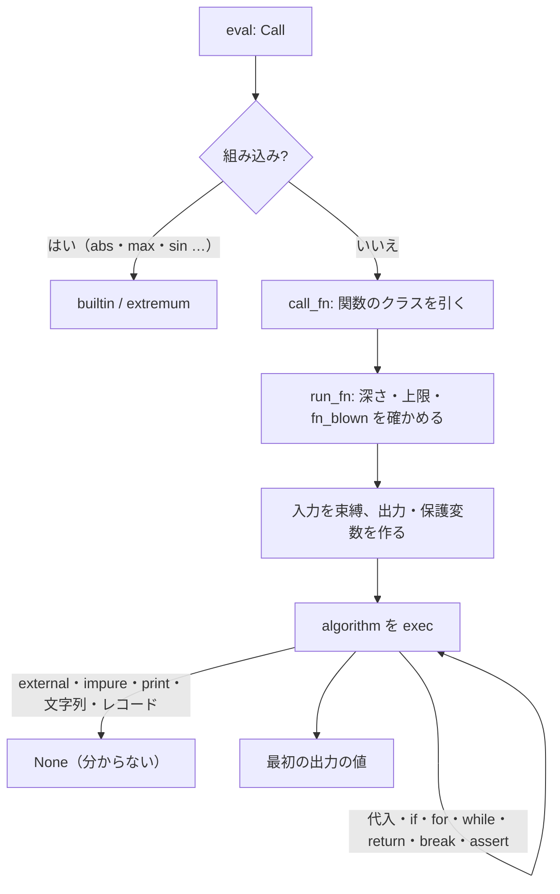

# S370 flat が Modelica の関数を評価する

| | |
| --- | --- |
| セッション | S370 |
| 日付 | 2026-11-16 |
| ブランチ | `feature/s370-flat-fn-eval`（`main`〔S367・S368 を取り込み済み〕から切った） |
| Phase | Track B（B3 flatten） |
| スライド | [slides.html](slides.html) |
| 作業記録 | `log/work/2026-11-16-s370-flat-fn-eval.md` |

## 1. 目的

S367 のあと、自前の flat が断る MSL の例題は 5 本だった。うち `non-constant-dim` の 4 本は FFT（`Rectifier12pulseFFT`・`Rectifier6pulseFFT`・`RealFFT1`・`RealFFT2`）で、`realFFTsamplePoints(f_max, f_resolution, f_max_factor=5)` のような、`algorithm` を持つ Modelica の関数を実行しないと配列の大きさが決まらない。S367 までは `anyTrue`・`isPowerOf2`・`numberOfSymmetricBaseSystems` の 3 つを、名前を引いて決め打つ shortcut で評価していた。

そこで、定数の評価（`eval`）に、関数を実行する最小の評価器を足す。決め打ちはこの評価器に置き換え、FFT の 4 本を平らにする。回帰 0 が条件。

## 2. 決定と理由

### 2.1 関数の評価器（`globe-mode-flat` の `flatten/fneval.rs`）

| 項目 | 決定 | 理由 |
| --- | --- | --- |
| 呼び出し口 | `eval` の `Call` のうち、組み込み（`size`・`max`・`abs` など）でないものを `call_fn` に渡す。引数は `eval`（スカラー）か `eval_items`（`{…}`）で定数にする | 配列の大きさ・`for` の範囲・`if` の条件は、すべて `eval` を通る。ここに足せば全部に効く |
| 実行できる関数 | `function` の `algorithm` と、出力・保護変数の束縛 `= e`。値は整数・実数・論理のスカラーと 1 次元の配列 | 依頼の範囲。MSL の 4 本（`anyTrue` は束縛だけで本体が空の `algorithm`）に足りる |
| 文 | 代入（`x := e`・`x[i] := e`）、`if`・`elseif`・`else`、`for`（添字 1 つ。範囲か配列）、`while`、`return`、`break`、`assert` | `assert` は条件が偽なら「分からない」にする（評価を続けない） |
| 評価しないもの | `external`、`impure`、入力・出力を受け継ぐ `extends`、文字列・レコード・列挙の変数、`print` など `assert` 以外の呼び出しの文、`when`、複数の左辺 | 今までどおり「分からない」を返す。Modelica 風の評価を広げて誤った値を返すより、断るほうがよい |
| 変数の型 | 宣言の型（`type_of` で `Real`・`Integer`・`Boolean` まで型の鎖をたどる）に代入のたびに合わせる | `ceil` などは整数を返す（今の `eval` と同じ）ので、実数の変数に入れるときに実数にする |
| `and`・`or` | 左で決まれば右を評価しない | `anyTrue` の `size(b, 1) > 0 and max(b)` は、空の配列で `max` が決まらない |
| 暴走を防ぐ | 1 回の呼び出し（入れ子を含む）で数える文と反復を `MAX_ITERS`（release で 100 万、試験で 1 万。S365 と同じ定数）に、呼び出しの入れ子を 32 に制限。上限に届いた関数は覚えて（`fn_blown`）、同じ関数を繰り返し評価しない | 終わらない `while true`・終わらない再帰・巨大な `for` の範囲で、`eval` を呼ぶたびに数秒かかるのを防ぐ |
| 共有の部品 | 組み込み関数の表 `BUILTINS`・`builtin`・`extremum`・`unop` を `eval` と共有。`eval` が評価できる関数に `sin`・`cos`・`exp`・`log`・`atan2`・`sign`・`rem` なども増えた | 評価器だけに別の表を作らない。`-i64::MIN` と `abs(i64::MIN)` の溢れは `checked_*` で `None` にした（前は debug で panic） |

shortcut: 配列は 1 次元・要素はスカラーだけ（配列どうしの演算・内包・`zeros` は分からない）。`for` の添字は 1 つ。実行した関数の結果は覚えない（上限に届いたものだけ覚える）。必要になったら足す。

### 2.2 決め打ちの置き換え

`anyTrue`・`isPowerOf2`・`numberOfSymmetricBaseSystems` の 3 つの決め打ち（名前を引いて MSL の関数と確かめ、Rust で値を計算していた）を `eval` から消した。MSL の本体（`anyTrue` は `output Boolean result = size(b, 1) > 0 and max(b)`、`isPowerOf2` は `while powOf2 < target`、`numberOfSymmetricBaseSystems` は自分を呼ぶ再帰）を実行して、同じ値になることを試験 `msl_function_bodies_decide_array_sizes` で確かめた（MSL の本文から注釈と説明を除いて貼った）。S367 の試験 `record_arrays_bound_through_record_fields_and_2d_connector_arrays` の `anyTrue` は、本体が決め打ち前提の偽物（常に `false`）だったので、MSL と同じ本体に直した。

### 2.3 FFT の 4 本

`ns = realFFTsamplePoints(f_max, f_res, f_max_factor=5)`（`while true`・入れ子の `while`・`break`・`assert`・名前つきの引数・既定値の入力）が評価できて、`Real buf[ns]`・`Real fi[nfi]` の大きさが決まる。4 本とも平らになり、DAE にもなった。

**Rumoca とは突き合わせられない**: Rumoca の v0.10.2（pin している版）は `ET004`（`msl-known-unsupported.txt`）、手元の CLI v0.10.4 も、`RealFFT1` で `E008: unevaluable array dimensions for 'fi'`（`rumoca compile --emit flat-json`）と断る（ほかの 3 本は CLI では試していない）。代わりに、MSL の全例題に対する omc の `checkModel` の数（[omc-compare.md](../../omc-compare.md)）と、自前の DAE の方程式と未知数の数を比べた。

| 例題 | 自前の DAE（方程式 / 未知数） | omc の `checkModel` |
| --- | --- | --- |
| `Blocks.Examples.Rectifier12pulseFFT` | 5853 / 5853（状態 14） | 5853 / 5853 |
| `Blocks.Examples.Rectifier6pulseFFT` | 5386 / 5386（状態 8） | 5386 / 5386 |
| `Math.FastFourierTransform.Examples.RealFFT1` | 245 / 245 | 245 / 245 |
| `Math.FastFourierTransform.Examples.RealFFT2` | 224 / 224 | 224 / 224 |

4 本とも、釣り合いと構造の正則を自前が示し、omc と方程式・未知数の数が一致した。

### 2.4 作業の落とし穴（共有 target）

最初の全体の検査の用意で、release の `globe-mode-flat` が **別の worktree が作った古い rlib のまま**だった（共有 target で同じ名前の rlib を使い回し、ソースの mtime の比べ方で「最新」と見なされたと考えている。cargo の内部の確認はしていない【未確認】）。新しい評価器が入らないまま `diff-frontend` が走り、debug の試験では通るのに release では断る、という食い違いで見つかった。`touch -c` で `lib.rs`（と `flatten.rs`）を触ってから release を作り直して直した。全体の検査の前には、`src/Rust/mod/*/src/lib.rs` と `xtask/src/main.rs` を `touch -c` して全部作り直した。

## 3. 図



## 4. 再現手順

```bash
cargo test -p globe-mode-flat          # 新しい試験: flatten.rs の modelica_functions_are_evaluated_for_sizes、tests/flat.rs の msl_function_bodies_decide_array_sizes
cargo xtask diff-frontend --class Modelica.Math.FastFourierTransform.Examples.RealFFT1 --dump
mise run msl:diff-frontend             # release、全体の検査
```

検証の数字（MSL の例題 566 本、S367 → S370）:

| 項目 | S367 | S370 |
| --- | ---: | ---: |
| 自前で平らにできた | 561 | **565** |
| Rumoca も flat まで通った（名前・方程式の数が一致） | 532（529・517） | 532（529・517） |
| DAE にできた | 561/561 | **565/565** |
| Rumoca の釣り合いまで通った | 382 | 382 |
| 釣り合いの判定 | 382/382 | 382/382 |
| 方程式と未知数の数 | 381/382 | 381/382 |
| 状態の数 | 381/382 | 381/382 |
| 構造の正則 | 382/382 | 382/382 |

**回帰 0 本、改善 4 本**（4 本はすべて FFT で、flat・dae が通るようになった）。1089 s、最大 RSS 5.3 GiB。637 本のほかの例題（MSL の例題 562 本と `GlobeModeValidation` 75 本）は、フラグも名前・方程式の数の食い違いの一覧も S367 と同じ。断る残りは 1 本（`unsized-array`）。詳しくは [ADR-0039](../../adr/0039-native-cst-parser.md) の付記（S370）。

## 5. 次回

- `unsized-array` の 1 本（`ReadRealMatrixFromFile`。ファイルを読む外部関数の戻り値の大きさ）は決められない。
- 評価器の shortcut（配列は 1 次元・スカラーだけ、結果を覚えない）。MSL で必要になったら広げる。
- FFT の 4 本は Rumoca の flat が通らないので、名前・方程式の数の突き合わせができない。Rumoca が評価できるようになったら（上流の下書きに足す）突き合わせる。
