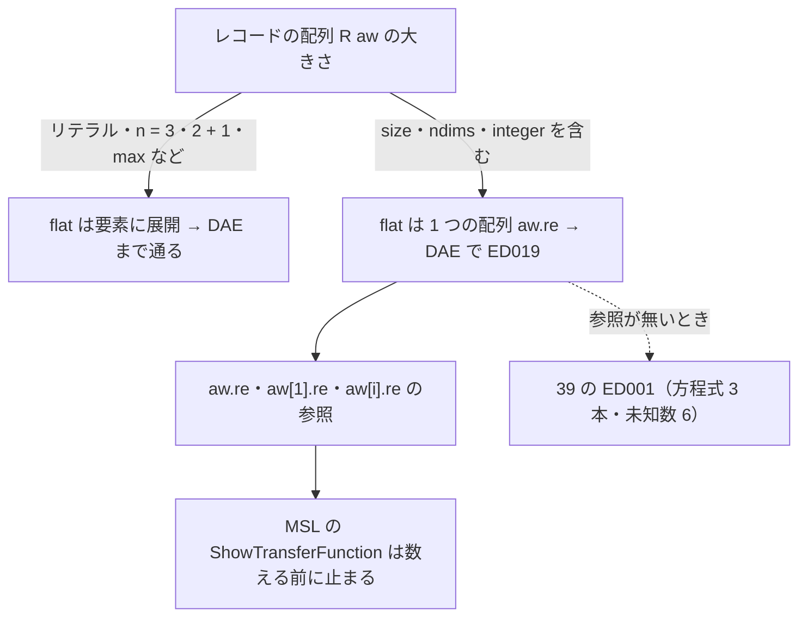

# S371 上流の下書き 41: レコードの配列の成分の ED019

| | |
| --- | --- |
| セッション | S371 |
| 日付 | 2026-11-16 |
| ブランチ | `feature/s371-upstream-draft-41` |
| Phase | 文書（上流への報告の下書き） |
| スライド | [slides.html](slides.html) |
| 作業記録 | `log/work/2026-11-16-s371-upstream-draft-41.md` |

## 1. 目的

S359 の「39 の途中で見つけた別の限界」（部品の中でレコードの配列の成分を切り出すと、Rumoca が ED019 `record-array member slice` で止まる。MSL の `ShowTransferFunction` は方程式の数より先にこれで止まる）を、[doc/upstream.md](../../upstream.md) の流儀の 4 点セット（英語 `.md`・再現の `.mo`・日本語 `_jp.md`・スライド 1 枚の `_jp.html`）の下書き 41 にする。ユーザーが 2026-11-16 に「ED019 は下書き 41 にして」と指示した。Rumoca v0.10.2（GlobeMode の固定）と最新のリリース v0.10.4 の両方と omc 1.27.2 で確かめ、一覧に足す。**出さない**（issue も PR も作らない。提出はユーザーの判断）。Rust のコードは変えない。

## 2. 決定と理由

- **下書きの題は「大きさを `size(...)` で決めるとき」にした。** S359 の備考は原因を「部品の中でスライドする」と書き、「最上位のクラスなら通る」と書いた。S371 で二分法をやり直すと、どちらも成り立たない。
  - 最上位のクラスでも、部品でも同じ ED019 が出る（`A` と `C`）。
  - レコードの配列の大きさがリテラル、`parameter Integer n = 3`、`constant Integer n = 3`、`2 + 1`、`max`・`min`・`abs`・`div`・`mod` を使う式なら、同じ本体でも通る。`size(...)`・`ndims(...)`・`integer(...)` を使うと落ちる（`n = size(a, 1)` と書いた `Integer` の parameter も落ちる）。
  - 参照の形はスライド `aw.re` に限らず、1 つの要素の成分 `aw[1].re` も、方程式の左辺の `aw[i].re` も同じエラーになる（最初の参照を指す）。成分を 1 つも参照しない形は 39 の `ED001` になる。
- **flat のモデルはできていて、DAE を作る段で出る。** `--emit flat-json` は両版で通る。`size(a, 1)` の形は変数が 1 つの配列 `aw.re`・`aw.im`（`dims` が `[3]`）で、`instance_relations` の `Aggregate` が 1 つ。通る形は要素ごとに `aw[k].re`・`Aggregate`（`indices` が `[k]`）。Rumoca の main のソース（`b55eafce`。GitHub の contents API で読んだ。ビルドしていない）では、メッセージは `record_array_fields.rs` の `component_ancestry` が、スコープの実体の種類が `Class` でないときに返す。`A` でスコープがどの実体かは追っていない。
- **MLS の根拠は 3.7 の 10.6.9（Slice Operation）。** 「レコードの配列にメンバーアクセス演算子を使うと、各レコードのメンバーを選んで配列を作る」。節の本文をページで読んだ（確認日 2026-11-16）。判定は**バグ**（omc 1.27.2 は全部通す）。
- **MSL の例題は 2 本だが、下書きの対象は 1 本。** 2026-10-31 の funnel の結果（v0.10.2、566 本）でこのメッセージが出ていたのは `ShowTransferFunction` と `Electrical.Batteries.Examples.ShowImpedance`。後者は `parameter RCData rcData[nRC]`（`nRC` は `Integer` の parameter）の形で、v0.10.2 は落ち、v0.10.4 は通る（`--emit dae-json` が終了コード 0）。理由は追っていない。前者は `Complex bw[size(b,1)]` で、v0.10.4 でも落ちる。
- **GlobeMode 側の回避は要らない。** 自前の flat は大きさを評価できるレコードの配列を要素に展開するので、`ShowTransferFunction` は平らになる（S337）。Rumoca を通す検査（`globe check`・`msl:funnel`）は S5 で止まり、`ED019` のコードで `GM-U0001`（未対応）に振り分ける。
- **再現の `.mo` は `Rep41`（`A`〜`H`）。** 失敗する形が `A`（スライド）・`B`（1 つの要素の成分）・`C`（部品）・`D`（`for` 文の中の左辺）・`E`（`Integer` の parameter が `size(a, 1)`）、対照が `F`（リテラル 3）・`G`（`n = 3`）・`H`（`size(a, 1)` で決めた `Real` の配列）。`globe fmt` で整形した。MSL の `Complex` の形は本文に `ComplexSlice.mo`（`Q`・`K`）として貼った。

## 3. 図



## 4. 再現手順

```bash
# Rumoca の CLI は data/rumoca（v0.10.2）と data/rumoca-latest（v0.10.4）。.mo だけを置いたディレクトリで回す
rumoca compile 41-ed019-record-array-member-slice-dimension-from-size-call.mo -m Rep41.A --emit dae-mo
# MSL の Complex（Complex.mo だけをソースの根に）
rumoca compile ComplexSlice.mo -m Q --source-root data/msl/Complex.mo --emit dae-mo
# MSL の例題（data/msl に Modelica 4.1.0 がある）
rumoca compile "Modelica 4.1.0/package.mo" -m Modelica.ComplexBlocks.Examples.ShowTransferFunction --source-root . --emit dae-mo
# omc
omc check.mos   # loadFile("41-….mo"); checkModel(Rep41.A); ...
```

検証の結果（数字）:

- 41 の 8 モデル × 2 版: `A`〜`E` は両版で ED019（位置は `A` 21:13、`B` 36:9、`C` 21:13、`D` 54:7、`E` 72:13）。対照の `F`・`G`・`H` は両版で通る。MSL の `Complex` は `Q` が両版で ED019、`K` が両版で通る。
- 大きさの変種（`A` の本体で大きさだけを変えた形を 2 版で回した。表の分は次のとおり）: 通るのはリテラル 3・`n = 3`・`constant n = 3`・`2 + 1`・`max(1, 3)`・`min(3, 4)`・`abs(-3)`・`div(7, 2)`・`mod(7, 4)`、落ちるのは `size(a, 1)`（`a` が parameter・constant・大きさ固定の parameter）・`size({1, 2, 3}, 1)`・`size(ones(3), 1)`・`ndims({1, 2, 3}) + 2`・`integer(3.2)`。
- omc 1.27.2 の `checkModel`: `A` 7 と 7、`B` 7 と 7、`C` 7 と 7、`D` 6 と 6、`E` 7 と 7、`F`・`G`・`H` 7 と 7、`Q`・`K` 7 と 7、`ShowTransferFunction` 29 と 29、`ShowImpedance` 4 と 4。
- `ShowTransferFunction` は両版で `TransferFunction.mo:31:22`（`sum(bw.re)`）。`ShowImpedance` は v0.10.2 が `Impedance.mo:12:50` で落ち、v0.10.4 は通る。
- v0.10.4 が最新のリリースであることと main が `b55eafce` のままであることを、releases の API と commits の API で確かめた（2026-11-16）。

## 5. 次回

- 提出するかはユーザーが決める。出すなら A・B・F・G の 4 本に絞り、Rumoca の main で再現を確かめてから。
- Rumoca の main はビルドしていない。ソースには同じ文言があるが、再現するかは【未確認】。
- GlobeMode の Rumoca の rev を上げる版の最初に、`ShowTransferFunction` が `msl:diff-frontend`・`msl:funnel` でどう変わるかを見る（v0.10.4 でも ED019 のままなら変わらない）。
- なぜ大きさの書き方で結果が変わるか（`size(...)`・`ndims(...)`・`integer(...)` で落ち、`max`・`div` などで通る違い）は追っていない。出すなら上流に尋ねる。
