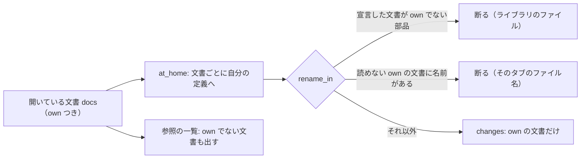

# S372 8 回目のレビューの issue #141〜#147

| | |
| --- | --- |
| セッション | S372 |
| 日付 | 2026-11-16 |
| ブランチ | `feature/s372-review8-fixes`（main の `44b880dd`〔S367 のマージ〕から切った） |
| Phase | P4（UI の参照・リネーム）・Track B（B3 flat・B4 DAE） |
| スライド | [slides.html](slides.html) |
| 作業記録 | `log/work/2026-11-16-s372-review8-fixes.md` |
| レビュー履歴 | `log/review/2026-11-16-s361-s368-review8.md` |

## 1. 目的

7 回目のレビューの後の変更（S361〜S368）を読んだ 8 回目のレビューの issue #141〜#147 を、1 件ずつ自分で再現してから直す。#141〜#143 は S368 の UI の参照・リネーム（`globe/references`・`globe/rename`、wasm の `references`・`rename`）の端、#144〜#147 は native の検査（`--frontend native`、LSP で設定したとき）の flat・DAE。コードの 4 件は Rumoca の道（既定）を変えない。

## 2. 決定と理由

| # | 何が起きていたか | 直し | 試験 |
| --- | --- | --- | --- |
| #141 | UI はライブラリのタブ（読み取り専用）を開くたびに `setFile` し、離れても外さない。S368 の「ライブラリで宣言した部品は断る」は宣言したファイルが `docs` の中にあるかで決めていたので、タブを一度開くと断られず、自分のタブだけが書き換わった | `Doc` に `own` を足す。wasm は木のファイル名、LSP は `-L` の下で根の下でないファイル（`in_library`）を `own: false` に。`rename_in` は、宣言した文書が `own` でない部品と `own` でない文書からのリネームを断り、`changes` に入れない | `library_tab_is_listed_but_never_edited`（`definition.rs`）、`globe_rename_refuses_a_component_declared_in_an_open_library_tab`（LSP）、`smoke.mjs` の 1b3（wasm） |
| #142 | 同じ名前のクラスを 2 つのタブが定義すると、`Workspace` は 1 つの名前空間なのでファイル名順の先に寄り、後ろのタブの `Base b;`・`extends Base` の `x` が先のタブのものとして書き換わった | `at_home`: 文書を引く間だけ `Resolver::overlay`（S171）をその文書にする。各文書の名前はまず自分の定義に解決する | `same_named_classes_in_two_documents_stay_apart`、UI の `cross_file_refs_edges` |
| #143 | 構文の誤りで読めないタブは outline が無く、`class_hits` は 0 件を返す。リネームはそのタブを黙って飛ばして成功した | 読めない自分のタブに識別子 `name`（字句に分けられなければ部分文字列）があれば、そのタブのファイル名を挙げて断る（`-32803`。UI は `failure` に出す）。部品も同じ | `rename_refuses_when_another_tab_cannot_be_read`、UI の `cross_file_refs_edges` |
| #144 | 範囲 `connect(a[1:3], b[1:2])` は長さが違うと先頭の 1 本だけつなぎ、2 次元の部品の配列は全要素数だけを比べて `[2,3]` と `[3,2]` を行優先で対応づけていた | 長さが違えば `connect`（`differ in size`）で断る。`expand_end` が展開した次元（`[k]` か `[行, 列]`）も返し、`gen_connects`・`split_array_var` が 2 次元どうしの行数・列数まで比べる | `connect_with_mismatched_sizes_is_refused` |
| #145 | 内包の `inStream` の展開は項をカンマでつないだだけで、`sum(…)` の引数だと `sum(a, b, c)` になった | 親が配列の構築子でなければ `{…}` で包む | `in_stream_comprehension_as_a_call_argument_is_braced` |
| #146 | `y = {x[1]*2, …, x[n]*2}` は行ごとに全要素の参照を調べ、incidence が n×n の密（n = 4000 で 15 s・330 MB） | `Ref` に `row: Option<(j, m)>`。方程式の数が `m` のとき行 `j` だけが調べる | `array_constructor_equation_touches_one_element_per_row` |
| #147 | 範囲の最後の要素のあとの `i += s` が溢れ、debug は panic（#137 の取りこぼし） | `checked_add` で打ち切る | `range_ending_at_i64_max_does_not_overflow` |

### #142・#143 は issue の案から形を変えた

- **#142**: 案は「他の文書が同名のクラスを最上位に定義しているなら、その文書の識別子は数えない」だった。3 つ目の症状（B の `Base` を変えるとき、B 自身の `Base b;` が A の `Base` に解決されて落ちる）は、この案では直らない。原因は名前の解決が文書の外のファイル名順に寄ることなので、文書ごとに `Resolver::overlay`（S171。入力の途中で壊れた文書が、同じファイルの型を先に引くための仕掛け）をその文書に立てて直した。`Resolver` に項目を足さず、`definition.rs` の中だけで済む。
- **#143**: 案の後半（識別子があるのに同じクラスに解決できなかったタブも断る）は、#142 の「同名のクラスを自分で定義するタブ」や、同名の部品を持つだけのタブも断ってしまう。読めないタブ（outline が無い）だけにした。

### 区別できない場合（shortcut）

同名のクラスを定義する文書が 2 つ以上あるとき、**定義しない** 3 つ目の文書が `Base` を使うと、定義ジャンプと同じくファイル名順の先に寄る（リネームはその先の定義を変えると、この文書の使い方も変える）。断りは足していない。

## 3. 図



## 4. 再現手順

```bash
cd <worktree>
export CARGO_TARGET_DIR=<main>/.git-worktree/target-shared CARGO_BUILD_JOBS=2
cargo test -p globe-mode-lsp -p globe-mode-wasm -p globe-mode-flat -p globe-mode-dae
# wasm（release）→ Node の smoke（1b3 が #141〜#143）、UI の 2 タブの試験
mise run wasm:build && node src/Rust/mod/globe-mode-wasm/node/smoke.mjs
mise run ui:build && uv run python src/Svelte/tests/test_ui.py
# 全体の検査（写したバイナリを flock の下で。回帰があれば終了コード 1）
flock <lock> <xtask のコピー> diff-frontend --report doc/frontend-diff.md --json <json> --baseline-json <S367 の json>
```

検証の結果（数字）:

- 追加した回帰試験: `globe-mode-lsp` 3（`definition.rs`）+ 1（LSP の `globe/rename`）、`globe-mode-flat` 3（`tests/flat.rs` 2・`flatten.rs` 1）、`globe-mode-dae` 1、`smoke.mjs` の 1b3、UI の `cross_file_refs_edges`。直す前（`44b880dd`）の道に当てると、flat・dae は変更を戻すと落ち、Node の smoke（直す前の wasm）は `Missing expected exception`、UI の試験（直す前の wasm）は一覧が 3 行でなく 4 行で落ちた。
- `cargo test -p globe-mode-lsp`（82 本）・`-p globe-mode-wasm`・`-p globe-mode-flat`（単体 7・`tests/flat.rs` 56）・`-p globe-mode-dae`（20）が通る。`cargo fmt --check`・`cargo clippy -p globe-mode-lsp -p globe-mode-wasm -p globe-mode-flat -p globe-mode-dae --all-targets -- -D warnings` が通る。`pnpm check`（svelte-check）は 0 件。
- #146 の計測（debug、`flatprobe`）: `y = {x[1]*2, …}`（n = 4000）の DAE の `build` が 18.8 s（直す前の `44b880dd`。issue は 15.8 s）→ 0.23 s、RSS 327 MB → 14 MB。`{inStream(f[i].h) for i in 1:4000}` は 20.3 s・354 MB → 1.0 s・39 MB（他の担当の測定が同時に走っていた机の値）。
- 全体の検査（`msl:diff-frontend` 相当。写したバイナリ `xtask-s372`・`flock`・基準 `frontend-diff-s367.json`）: MSL の例題 566 本・`GlobeModeValidation` 75 本（S367 の結果が基準）、1419 s、最大 RSS 4.9 GiB。**回帰 0 本・改善 0 本**。MSL 566 本: parse 566/566・resolve 566/566・flat 561/566・名前 529/532・方程式の数 517/532・DAE 561/561・判定 382/382・数 381/382・状態 381/382・構造の正則 382/382（S367 と同じ。断る 5 本のうち、`connect` の大きさの断りで増えた例は 0）。`GlobeModeValidation` は parse・resolve・flat・DAE が 75/75、名前・方程式 74/74、判定 74/74、構造の正則 73/73

## 5. 次回

- 同名のクラスを定義しない文書の使い方（上の shortcut）、参照の一覧が読めないタブを黙って飛ばすこと。要るなら参照にも「読めないタブがある」と知らせる口を足す。
- UI の実機（Desktop・Android の WebView）でライブラリのタブを開いて F2 する確認はしていない（wasm の Node と sidecar 相当の LSP で確かめた）。
