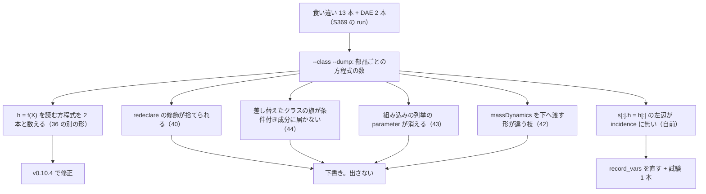

# S373 ライブラリで Rumoca と食い違う例題の原因分け

| | |
| --- | --- |
| セッション | S373 |
| 日付 | 2026-11-16 |
| ブランチ | `feature/s373-library-mismatches` |
| Phase | Track B（検査の道具・自前の DAE） |
| スライド | [slides.html](slides.html) |
| 作業記録 | `log/work/2026-11-16-s373-library-mismatches.md` |

## 1. 目的

S369 で `diff-frontend --library …` ができ、`libraries.yml`（run 43772634191、main は S367 まで）で 7 ライブラリ 2132 本の例題を自前の parse → resolve → flat → dae と Rumoca で突き合わせた。Rumoca も通った例題のうち、変数の名前・方程式の数・DAE が合わない 13 本 + DAE 2 本が残った（原因は未調査のまま作業記録に名前だけ残した）。この WP は、それを集め直して原因ごとに分け、**自前の誤りなら直し、Rumoca の誤りなら直さずに根拠を残す**（[doc/upstream.md](../../upstream.md) の書式。上流には出さない）。経緯と段ごとの数字は [ADR-0039](../../adr/0039-native-cst-parser.md) の付記（S373）。

## 2. 決定と理由

| 項目 | 決定 | 理由 |
| --- | --- | --- |
| 原因の分け方 | 1 本ずつ `diff-frontend --library … --class <名> --dump` で、自前の方程式・変数と Rumoca の「方程式の持ち主（部品）ごとの数」を並べ、食い違う部品に絞ってから、`rumoca compile`（v0.10.2・v0.10.4 の CLI）と omc 1.27.2 で最小の再現を作った | 1 つの原因が 3 ライブラリ × 数本に出る（`EnthalpyFlowRate` など）ので、例題でなく原因で数える。Rumoca の誤りは両版と omc で確かめてから下書きにする |
| 自前の誤り（1 件） | `globe-mode-dae` の `Ctx::record_vars`（範囲 `[:]` の枝）が、要素の欄が**変数そのもの**のとき空を返していたのを、その変数を返すようにした（1 か所）。回帰試験 `slice_of_a_component_array_field_touches_every_element` | AixLib の `PrescribedSolarRad` の `solRadOut[:].H = H[:]`（`solRadOut` は部品の配列で、変数は `solRadOut[1].H`）の左辺が incidence に入らず、未知数 5 つが行に当たらないので構造が特異になっていた（Rumoca は正則）。S362 の「範囲は見ない」の shortcut を保ったまま、全要素に触れさせる |
| Rumoca の誤り（4 件） | 直さない。42・43・44 を下書き（4 点セット）にし、36・40 に追記 | 42 と 44 は v0.10.2・v0.10.4 の両方で再現し、omc は自前と同じ答え。43 は軽い（変数が消えるだけ）。36 の別の形は v0.10.4 で直っている（方程式を持ち主ごとに数える 61 本が自前と一致）。出さない（出すのはユーザー） |
| `StateSelect` の parameter | 自前の flat は今まで通り Rumoca に合わせて落とす | 名前の集合を Rumoca に合わせる S 以前の決め。`AssertionLevel` は omc と同じく残す（43 の「GlobeMode 側の回避」に書いた） |
| 検査 | MSL 566 本 + `GlobeModeValidation` 75 本の全体の突き合わせで回帰 0。直した例題は `--class` で一致を確かめた。ライブラリは `libraries.yml` を 1 回回した | DAE の incidence を変えたので、MSL で 1 本も悪くならないことが条件 |

## 3. 図



## 4. 再現手順

```bash
cargo xtask fetch-library Buildings                         # AixLib・IBPSA・ThermofluidStream も同じ
cargo xtask diff-frontend --library data/libs/AixLib --package AixLib \
  --class AixLib.ThermalZones.HighOrder.Components.Examples.WindowsDoors.WindowSimple --dump
cargo xtask diff-frontend --library data/libs/Buildings --package Buildings \
  --class Buildings.Fluid.Sensors.Examples.EnthalpyFlowRate --dump
# Rumoca の誤りの小さな再現（各版の CLI と omc で）
rumoca compile 42-modifier-passes-default-binding-in-wrong-scope.mo -m Rep42.A --emit flat-mo
rumoca compile 43-predefined-enumeration-parameter-dropped.mo -m Rep43.A --emit flat-json
rumoca compile 44-conditional-component-ignores-redeclared-class.mo -m Rep44.A --emit flat-json
cargo test -p globe-mode-dae slice_of_a_component_array_field
```

検査の数字は作業記録 `log/work/2026-11-16-s373-library-mismatches.md`。

## 5. 次回

- ライブラリの本数が増えた分は、`libraries.yml` の次の run で確かめる。`expandable`・`composite-binding` 以外の「平らにできない」理由（`unsized-array`・`redeclare`・`connect-array`・`inner-outer`・`non-constant-dim`）は自前の穴で、本数の多い順に別の WP になる。
- 42〜44 は Rumoca の main で確かめ直してから、出すかをユーザーが決める。
