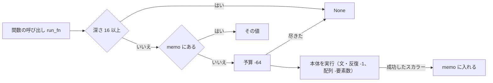

# S374 9 回目のレビューの issue #148〜#152（関数の評価器）

| | |
| --- | --- |
| セッション | S374 |
| 日付 | 2026-11-16 |
| ブランチ | `feature/s374-review9-fneval`（main の `b4019e6e`〔S370 のマージ〕から切った） |
| Phase | Track B（B3 flat） |
| スライド | [slides.html](slides.html) |
| 作業記録 | `log/work/2026-11-16-s374-review9-fneval.md` |
| レビュー履歴 | `log/review/2026-11-16-s369-s372-review9.md` |

## 1. 目的

9 回目のレビュー（S369〜S372 の変更）の issue のうち、S370 の関数の評価器（`globe-mode-flat/src/flatten/fneval.rs`。flat が Modelica の関数の `algorithm` を実行して配列の大きさを決める）への 5 件（#148〜#152）を、1 件ずつ自分で再現してから直す。native の検査（`globe check --frontend native`・LSP で設定したとき・wasm の `check_with(…, "native")`）だけに届き、Rumoca の道（既定）は変わらない。

## 2. 決定と理由

| # | 何が起きていたか | 直し | 試験 |
| --- | --- | --- | --- |
| #148 | `tick` は文と反復だけを数える。出力・保護変数の束縛だけで再帰する関数は 1 度も数えられず、枝 4 本で `g(10)` が 85 秒・1 段ごとに 4 倍（深さ 16 でも 4^15）。`algorithm` の形でも 1 呼び出し 1 tick で、100 万呼び出し（56 秒）まで許した | 呼び出し 1 回を 64 と数え（`CALL_COST`）、予算は 1 回の flat で 1 つ（`MAX_ITERS`）。呼び出しごとに戻さず、`fn_blown` をやめた | `function_work_is_budgeted_across_calls`（`g(15, 0)` が `non-constant-dim`、1 回 約 2100 の関数を 20 回で超える・4 回なら通る） |
| #149 | 局所の配列は 1 つ 100 万要素まで、再帰の段数だけ重なって 2 本 × 15 段で RSS 709 MB | 配列の確保・複製を要素の数だけ数える。確保した要素の総数が 1 回の flat で `MAX_ITERS` に収まる（issue の案の「生きている数の `MAX_SCALARS`」より厳しいので、生きている数は別に数えない） | `function_local_arrays_have_a_total_cap`（30 万要素 × 3 段は通り、4 段と 15 段は断る） |
| #150 | 配列を読むたびに全要素を複製（`max(a)` が `a[1]` の 270 倍）。`parameter n = f(2)` は使う場所ごとに `f` を最初から走らせる。予算が呼び出しごとに戻る | 配列は `Rc<Vec<Val>>`（読み・引数の渡しで複製しない）。走査は要素の数を数える。同じ関数・同じスカラーの引数の結果を覚える（`fn_memo`）。予算は #148 のとおり 1 つ | 同じ `function_work_is_budgeted_across_calls`（`max(a)` を 100 回なめると断り、`a[1]` なら通る・同じ引数の 4 本の枝は 16 回で済む・`n = w(2)` を 20 か所で使うのは 1 回分） |
| #151 | `for` の範囲 `0:9223372036854775807` の `span / |s| + 1` が溢れ、debug は panic・release は黙って 0 回のループ | `(span / |s|).checked_add(1)`。範囲は配列を作らず 1 つずつ出す | `function_for_range_count_does_not_overflow`（3 つの範囲） |
| #152 | 整数の `mod`・`div`・`rem`・比較・`max`・`min`・`floor`・`ceil`・`integer` が f64 を通り、2^53 を超えると別の値。`mod(9223372036854775807, 2)` は debug で panic。`integer(sqrt(-1))` が 0 になる | 整数どうしは整数のまま。`integer` は `i64` に収まらない値・NaN で「分からない」、`floor`・`ceil` は収まらなければ Real のまま。NaN の比較と文字列の大小は「分からない」 | `integer_constants_do_not_pass_through_f64`（17 の値と 5 つの「分からない」） |

### issue の案から形を変えたところ

- **#149**: 案は、`Frame` ごとの配列の要素数の合計を `Cell` で数えて `MAX_SCALARS`（200 万）を超えたら断る形だった。#148 の予算に「配列の確保は要素の数」を入れると、確保した要素の累計が `MAX_ITERS`（100 万）に収まる。累計は生きている数以上なので、生きている数を別に数える必要がなくなった（実装して試験を書いたあとで気づき、生きている数の数え方を外した）。代わりに、同じ大きさの配列を何度も確保する関数は累計 100 万要素までしか呼べない。MSL の FFT の関数は配列を持たない。
- **#152 の文字列**: 案は「中身で比べる」。`Val::S` は文字列の hash（中身を持たない）で、`Val` は `Copy` なので文字列を持たせると波及が大きい。`<`・`<=`・`>`・`>=` は「分からない」にして、`==`・`<>` は今までどおり hash で比べる。

### 覚える結果の範囲（shortcut）

覚えるのは、引数がスカラーだけで、`redeclare` の差し替え（`Ctx::cenv`）が空の文脈の、成功したスカラーの値だけ。関数の中で引くパッケージの定数は `cenv` と `heir` で変わるので、鍵に `heir` を入れ、`cenv` が空でない文脈は覚えない。深さの上限や予算で断られた結果は、文脈で変わるので覚えない。

## 3. 図



## 4. 再現手順

```bash
cd <worktree>
export CARGO_TARGET_DIR=<main>/.git-worktree/target-shared CARGO_BUILD_JOBS=2
cargo test -p globe-mode-flat
# wasm のスタックと FFT（release の wasm。load 10 未満のとき）
mise run wasm:node
# 全体の検査（写したバイナリを flock の下で）
flock <lock> <xtask のコピー> diff-frontend --report doc/frontend-diff.md --json <json> --baseline-json <S370 の json>
```

検証の結果（数字）は作業記録（`log/work/2026-11-16-s374-review9-fneval.md`）。

## 5. 次回

- 文字列の大小の辞書順（`Val` に文字列を持たせる）。
- memo は `redeclare` の文脈と配列を返す関数では働かない。MSL の `Medium` 系で関数が繰り返し評価されるなら広げる。
- release で予算いっぱいまで回したときの時間は測っていない（debug で 1 tick 約 5 µs）。
