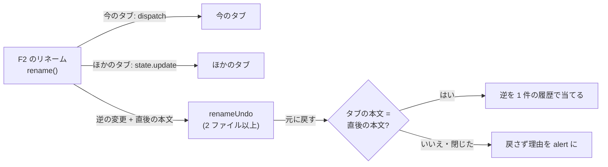

# S375 複数のタブにまたがるリネームを 1 つの操作で戻す

| | |
| --- | --- |
| セッション | S375 |
| 日付 | 2026-11-16 |
| ブランチ | `feature/s375-ui-rename-undo` |
| Phase | P4（エディタの言語サービス） |
| スライド | [slides.html](slides.html) |
| 作業記録 | `log/work/2026-11-16-s375-ui-rename-undo.md` |

## 1. 目的

[S368 の解説書](../S368-ui-cross-file-refs/解説書.md)で UI のリネーム（F2）が開いている自分のタブの全部に当たるようになった。今のタブは 1 回の dispatch、ほかの自分のタブは `state.update` で当てるので、CodeMirror の履歴（文書ごと）では Ctrl+Z がタブごとにしか戻らない（S368 の限界 (3)、「次回」の 2 つ目）。

最小版として、複数のタブにまたがるリネームを 1 つの操作として戻せるようにする。UI の履歴を束ねる仕組みは作らず、リネームの直後に出すボタンで各タブに逆の変更を当てる。Rust は触らない（編集の計算は Rust が返す `TextEdit` のまま。UI がするのは、本文の一致を確かめて逆の変更を当てることだけ）。

## 2. 決定と理由

| 項目 | 決定 | 理由 |
| --- | --- | --- |
| 履歴の束ね方 | 束ねない。各タブの「変更の逆」（`ChangeSet.invert`）とリネーム直後の本文を `renameUndo` に持ち、ボタンで当てる | CodeMirror の履歴は `EditorState` ごと。タブをまたぐ履歴を作るより、1 つのボタンのほうが小さい |
| 出す条件 | 2 つ以上のファイルに当たったときだけ | 1 ファイルなら、そのタブの Ctrl+Z で足りる。既存の試験（1 タブのリネーム）の画面も変わらない |
| 戻し方 | 本文がリネーム直後のままのタブに、逆の変更を 1 回の transaction で当てる。`isolateHistory.of("full")` で直前のリネームと履歴の 1 件に混ざらないようにする | 混ざると戻した直後の Ctrl+Z の挙動が時間（`newGroupDelay`、500 ms）次第になる。履歴 1 件で、そのタブの Ctrl+Z がリネームをやり直す |
| モデル名 | 今のタブは S186 の `modelRenamed` を逆向きに載せる。ほかのタブは `tab.model` を `to` なら `from` に | モデル名の欄がリネームに追っていた（S186）ので、戻すときも追う |
| 黙って上書きしない | リネームのあとに本文が変わった（編集・そのタブの Ctrl+Z）・閉じたタブは戻さず、名前と理由を `failure`（`role="alert"`）に出す。ほかのタブは戻す | 利用者の編集を失わない。全部戻す・何もしないの二択にはせず、変わったタブだけを戻さない（依頼どおり） |
| 本文の比較 | `Text.eq`（本文の一致） | 編集して元に戻した本文は変わっていないので、戻してよい |
| キーボード | 通常の `<button>`。エディタから Esc のあと Tab（S188）で届き、Enter で押す。リネームの直後に `live` で知らせ、戻したあとはフォーカスをエディタへ返す | 専用のショートカットは足さない（`Ctrl+Shift+Z` などは CodeMirror の redo と重なる） |

ADR は [ADR-0023 の S375](../../adr/0023-desktop-and-web-process-layout.md)、機能の表は [features.md](../../features.md) の「参照・リネーム」の行。

## 3. 図



## 4. 再現手順

```bash
cd src/Svelte && pnpm install --frozen-lockfile && pnpm check
mise run wasm:build && (cd src/Svelte && pnpm build)   # MSL まで確かめるなら data/msl を symlink してから
uv run python src/Svelte/tests/test_ui.py
```

試験は `test_ui.py` の `cross_file_rename_undo`（S368・S372 の 2 タブの試験と同じ形）。A.mo の `Base` を F2 で `Core` に変えると、モデル名の欄も `Core` になる。エディタから Esc・Tab を押してボタンに届き、Enter を押すと、A.mo・B.mo とモデル名が元に戻る。A.mo の Ctrl+Z 1 回でリネームがやり直され、もう 1 回で戻る（履歴に 1 件）。もう一度リネームして B.mo を編集してからボタンを押すと、B.mo はそのままで理由に `B.mo` が出て、A.mo だけが戻る。

検証の数字は作業記録（`log/work/2026-11-16-s375-ui-rename-undo.md`）。

## 5. 次回

- Ctrl+Z 1 回で全タブが動くようにするには、UI の履歴を束ねる仕組みが要る（今はボタンが束ねる）。
- 一部のタブが戻らないと、リネームが一部だけ戻った状態になる（理由は出す。残りは手で直す）。「全部戻せるときだけ戻す」にするかは、使ってみてから決める。
- 開いていないファイル（ディスクの根の下）の参照・リネーム、同じクラスを 2 つのタブが定義しているときの扱いは S368・S372 のまま。
