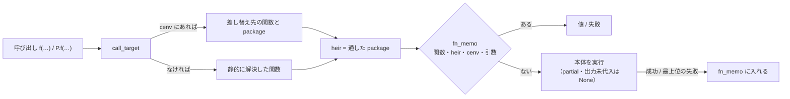

# S376 10 回目のレビューの issue #153〜#159（関数の評価器・DAE・UI）

| | |
| --- | --- |
| セッション | S376 |
| 日付 | 2026-11-16 |
| ブランチ | `feature/s376-review10-fixes`（main の `8b648675`〔S373 のマージ〕から切った） |
| Phase | Track B（B3 flat・B4 DAE）・P4（UI） |
| スライド | [slides.html](slides.html) |
| 作業記録 | `log/work/2026-11-16-s376-review10-fixes.md` |
| レビュー履歴 | `log/review/2026-11-16-s373-s375-review10.md` |

## 1. 目的

10 回目のレビュー（S373〜S375 の変更）の issue #153〜#159 を、1 件ずつ自分で再現してから直す。直す前に落ちる回帰試験を 1 本ずつ足す。native の検査（`globe check --frontend native`・LSP で設定したとき・wasm の `check_with(…, "native")`）と UI だけに届き、Rumoca の道（既定）は変わらない。

## 2. 決定と理由

| # | 何が起きていたか | 直し | 試験 |
| --- | --- | --- | --- |
| #156 | 関数の本体が読む package の定数が、`extends P(n = 5)`・`redeclare package` で上書きされていても宣言した側の既定値になる（`P5.m = f(1)` が 6 でなく 2）。関数を通さない `P5.n` も 1 になっていた（issue に無い、同じ `pkg_binding` の根） | 関数の `Frame` の `heir` に、呼び出しを通した package を入れる（`call_target`: `cenv` の差し替え先・`P5.f` の `P5`・`PKG` の文脈なら評価中の package）。参照の名前が通った package（`via_class`）を `pkg_binding` に渡す | `function_reads_package_constants_of_the_reaching_package` |
| #155 | `redeclare function f = f3`・`P.f`（`redeclare package P = P3`）の差し替えを見ず、`a.x` の大きさが黙って違う（6 でなく 2）。本体の無い `partial` の `f` は 0 を返して大きさ 0 の配列になる | `redeclare function f = f3` を `cenv` に入れ（以前は捨てていた）、`call_target` が差し替え先を引く。`partial` の関数・出力が代入されないまま終わった関数・`(…)` の修飾つきの差し替えは「分からない」 | `redeclared_and_partial_functions_are_not_run_as_declared` |
| #154 | `cenv`（`redeclare` の表）が空でないと `fn_memo` が効かず、使わない `redeclare package` があるだけで 300 インスタンスが通らない | 鍵に差し替えの組（名前 → クラス）の hash（`cenv_hash`）を足し、空のときだけという条件をやめた。`(…)` の修飾つきの差し替えは鍵にできないので覚えない | `function_memo_works_with_redeclared_packages_and_tells_contexts_apart` |
| #153 | 失敗した呼び出しは覚えず、同じ式を評価するたびに予算を使い、無関係な `ok(3)` まで断られる | 最上位（`depth == 0`）の呼び出しが予算内で失敗したことを `fn_memo` に覚える（`Option<V>`）。入れ子・予算切れの失敗は覚えない | `failed_calls_are_remembered_so_unrelated_calls_are_not_refused` |
| #158 | `c_i = c_{i-1} + c_{i-1}` が共有を覚えず 2^n 回の評価（20 個で 9 秒）。関数の中では S374 の予算にも数えられない | 名前の束縛の式の値を覚える（`eval_memo`。鍵は式の場所と文脈の中身の hash、成功だけ）。関数の中から `eval` に任せる式は 1 tick | `constant_chains_are_evaluated_once_per_binding`・`evaluations_inside_functions_are_budgeted` |
| #157 | S373 の直しが 2 次元以上の範囲 `s[:, 1].h` で効かず、`for` で書いた同じ方程式と違って構造が特異 | `[…]` を `,` で分け、範囲の位置だけ 1, 2, … に替える（範囲が複数なら直積） | `range_in_a_multi_dimensional_array_touches_the_elements`（dae） |
| #159 | 別のタブを見ているときの「元に戻す（n ファイル）」が、そのタブの履歴にモデル名の effect を入れず、戻ってからの Ctrl+Z でモデル名が追わない | その枝も `modelRenamed` を付けて `state.update` する | `test_ui.py` の `cross_file_rename_undo`（B.mo を見たまま押す版） |

### 設計の要点

- **関数の本体が見る package（`heir`）**: 関数の `Frame` の文脈の `heir` は、`pkg_binding` が `extends` の修飾（`P5` の `n = 5`）を引く先になる。呼び出しの名前が package を通せば（`P5.f`・`P.f` で `P` が `redeclare` された）その package、単純な名前なら呼び出しの文脈の package にする。関数そのものも、その package（`heir`）で差し替えた同じ名前のものがあれば入れ替える（`partial` の関数を `extends` で具体化したもの）。
- **覚える範囲**: `fn_memo` の鍵は（関数、`heir`、差し替えの組の hash、引数）。覚えるのは成功したスカラーの値と、最上位の呼び出しが予算内で失敗したこと。`eval_memo` は名前の束縛の式の成功した値で、鍵は式の場所と文脈の中身（`pfx`・系統・`for` の値・`heir`・差し替えの組）の hash。`Rc` の同一性は使わない（パッケージの定数の文脈は評価のたびに作り直し、解放後に別のものが同じアドレスを取りうる）。

### 限界（shortcut）

- 関数の中から呼ぶ兄弟の関数（`FN` の文脈）の `redeclare function` は見ない。入れ子の package の中の関数（`P5.Inner.f`）は、`Inner` が `P5` の系統でないので、定数は宣言した側の値のまま。
- `(…)` の修飾つきの差し替え（`redeclare package P = P3(n = 7)`）は、定数の評価（`dyn_const`）が今までどおり修飾を見ない。関数の差し替えは `(…)` があれば断る。
- `eval_memo` は束縛が 1 回の flat の中で変わらないことに頼る（`env` への登録は `inst_class` の最初に 1 回）。`cardinality` を使う段階（`resolve_card_ifs`）の前後で空にする。

## 3. 図



## 4. 再現手順

```bash
cd <worktree>
export CARGO_TARGET_DIR=<main>/.git-worktree/target-shared CARGO_BUILD_JOBS=2
cargo test -p globe-mode-flat -p globe-mode-dae
# UI（先に wasm-pkg と data/msl。pnpm build のあと）
uv run python src/Svelte/tests/test_ui.py
# 全体の検査（写したバイナリを flock の下で）
flock <lock> <xtask のコピー> diff-frontend --report doc/frontend-diff.md --json <json> --baseline-json <S374 の json>
```

再現は `.git-worktree/target-shared/review10/repro/` の `p1`〜`p6`・`gen_b.py`・`gen_c.py`・`gen_d.py`・`e1.mo`・`d1.mo`・`ui_undo_model.py`。検証の結果（数字）は作業記録（`log/work/2026-11-16-s376-review10-fixes.md`）。

## 5. 次回

- 関数の中から呼ぶ兄弟の関数の `redeclare`、入れ子の package（`P5.Inner.f`）の定数。
- `(…)` の修飾つきの package の差し替えを `dyn_const` が見る（今までどおり見ない）。
- 文字列の大小の辞書順（S374 から。`Val` に文字列を持たせる）。
