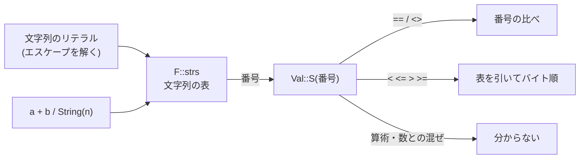

# S377 文字列の辞書順と、関数の評価器の持ち越し 3 件

| | |
| --- | --- |
| セッション | S377 |
| 日付 | 2026-11-16 |
| ブランチ | `feature/s377-fneval-strings`（main の `3806d109`〔S376 のマージ〕から切った） |
| Phase | Track B（B3 flat） |
| スライド | [slides.html](slides.html) |
| 作業記録 | `log/work/2026-11-16-s377-fneval-strings.md` |

## 1. 目的

S374 と S376 に残していた、flat の定数の評価（`eval`）と関数の評価器（`fneval.rs`）の持ち越しを直す。方針は「値が黙って違うものは直し、直せないものは『分からない』にする」。native の検査（`globe check --frontend native`・LSP で設定したとき・wasm の `check_with(…, "native")`）だけに届き、Rumoca の道（既定）は変わらない。各修正に、直す前に落ちる回帰試験を 1 本ずつ足し、omc の `checkModel` の変数の数と突き合わせた。

## 2. 決定と理由

| 項目 | 何が起きていたか | 直し | 試験 |
| --- | --- | --- | --- |
| 文字列の大小・連結 | `Val::S` は中身でなく hash で、`<` 系は「分からない」（S374）。`"a" + "b"` は hash の和の実数になった | `Val::S` を文字列の表（`F::strs`）の番号にし、同じ中身は同じ番号。`<` 系は UTF-8 のバイト順、`+` は連結（64 KiB まで）、`String(整数・論理・列挙の要素)`、リテラルのエスケープを解く。文字列と数の混ぜ・算術は「分からない」 | `string_comparison_concat_and_string_function_are_decided` |
| `P5.Inner.f` | `heir` を名前の前半の丸ごと（`P5.Inner`）から決めるので `Inner` 自身になり、`f` が読む `PP` の定数 `n` が宣言した側の 1（`P5.Inner.f(1)` が 6 でなく 2） | 名前が通った package の列（`P5`、`P5.Inner`）を関数の外側のクラスの列（`Inner`、`PP`）と末尾から合わせ、受け継いでいる package（`P5`）を `heir` にする（`reaching`） | `nested_package_function_reads_constants_of_the_reaching_package` |
| 兄弟の関数の `redeclare` | 関数の本体（`FN` の文脈）の中の `g(k)` は、インスタンスの `redeclare function g = g3` を引かない（`a.x` が 7 でなく 3） | `Ctx` に呼び出したインスタンスの系統（`inst`）を足し、`g` を宣言したクラスがそこに入るときだけ差し替えを引く | `function_calls_the_redeclared_sibling_function` |
| `(…)` つきの package | `redeclare package P = PP(n = 5)` の `P.n` が宣言した側の 1（5 のはず）。`dyn_const` が `(…)` の修飾を見ない | 修飾された名前は修飾の束縛。それに届く定数（`m = n + 1`）は「分からない」。届かない定数は今までどおり | `parenthesized_package_redeclare_changes_the_constants_it_reaches` |

### 設計の要点

- **文字列の表**: `Val` は `Copy` なので中身を持てない。表は伸びるだけで番号は変わらない（`eval_memo`・`fn_memo` が番号を持ったままでよい）。同じ中身が同じ番号なので `==` は番号の比べで済み、hash の衝突も無くなった。大小と連結だけが表を引く（`binop`・`ord` に表を渡す）。エスケープは解いてから入れる（`"\t" < "Z"` は、字面の `\t`〔0x5C〕でなく解いた 0x09 で比べるので真）。
- **`reaching`**: 関数 `f` の親が `Inner`、その親が `PP`。名前 `P5.Inner.f` が通った package は `P5`、`P5.Inner`。末尾から `Inner` ↔ `P5.Inner`（同じ。受け継ぎではない）、`PP` ↔ `P5`（`P5` が `PP` を受け継ぐ）と合わせる。外側ごとに別の package が受け継いでいて 1 つに決まらないときは「分からない」。
- **`Ctx::inst()`**: インスタンスの文脈は自分の系統、`FN` は呼び出し元から引き継いだ系統、`PKG` は `None`。`fn_memo` の鍵には、差し替えがあるときだけ呼び出し元の系統の hash を足す。
- **`dyn_const` の戻り値**: 外側の `None` は「差し替えられた package の定数ではない」、内側の `None` は「差し替えられているが決まらない」。内側を外側にすると、静的な参照に落ちて宣言した側の値を返してしまう。

### 限界（shortcut）

- 関数の変数に文字列は持てない（`Slot` の型は R・I・B）。実数の `String(1.5)` は書式が要るので「分からない」。`max`・`min` は文字列を拒まない（MLS では型の誤り）。
- `import` の別名を通した名前（`Inner.f`）は、外側の package を名前から引けず、宣言した側の値になる。
- `(…)` の修飾を当てた束縛は再評価しない（`m` は 6 のはずだが決めない）。MSL に `redeclare package … = X(…)` の形は 0 件。
- 非 ASCII の大小（`"é" > "z"`）は Rust のバイト順で、omc とは突き合わせていない（omc が字句解析で受けなかった）【未確認】。`String(列挙の要素)` が要素の名前を返すことは omc と一致したが、MLS の条文は【未確認】。

## 3. 図



## 4. 再現手順

```bash
cd <worktree>
export CARGO_TARGET_DIR=<main>/.git-worktree/target-shared CARGO_BUILD_JOBS=2
cargo test -p globe-mode-flat
# 全体の検査（写したバイナリを flock の下で）
flock <lock> <xtask のコピー> diff-frontend --report doc/frontend-diff.md --json <json> --baseline-json <S376 の json>
```

omc との突き合わせは、試験と同じモデルに `for i in 1:n loop x[i] = i; end for;` を足して `checkModel` の変数の数を見る（`P5.Inner.f(1)` は 6、`Sub a(redeclare function g = g3)` と `Sub b` で 7 と 3、`P = PP(n = 5)` の `P.n` は 5、`P.m` は 6〔自前は「分からない」〕）。検証の結果（数字）は作業記録（`log/work/2026-11-16-s377-fneval-strings.md`）。

## 5. 次回

- 文字列の変数を持つ関数（`Slot` の型に文字列）、実数の `String(x)` の書式。
- `(…)` の修飾を当てた束縛の再評価（`m` を 6 に決める）。
- `import` の別名を通した入れ子の package の関数。
