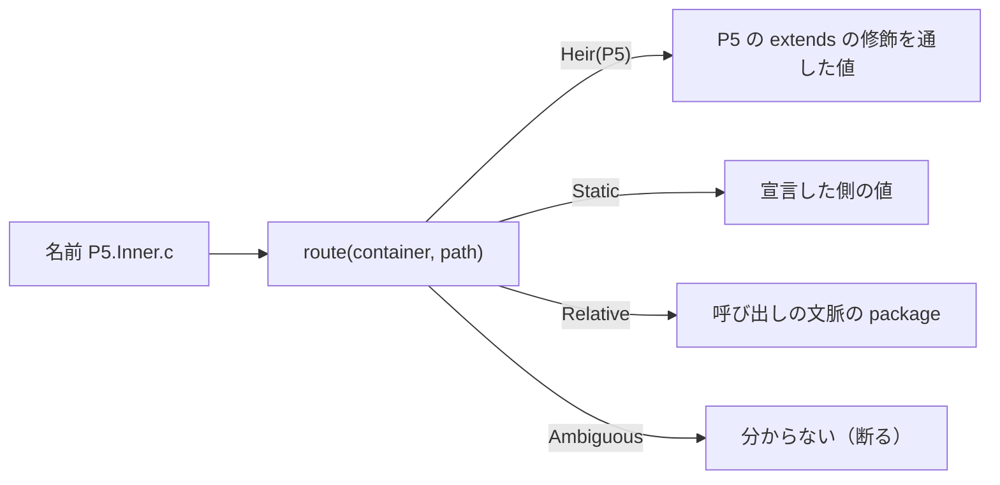

# S378 11 回目のレビュー（S376・S377 の変更）の issue #160〜#168

| | |
| --- | --- |
| セッション | S378 |
| 日付 | 2026-11-16 |
| ブランチ | `feature/s378-review11-fixes`（main の `35128c20`〔S377 のマージ〕から切った） |
| Phase | Track B（B3 flat） |
| スライド | [slides.html](slides.html) |
| 作業記録 | `log/work/2026-11-16-s378-review11-fixes.md` |
| レビュー履歴 | `log/review/2026-11-16-s376-s377-review11.md` |

## 1. 目的

11 回目のレビューの issue #160〜#168 を、1 件ずつ再現してから直す。9 件のうち 6 件（#161・#162・#163・#165・#167・#168）は、10 回目（S376・S377）でも同じ根の誤りが続いた。package の定数や関数の値が、宣言した package と違う package（`extends P(n = 5)`・`redeclare package`・入れ子の package・`redeclare package P = P` の受け渡し）を通って決まるとき、**その経路の取りこぼしで黙って違う値が出る**。1 つずつ正しい値を出す道を足すと、また別の経路の取りこぼしが出る。そこで今回は、**正しい値を確実に出せる経路だけ値を出し、たどれない・2 つ以上ありうる場合は断る**側へ寄せた。native の検査（`globe check --frontend native`・LSP で設定したとき・wasm の `check_with(…, "native")`）だけに届き、Rumoca の道（既定）は変わらない。

## 2. 決定と理由

| # | 何が起きていたか | 直し | 試験 |
| --- | --- | --- | --- |
| 160 | 文字列の表は捨てず、連結で作る文字列を反復ごとに積む。1 反復 33 KB、3 GB の制限で abort | 表の中身の総量に上限（16 MiB。試験は 1 MiB）。超えたら `intern`・`cat` が `None`（分からない） | `string_table_total_is_capped` |
| 161 | 入れ子の package の定数 `Inner.c = n + 1` が、`P5`（`extends PP(n = 5)`）を通さず 2（6 のはず） | `route`（下）が `Heir(P5)` を返し、宣言した側の束縛の文脈に受け継いだ側を通す | `nested_package_constants_follow_the_reaching_package` |
| 162 | `redeclare package P = R` の `P.Inner.c`（名前 3 つ以上）が `dyn_const` を通らず、`R` の `redeclare package Inner = Other` を見ない | `dyn_const` を 3 つ以上の名前に広げ、差し替え先から入れ子をたどる。`(…)` つきの差し替えを通る入れ子の定数は断る | `redeclared_package_constants_follow_the_nested_package` |
| 163 | `redeclare package P = P`（外側の差し替えをそのまま渡す）が外側の `(n = 7)` を落とす | `class_res` の `(…)` の修飾に、内側に書いた `(…)` を `merge`（内側が勝つ）して残す | `redeclare_package_passed_on_keeps_the_outer_modification` |
| 164 | `(…)` つきの `redeclare package` があると `fn_memo`・`eval_memo` が効かない（300 インスタンスが通らない） | `cenv_hash` が修飾の中身（式と書いた場所の文脈）も鍵にする。名前を含まない式は字面で区別する | `memo_keys_include_the_contents_of_parenthesized_redeclares` |
| 165 | `partial` でない `Lib` を `extends Lib(n = 5)` した `Lib5.X` の中が、`Lib5` でなく宣言した側の `n` を読む | `alias_heir` の `partial` の条件を外し、型名の前半が食い違うときだけ `route` で引く。入れ子の型 `L.Sub.Y` も | `model_type_through_an_inheriting_package_reads_its_constants` |
| 166 | 基底のクラス名で修飾した `Sub.f(2)` が、`Sub` を継いだインスタンスの `redeclare function g` を引く | 名前が宣言した側を明示する静的な呼び出しは、呼び出し元の差し替えの表と系統を持たない（`Target.stat`） | `qualified_static_call_ignores_the_instance_redeclare_function` |
| 167 | 関数の戻り値の大きさ `output Real y[n]` の `n` が、`P5.g(1)` を通さず 1 | `fn_frame` が `call_target` の行き先から `heir` を取る | `function_output_size_reads_constants_of_the_reaching_package` |
| 168 | 宣言した package を明示した `PP.f(k)` が、`P5` を通す評価の中で呼び出し元の `heir` に落ちて `n = 5` で動く | 名前が宣言した側の外側をすべて明示しているとき（`Static`）は落とさない。定数の参照 `PP.n` も同じ | 同上（161 と 1 本） |

### 設計の要点: `route`

定数・関数を宣言したクラス `container` と、名前が通った package の列 `path`（`P5.Inner.c` なら `P5`、`P5.Inner`）から、読む package を 1 つに決める。`container` とその外側のクラスを、同じ位置の `path` の package と末尾から合わせる。

| 結果 | 条件 | 値の出し方 |
| --- | --- | --- |
| `Heir(h)` | `container` かその外側のクラスを、同じ位置の package `h` が受け継いでいる（`P5` が `PP` を） | `h` の `extends` の修飾を通した値。宣言した側の束縛が外側の定数を読むときも `h` を通す |
| `Static` | 受け継ぎが無く、名前が `container` の外側をすべて明示している（`PP.n`） | 宣言した側の値。呼び出し元の `heir`・`cenv`・インスタンスの系統を持ち込まない |
| `Relative` | 外側が名前に出ない（`n`・`Inner.f`）、`import` の別名など | 呼び出しの文脈の package（今までどおり） |
| `Ambiguous` | 外側ごとに別の package が受け継いでいて、内側が外側の中にない | **断る**（`GM-U`。flat が `Unsupported`） |

入れ子の package が内側の中にあるとき（`Q.Inner`：`Q` の中の `redeclare package Inner = PP.Inner(c = 9)`）は、内側を `heir` にして、定数は内側から外側へ `chain` をたどって引く。`import` の別名を通した名前は外側を名前から引けない（`Relative` になり、呼び出し元の package の値）。

### 断る側に寄せた所

- `Ambiguous`（受け継ぎが入れ子でない 2 つ以上）: 定数・関数は `None`、型は `ambiguous-package`（flat が断る）。
- `redeclare package P = PP(n = 5)` の `(…)` の修飾を通る、入れ子の定数 `P.Inner.c`: 届くかどうかを決めない（以前は宣言した側の値を黙って出した）。
- 差し替え先から入れ子をたどれない `P.Inner.c` は今までどおり静的に引く（列挙の要素 `Medium.Choices.pT` など）。

### 限界（shortcut）

- `import` の別名を通した名前の外側は引けない（`Relative`）。
- `Ambiguous` は、内側が外側の中にない継承の入れ子（`A` の中の `package Y = Z(c = 7)` を `X extends A(n = 5)` を通して引く `X.Y.c`。omc は 7）も断る。直す前は最後の名前の package だけで決めて `X.Y.c` は 7（合う）だったが、`X.Z.c` は 2（6 のはず）だった。値にするには `heir` を 1 つでなく経路にする。
- `(…)` の修飾が入れ子の定数に届くかを決めない（`P = PP(n = 5)` の `P.Inner.c`）。MSL に `redeclare package … = X(…)` の形は 0 件。

## 3. 図



## 4. 再現手順

```bash
cd <worktree>
export CARGO_TARGET_DIR=<main>/.git-worktree/target-shared CARGO_BUILD_JOBS=2
cargo test -p globe-mode-flat
# omc の instantiateModel と変数ごとに比べる（再現は target-shared/review11/repro/）
python3 dd378.py i2.mo M
# 全体の検査（写したバイナリを flock の下で）
flock <lock> <xtask のコピー> diff-frontend --report doc/frontend-diff.md --json <json> --baseline-json <S377 の json>
# 公開ライブラリ
gh workflow run libraries.yml --ref feature/s378-review11-fixes
```

## 5. 次回

- `Ambiguous` のうち、内側が外側の中にない継承の入れ子（`X.Y.c`）を値にする（`heir` を 1 つでなく経路にする）。
- `(…)` の修飾が入れ子の定数に届くかを決める（束縛の再評価）。
- `import` の別名を通した名前の外側。
